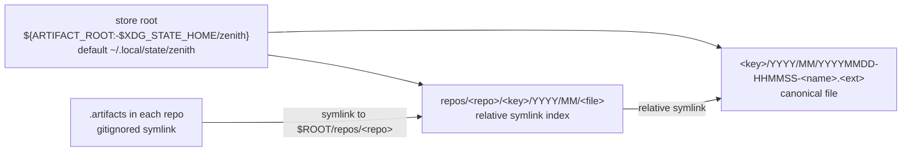

# Artifact store

<!-- START doctoc generated TOC please keep comment here to allow auto update -->
<!-- DON'T EDIT THIS SECTION, INSTEAD RE-RUN doctoc TO UPDATE -->

- [Contents](#contents)
  - [Hard rule: Design principles 101, right below the contents list](#hard-rule-design-principles-101-right-below-the-contents-list)
  - [Hard rule: every Markdown file opens with a contents list](#hard-rule-every-markdown-file-opens-with-a-contents-list)
  - [Hard rule: herdr tab layout for every multi-agent line](#hard-rule-herdr-tab-layout-for-every-multi-agent-line)
- [Design principles 101](#design-principles-101)
- [Why it exists](#why-it-exists)
- [Layout](#layout)
- [Naming](#naming)
- [Frontmatter](#frontmatter)
- [Commands](#commands)
- [Configuration](#configuration)
- [Multi-agent rules](#multi-agent-rules)
- [Cleanup](#cleanup)

<!-- END doctoc generated TOC please keep comment here to allow auto update -->

## Contents

- [Design principles 101](#design-principles-101)
- [Why it exists](#why-it-exists)
- [Layout](#layout)
- [Naming](#naming)
- [Frontmatter](#frontmatter)
- [Commands](#commands)
- [Configuration](#configuration)
- [Multi-agent rules](#multi-agent-rules)
- [Cleanup](#cleanup)

<!-- golden-rules:begin -->

### Hard rule: Design principles 101, right below the contents list

Owner order, 2026-10-16 UTC: "deisgn principal 101 global agents.md rule right below the contents list for it".
Backup of this file before the rule: `~/.local/state/zenith/backup/2026/10/20261016035435-home-agents-md-before-design-principles-101.md`.

Every design document carries a section named "Design principles 101" placed directly below its contents list, before any other section.
It lists the principles below, and for each one says in a line how this design meets it, or why it does not apply.
A design without that section is not ready for the owner to read.

The principles, each in the owner's own words:

1. CI/CD speed is king: "CICD SPEED IS KING"; "speed is king"; "speed is the name of the game, no bottlenecks".
2. Parallelism: "parallelism, speed, work needs to be done"; "do shit in parallel, we need this active".
3. Make and scripts drive the automation, never hands: "makefiles with scripts driving automation, NEVER by hand!".
4. Portable, generic, templated, reused: "everything portable, generic, templated out so everybody gets it, NEVER REINVENT THE WHEEL". Inventory what already exists and reuse it before building anything new.
5. Small scope, proven: "prove shit discover it small scope that an ape could build this shit".
6. Tests where they count, and CI owns the full suite: "i hate slow CICD, we're built for speed, test only things relevant, don't run full suites, make changes and test those relevant changes, CICD does linting and full suite" (2026-10-16 UTC, replacing the earlier "only full suite before prs"). Agents run only the tests their change touches, never a full suite locally; CI runs lint and the full suite.
7. Evidence or silence: "reproduce errors or problems only with supporting evidence otherwise mute". A problem is reported only with its reproduction and evidence attached; without evidence, an agent says nothing about it.
8. Specs: "xml specs 1000 lines or less good never examples unlimited files being specific with content list at the top".
9. DAG and doc design first: "dag this shit out doc design first".
10. Migrations and easy node updates: "ensure migrations plans and easy updates to the nodes".
11. Clean up after itself: "make sure you clean up too".
12. Frictionless for the owner: "ensure its frictionless". The owner only decides, on Bearings, one card at a time.
13. Context discipline: "no more than 30% on the ctx and smart checkpointing built in with monitoring that not disruptive but token efficient".
14. Multi-agent work, shown with GOOD and NEVER examples: "MULTIAGENT WORK MINDSET GOOD NEVER EXAMPLES". Every design is built for many agents working at once, and every rule it sets carries a GOOD and a NEVER example.
15. XML spec, mermaid architecture and DAG, the DAG is the source: "always design with xml spec 1000 lines or less unlimited files doc design first driven by mermaid for architecture and DAG with graceful migration plans and easy of use ... the DAG is the source, build to spec".
16. Migration is the test of the design: "if workflows can't be easily migrated and updated, the design princpal is wrong and flow sucks". A design whose workflows cannot be migrated and updated easily is rejected and redesigned.
17. Config files and arguments pass every input: "config and arguments are good ways to pass things, easy in makefiles too". Every script takes its inputs from a config file or arguments, never hard-coded, and every Make target passes them as `VAR=value`.
18. Agent to agent is schema, never prose: "agent to agent prose sucks, schemas with defined AC always". Every brief, handoff and result between agents is a JSON document valid against a JSON schema, and every one carries defined acceptance criteria, each with the proof that ticks it. Prose is for the owner only.
19. Small tickets, disjoint files, logical order: "scope tickets and work orders small, keep things built for speed, never touching same files and logical ordering". Every ticket and work order is small, declares the files it touches, and no two tickets that can run at the same time touch the same file; the DAG orders the rest so dependent work waits on its input.
20. Worktree, feature branch, deterministic DAG path, the DAG is the state: "worktrees and feature branches with the whole process DAG when getting work so it follows a deterministic path with clear checklist runbooks playbooks documents everything that node needs is there and graceful recovery, always, doc design first with those mermaid and build to spec and keep the idea of terraform in mind, the state file is the source of truth, so should the DAG doc design architecture". Taking work always opens its own worktree and feature branch and walks the process DAG in a fixed order. Each node ships with its checklist, runbook, playbook and every document it needs, and recovers gracefully from wherever it stopped. Like a Terraform state file, the DAG design is the source of truth: the build is planned against it, applied to match it, and any drift from it is detected and reported.
21. Merge, never park: "get this code merged the fuck in, dead code is shit, it sitting under agents is stupid". A PR whose CI is green and whose design was approved merges at once, by a script; PRs never pile up in deep stacks waiting on each other, and a stack is collapsed leaves first by the merge script.
22. See it, isolate it, fix it, or hand it off and get out of the way: "see a bug, isolate it, and get it fixed as asap, if you don't know how to fix shit, get the fuck out of my way in the proper engineering way". An agent that sees a bug isolates it to a reproduction and fixes it at once in a small PR. An agent that cannot fix it files a ticket with the reproduction and evidence, hands it to a seat that can, and steps aside; it never blocks the line or guesses.
23. Artifacts live outside git, named by script, linked in like packages: "any files we ever need to create, they never go in the git repo, artifacts get smartly linked to the outside like packages do on linux, use format <key name>/YYYY/MM/YYYYMMDD-HHMMSS-<descriptive name under 55 chars completely with the prefix included>.<whatever ext> scripted too with frontmatter that makes sense, logs context whatever kind of file that we don't want tracked in git, we don't have time for that shit, point to where its at and if we need context we know where to go looking". Every log, context file, brief, result, screenshot or other untracked file is written by a script to `<key>/YYYY/MM/YYYYMMDD-HHMMSS-<name>.<ext>` under the shared artifact store, where the file name with its timestamp prefix stays under 55 characters. Each one opens with frontmatter that says what it is, who wrote it, from which repo, branch and session, and when, in UTC. Repositories never hold them; they hold a pointer, and the store is reached the way a package is, through a link, so an agent that needs the context knows exactly where to look.
24. Smart checkpointing with compaction is the standard: "checkpointing or smart checkingpointing with compaction is smart as fuck". Every seat runs with compaction-guard checkpoints, and every new seat gets it by default.

GOOD: a design that opens with its contents list, then Design principles 101 with one line per principle, then a mermaid DAG that the XML spec and the build follow exactly.
NEVER: a build that drifts from its DAG, or a workflow that has to be rebuilt by hand to change it.

### Hard rule: every Markdown file opens with a contents list

Owner order, 2026-10-16 UTC: "EVERY .md file starts with content lists at the top, so my global files that aren't checked in need to change and the ones in the dotfiles as well".
This covers the global files outside any repository (this file, `~/OPINIONS.md`) and every Markdown file in dotfiles.
The list is generated and refreshed by a Make target and a script, never by hand, and a fast check fails a PR whose Markdown lacks it.
Files marked auto-generated, CHANGELOG.md files, and vendored skill copies are fixed at their source, never in place.

### Hard rule: herdr tab layout for every multi-agent line

Owner order, 2026-10-16 UTC: "since we use herdr, its should always be known to use herdr in a tab layout with 3X3 and the 1(YOU ONLY ON AGENT IN THIS FULL 3 slots)|3 panes|3 panes, everything labeled, make new tabs when not, driven by makefiles and scripts with automated cleanup too".
Backup of this file before the rule: `~/.local/state/zenith/backup/2026/10/20261016035943-home-agents-md-before-herdr-layout.md`.

Every line runs in herdr tabs on a 3 by 3 grid.
The first tab is the architect's: the left column is the architect alone, at full height across its 3 slots; the middle and right columns hold 3 seat panes each.
When a tab is full, the next seat opens a new tab of the same grid instead of squeezing a pane in; overflow tabs hold seats only, since the architect lives once.
Every tab and every pane is labeled with its line and seat name.
Opening, placing, labeling, closing and cleaning up panes and tabs is done by Make targets and scripts, never by hand: a finished seat's pane closes, and an empty tab closes with it.

GOOD: tab `inbox-triage 1` with the architect on the left, then `sweep-build`, `yp-line`, `ctx-guard` in the middle and `md-toc`, `li-page`, `li-send2` on the right; the eighth seat opens tab `inbox-triage 2`.
NEVER: unlabeled panes split wherever there was room, or a dead seat's pane left open.


<!-- golden-rules:end -->

## Design principles 101

1. CI/CD speed: one bash script with no dependencies beyond coreutils and git, and the CI check is a single `git ls-files` pass.
2. Parallelism: every seat writes its own timestamped file, so any number of seats write at once without a lock.
3. Make and scripts: every operation is a Make target backed by `artifact.sh`; nothing is placed, named or deleted by hand.
4. Portable and reused: it reuses the existing `~/.local/state/zenith` root and XDG state, and ships an includable `artifact.mk` like `ctx-guard.mk`.
5. Small scope: one store, one naming rule, one link per repo; nothing more.
6. Tests where they count: `make artifact-test` runs the suite in Podman only, and CI runs it with the full suite.
7. Evidence or silence: not applicable; the tool reports no problems beyond its own refusals, which carry the offending path.
8. Specs: this README plus the mermaid diagram below is the spec, well under 1000 lines, with a contents list at the top.
9. DAG and doc design first: this document was written before the script, and the layout diagram is the source.
10. Migrations: older backups keep their names, the format applies going forward, and the root moves with one `ARTIFACT_ROOT` setting.
11. Clean up: `make artifact-clean` removes old files, sidecars, dangling links and empty directories, dry run first.
12. Frictionless: the owner never runs it; seats call it, and a path is all anyone needs to follow.
13. Context discipline: frontmatter lets an agent read what a file is from its first lines without loading the whole file.
14. Multi-agent: see [Multi-agent rules](#multi-agent-rules), each rule with a GOOD and a NEVER example.
15. XML spec, mermaid, DAG: the mermaid layout in this README is the architecture source, and the script is built to it.
16. Migration is the test: changing the root, the keys or the check patterns is a config edit, never a rebuild.
17. Config and arguments: every input comes from `artifact.conf`, the environment or an argument, and Make passes them as `VAR=value`.
18. Agent to agent schema: not applicable, there is no agent handoff here, but the frontmatter and sidecars are machine-readable.
19. Small tickets, disjoint files: the change touches only `claude/tools/artifact/*`, one include line in the root `Makefile`, one `.gitignore` line, one hook in `claude/tools/testing/run-tests.sh`, and the CI job.
20. Worktree and DAG state: the store is outside every worktree, so worktrees and branches share it without drift.
21. Merge, never park: the tool is small enough to land in one pull request.
22. See it, fix it: `artifact-check` fails CI on a tracked artifact, so the bug is caught at the pull request that adds it.
23. Artifacts outside git: this tool is item 23.
24. Smart checkpointing: not applicable; checkpoints are written by compaction-guard, and they may be stored here under the `context` key.

## Why it exists

Owner order, 2026-10-16 UTC: "any files we ever need to create, they never go in the git repo, artifacts get smartly linked to the outside like packages do on linux, use format <key name>/YYYY/MM/YYYYMMDD-HHMMSS-<descriptive name under 55 chars completely with the prefix included>.<whatever ext> scripted too with frontmatter that makes sense, logs context whatever kind of file that we don't want tracked in git, we don't have time for that shit, point to where its at and if we need context we know where to go looking, other than that, yah".

Every log, brief, result, screenshot, context file or backup lives in one store outside every repository.
A repository holds a pointer to it, never the file.

## Layout

The canonical file lives once under its key.
Each repository gets a relative symlink index under `repos/<repo>/`, and a gitignored `.artifacts` link in the repository points at it.
It works the way `/usr/bin` links point at files a package owns.



## Naming

The file name is `YYYYMMDD-HHMMSS-<name>`, and it must be under 55 characters.
The timestamp prefix is 16 characters including its trailing dash, so `<name>` is at most 38 characters.
The extension is not counted.
`<name>` is a lowercase slug of `[a-z0-9-]`.
`<key>` must be listed in `ARTIFACT_KEYS`; an unknown key is refused.
Timestamps are UTC only.
An existing file is never overwritten; the script refuses instead.

Example: `log/2026/10/20261016-141502-seat-run.md`.

Older backups already named `YYYYMMDDHHMMSS-...` are left as they are.
The format applies going forward.

## Frontmatter

Every file opens with frontmatter that says what it is, in the comment syntax its format allows.

| Extensions                             | Where the frontmatter goes                          |
| -------------------------------------- | --------------------------------------------------- |
| md, txt, log                           | YAML block between `---` lines at the top           |
| sh, py, yaml, yml, toml, conf, mk      | YAML lines prefixed `# ` between `# ---` lines      |
| html, xml, svg                         | inside `<!-- --- ... --- -->`                       |
| everything else (json, jsonl, png, csv, pdf ...) | sidecar file `<file>.meta.json`           |

Fields:

| Field     | Meaning                                  | Default                                  |
| --------- | ---------------------------------------- | ---------------------------------------- |
| `key`     | store key                                | required                                 |
| `name`    | the slug                                 | required                                 |
| `what`    | one line saying what the file is         | the name, dashes as spaces               |
| `by`      | who wrote it                             | `ARTIFACT_BY`, else `$USER`              |
| `repo`    | repository it came from                  | git of the current directory             |
| `branch`  | branch it came from                      | git of the current directory             |
| `session` | session id                               | `ARTIFACT_SESSION`, else `CLAUDE_SESSION_ID` |
| `created` | UTC ISO-8601 with `Z`                    | now                                      |
| `path`    | absolute path of the file                | computed                                 |

Example for a Markdown file:

```yaml
---
key: log
name: seat-run
what: build seat run log
by: <seat-name>
repo: dotfiles
branch: feat/<branch>
session: <session-id>
created: 2026-10-16T14:15:02Z
path: /home/<user>/.local/state/zenith/log/2026/10/20261016-141502-seat-run.md
---
```

## Commands

The script is `claude/tools/artifact/artifact.sh`; every Make target has a script equivalent.

| Make target | Script equivalent | What it does |
| ----------- | ----------------- | ------------ |
| `make artifact-new KEY=log NAME=seat-run EXT=md [WHAT="..."] [REPO= BRANCH= SESSION=]` | `artifact.sh new --key log --name seat-run --ext md [--what ..] [--repo ..] [--branch ..] [--session ..]` | Creates the file with frontmatter and its repo link, and prints the absolute path |
| `make artifact-link [DIR=.] [EXCLUDE=1]` | `artifact.sh link [--dir .] [--exclude]` | Creates the `.artifacts` symlink and adds `/.artifacts` to `.gitignore`, printing a reminder to commit that once; `--exclude` writes `.git/info/exclude` instead |
| `make artifact-find KEY=log [SINCE=2026-10-01] [REPO=name]` | `artifact.sh find --key log [--since 2026-10-01] [--repo name]` | Lists matching files by date, oldest first, newest last |
| `make artifact-check [DIR=.]` | `artifact.sh check [--dir .]` | Exits 1 listing tracked files that match `ARTIFACT_CHECK_PATTERNS`, minus `ARTIFACT_CHECK_ALLOW` |
| `make artifact-clean KEY=log OLDER_THAN=30 [APPLY=1]` | `artifact.sh clean --key log --older-than 30 [--apply]` | Dry run by default; with apply, deletes files and sidecars, removes dangling repo links and empty directories |
| `make artifact-test` | `bash claude/tools/testing/run-tests.sh` (artifact hook) | Runs the suite in Podman |

`artifact-check` runs in CI as the `artifacts` job in `.github/workflows/skill-pr-gate.yml`.

Typical use in a seat:

```bash
f=$(make -s artifact-new KEY=log NAME=seat-run EXT=md WHAT="build seat run log")
some-command >> "$f"
```

To use the targets from another repository, include the fragment:

```make
include path/to/claude/tools/artifact/artifact.mk
```

## Configuration

`claude/tools/artifact/artifact.conf` is shell `KEY=value`.

| Variable | Default | Meaning |
| -------- | ------- | ------- |
| `ARTIFACT_ROOT` | `$XDG_STATE_HOME/zenith`, else `~/.local/state/zenith` | Store root |
| `ARTIFACT_KEYS` | `backup brief result log context screenshot report state trace` | Allowed keys |
| `ARTIFACT_CHECK_PATTERNS` | see below | Extended regex of paths that must not be tracked |
| `ARTIFACT_CHECK_ALLOW` | `templates/` | Extended regex of paths exempt from the check |

The default `ARTIFACT_CHECK_PATTERNS` matches any of:

```text
\.log$
\.out$
(^|/)nohup\.out$
\.pid$
\.trace$
-result\.json$
(^|/)screenshots?/
(^|/)[0-9]{8}-[0-9]{6}-
```

Precedence, lowest to highest:

1. Built-in defaults in `artifact.sh`.
2. The conf file: `artifact.conf` next to the script, or the path in `ARTIFACT_CONF`, then `~/.config/zenith/artifact.conf` if present.
3. The environment.
4. Arguments.

## Multi-agent rules

Rule 1: seats write artifacts through `artifact-new`, never by hand.
GOOD: `f=$(make -s artifact-new KEY=result NAME=wo-build EXT=json)` then the seat writes to `$f`.
NEVER: `echo ... > ~/.local/state/zenith/result/run.json`, with a hand-made name and no frontmatter.

Rule 2: repositories hold pointers, never the file.
GOOD: a pull request body names `.artifacts/log/2026/10/20261016-141502-seat-run.md`, or its absolute store path.
NEVER: a commit that adds `seat-run.log` or `screenshots/` to the tree; `artifact-check` fails it in CI.

Rule 3: cleanup goes through `artifact-clean`, dry run first.
GOOD: `make artifact-clean KEY=log OLDER_THAN=30`, read the list, then rerun with `APPLY=1`.
NEVER: `rm -rf ~/.local/state/zenith/log`, which strands repo links and deletes files another seat still points at.

Rule 4: parallel seats never collide.
GOOD: two seats create `seat-run` in the same minute and get `20261016-141502-seat-run.md` and `20261016-141507-seat-run.md`; if the second lands in the same second, the script refuses and the seat retries with a distinct name.
NEVER: a seat that deletes or truncates an existing file to reuse its name.

Rule 5: keys are config, never invented.
GOOD: a new kind of file gets its key added to `ARTIFACT_KEYS` in `artifact.conf` through a pull request.
NEVER: `KEY=misc` passed on the fly; the script refuses an unlisted key.

## Cleanup

The tool writes outside the repository in these places only:

| What | Where | How to remove |
| ---- | ----- | ------------- |
| Canonical files and sidecars | `$ARTIFACT_ROOT/<key>/YYYY/MM/` | `make artifact-clean KEY=<key> OLDER_THAN=<days> APPLY=1` |
| Repo link index | `$ARTIFACT_ROOT/repos/<repo>/` | dangling links and empty directories go with `artifact-clean ... APPLY=1` |
| Per-repo link | `<repo>/.artifacts` | `rm <repo>/.artifacts`, then drop `/.artifacts` from `.gitignore` if wanted |
| Test scratch | inside the Podman container only | removed with the container |

Removing the whole store is `rm -rf "$ARTIFACT_ROOT"` followed by `rm` of each repository's `.artifacts` link; do it only after `make artifact-find` shows nothing is still needed.
