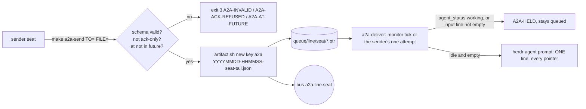

# a2a-guard

<!-- START doctoc generated TOC please keep comment here to allow auto update -->
<!-- DON'T EDIT THIS SECTION, INSTEAD RE-RUN doctoc TO UPDATE -->

- [Design principles 101](#design-principles-101)
- [Flow](#flow)
- [Status codes](#status-codes)
- [Examples](#examples)

<!-- END doctoc generated TOC please keep comment here to allow auto update -->

## Design principles 101

Brief BR-20261016-a2a-guard, owner 2026-10-16: "YOU SEE THE PROBLEM WHATS THE AUTOMATION TO NOT HAVE IT HAPPEN AGAIN IN A NON DISRUPTIVE WAY?"

1. CI/CD speed: `a2a-lint` is one grep, seconds per PR.
2. Parallelism: sends never block on the receiver; delivery is a separate consumer.
3. Make drives it: `make a2a-send`, `a2a-deliver`, `a2a-deliver-loop`, `a2a-lint`, `repo-settings-check`, `a2a-guard-test`, `a2a-uat`, `a2a-clean`.
4. Reuse: `brief.sh` and `validate-schema.sh` validate, `artifact.sh` names, `herdr-grid.sh` claims the UAT pane, the LINE bus carries events.
5. Small scope: four scripts, one config, one lib.
6. Relevant tests only: `make a2a-guard-test` runs this directory's suite; CI owns the rest.
7. Evidence: every refusal and delivery prints a status code; the UAT gate writes its output to the store (key log).
8. Specs: not applicable; no XML spec, the brief is the spec.
9. DAG first: the flow below.
10. Migrations: the queue is plain pointer files; a bus-native consumer replaces `a2a-deliver.sh` without changing senders.
11. Clean up: `make a2a-clean OLDER_THAN=` prunes delivered pointers; the UAT gate closes its pane on every exit.
12. Frictionless: the owner sees nothing; no owner card.
13. Context: one pointer line per seat per delivery, never the message body.
14. Multi-agent: GOOD and NEVER examples below.
15. Mermaid: the flow below.
16. Migration test: changing the transport touches `a2a-deliver.sh` only.
17. Config and arguments: `config.json`, `A2A_*` env, `VAR=value`.
18. Schema, never prose: only zenith.a2a.brief.v1 and zenith.a2a.result.v1 are sent.
19. Disjoint files: the work orders under WO-20261016-916d declare their files.
20. Worktree and branch: feat/a2a-guard.
21. Merge: auto-merge on green.
22. Fix it: P1, P2 (visible) and P3 fixed here.
23. Artifacts: every message lives at `<store>/a2a/YYYY/MM/YYYYMMDD-HHMMSS-<seat>-<tail>.json`.
24. Checkpointing: not applicable; no long-lived seat.
25. AWS: none.
26. Producer and consumer: senders produce to the queue and the bus subject `a2a.<line>.<seat>`; `a2a-deliver` consumes with no model.
27. One monitor pattern: `a2a-deliver` is one entry in `config/monitors.json`.
28. Idempotent: a second delivery pass types nothing; refused messages write nothing.
29. Status codes: the map below.
30. Ape-sized: each script does one thing.
31. Evidence steps: the UAT gate records herdr status before and after.
32. No opinions: not applicable.
33. Break glass: not applicable.
34. dev, UAT, stable: `a2a-guard-test` (Podman, fake herdr), `a2a-uat` (real herdr, test seat), stable (the monitor entry).
35. No notifications: the UAT seat is `cat`-like, reports only working and idle, and the owner gets nothing.
36. Permissions: none needed.
37. Timing: not yet; the line-timing wrapper owns it.
38. Batching: several queued messages for one seat go as one line.

## Flow

## Status codes

| Code | Meaning | Who acts |
| --- | --- | --- |
| A2A-QUEUED | message stored and queued | nobody |
| A2A-DELIVERED | one line typed into an idle seat | the receiving seat reads the files |
| A2A-HELD | seat working, typing, or locked; stays queued | nobody, the monitor retries |
| A2A-ACK-REFUSED | order is only an acknowledgement, or an AC asks for one | the sender drops it |
| A2A-AT-FUTURE | `at` is ahead of the real UTC clock | the sender stops hand-writing times |
| A2A-INVALID | not JSON, or fails its schema | the sender fixes the file |
| A2A-NAME-COLLISION | the store refused three names | the orchestrator |
| A2A-NAME-REFUSED | a queued pointer is not a store-minted file | the orchestrator |
| A2A-DELIVER-FAILED | herdr refused the prompt; still queued | the monitor retries |
| A2A-BUS-DOWN | bus publish failed; the file queue holds it | the bus monitor |
| A2A-RAW-SEND | a script calls `herdr pane send-text` outside this directory | the PR author |
| RS-OK, RS-NO-AUTOMERGE, RS-NO-PROTECTION, RS-NO-MERGE-WF, RS-UNREADABLE | `repo-settings-check` per repo | merge-port |

## Examples

GOOD: `make a2a-send TO=sweep-build FILE=/tmp/order.json` while sweep-build is working; it gets one line when it goes idle.

NEVER: `herdr pane send-text wD9:p3 "ack this"`; CI fails it, and an ack-only order is refused anyway.
