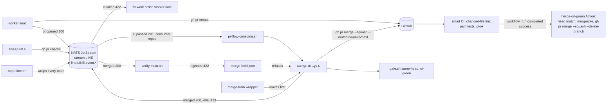
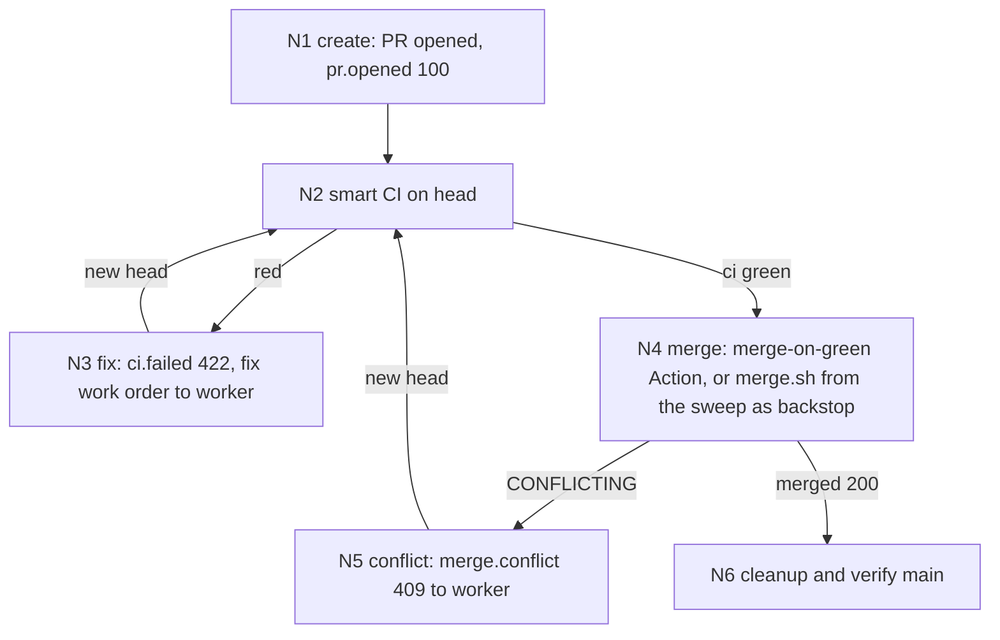

# PR process - one merge flow for every repository, ported from coq

<!-- START doctoc generated TOC please keep comment here to allow auto update -->
<!-- DON'T EDIT THIS SECTION, INSTEAD RE-RUN doctoc TO UPDATE -->

- [Contents](#contents)
- [1. Design principles 101](#1-design-principles-101)
- [2. Goal](#2-goal)
- [3. Inventory of the coq PR process](#3-inventory-of-the-coq-pr-process)
- [4. Measured time per step](#4-measured-time-per-step)
- [5. Architecture](#5-architecture)
- [6. The PR process DAG](#6-the-pr-process-dag)
- [7. Step map: coq file to ported file](#7-step-map-coq-file-to-ported-file)
- [8. Smart CI template](#8-smart-ci-template)
- [9. Status code map](#9-status-code-map)
- [10. Config](#10-config)
- [11. Facts the design answers](#11-facts-the-design-answers)
- [12. Migration](#12-migration)
- [13. Build tickets](#13-build-tickets)
- [14. Testing: dev, UAT, stable](#14-testing-dev-uat-stable)
- [15. Where everything lives, and how it is cleaned](#15-where-everything-lives-and-how-it-is-cleaned)
- [16. As built](#16-as-built)

<!-- END doctoc generated TOC please keep comment here to allow auto update -->

## Contents

1. [Design principles 101](#1-design-principles-101)
2. [Goal](#2-goal)
3. [Inventory of the coq PR process](#3-inventory-of-the-coq-pr-process)
4. [Measured time per step](#4-measured-time-per-step)
5. [Architecture](#5-architecture)
6. [The PR process DAG](#6-the-pr-process-dag)
7. [Step map: coq file to ported file](#7-step-map-coq-file-to-ported-file)
8. [Smart CI template](#8-smart-ci-template)
9. [Status code map](#9-status-code-map)
10. [Config](#10-config)
11. [Facts the design answers](#11-facts-the-design-answers)
12. [Migration](#12-migration)
13. [Build tickets](#13-build-tickets)
14. [Testing: dev, UAT, stable](#14-testing-dev-uat-stable)
15. [Where everything lives, and how it is cleaned](#15-where-everything-lives-and-how-it-is-cleaned)
16. [As built](#16-as-built)

Status: STABLE, built 2026-10-16 UTC from this design (PR #169) and running on dotfiles, business and ypconsult-01-src. Section 16 records what was built differently and why.
Owner orders, 2026-10-16 UTC: "the coq herdr plugin on local had the pr process smoking fast, did you follow that or did you create your own and its working smooth?", "the PR process should be docuemented globablly since it works, get it smoking first and get that DAG out globally", "automate that process, we dont need gates we need speed" and "testing and linting smartly".
Companion file: [`pr-process.spec.xml`](pr-process.spec.xml) (nodes, records, codes, config, make, tickets).
Brief: `BR-20261016-merge-port` v2.

## 1. Design principles 101

Each line says how this design meets the principle, or why it does not apply.

1. CI/CD speed is king: no review wait; the merge-on-green Action merges the PR the moment `ci` completes green on its head, and CI is path-filtered and parallel with a 3 minute budget.
2. Parallelism: CI jobs run as a matrix; the merge is per PR and stateless between PRs; build tickets run in parallel layers (section 13).
3. Make and scripts drive the automation: every node is a script behind a target in `claude/workflow/pr-flow/pr-flow.mk`; no seat merges by hand.
4. Portable, generic, templated, reused: coq's `merge.sh` and `gate.sh` are copied with their tests, and the CI template is ypconsult-01-src `ci.yml`; only config reads and the CI gate verb are new.
5. Small scope, proven: the first build ticket is `gate.sh ci-green` with its tests and nothing else.
6. Tests where they count: CI lints changed files and selects tests by path; the full suite runs sharded on main pushes; agents run only the cases their ticket names.
7. Evidence or silence: every outcome line carries the PR, head sha and the checks it read; a hold names the check or state that holds it.
8. Specs: one XML spec under 1000 lines with a contents element, no examples, checked by `make spec-check`.
9. DAG and doc design first: sections 5 and 6 come before any build ticket is cut.
10. Migrations and easy node updates: each repository's CI and merge-on-green templates and its config entry move together, one PR per repository (section 12).
11. Clean up after itself: the merge-on-green Action merges with `--delete-branch`; the local sweep keeps coq's cleanup order for local branches and slots; `make pr-flow-clean` removes temp clones and stale state.
12. Frictionless for the owner: no decision is needed; the merge-on-green Action needs no branch protection and no repository setting.
13. Context discipline: no node uses a model; a red CI becomes a fix work order for a fresh worker seat.
14. Multi-agent work with GOOD and NEVER examples: every rule in the spec carries one; `--match-head-commit` stops a merge of a head nobody tested.
15. XML spec, mermaid architecture and DAG, the DAG is the source: section 6 is the source and the spec follows it node for node.
16. Migration is the test of the design: adding a repository is one config entry plus one templated CI PR.
17. Config files and arguments pass every input: `claude/workflow/pr-flow/config/pr-flow.json` plus `REPO= PR= LINE=` on every target.
18. Agent to agent is schema, never prose: records on the bus (`pr.opened 100`, `ci.passed 201`, `ci.failed 422`, `merged 200`, `merge.conflict 409`, `blocked 423`) valid against `pr-flow-record.schema.json`.
19. Small tickets, disjoint files, logical order: section 13 lists each ticket with its files; no two tickets in one layer share a file.
20. Worktree, feature branch, deterministic path, the DAG is the state: each PR walks N1 to N6 in a fixed order and its records on the bus are its state.
21. Merge, never park: the merge-on-green Action merges on the `ci` result itself; `make merge-train` becomes a wrapper that orders a stack leaves first and calls the merge per PR.
22. See it, isolate it, fix it, or hand it off: a red CI posts `ci.failed 422` with the failing job and log tail to the worker lane as a fix work order; a conflict posts `merge.conflict 409` once per head.
23. Artifacts live outside the repo: records on the bus; hold file and consumer state under the state root.
24. Smart checkpointing: does not apply to scripts; every seat keeps compaction-guard.
25. No AWS spend: none; GitHub Actions, git, NATS only.
26. Producer and consumer: GitHub produces the `ci` result and the Action consumes it with no model; locally the sweep produces `ci.*` and `merged` records onto `line.<line>.event.*` for a durable pull consumer that cuts fix work orders and cleans up; nothing is typed into a pane.
27. One pattern for everything that watches: the consumer and the 60 s sweep are two entries in the monitors config.
28. Idempotency and graceful recovery: every post is deduped on its key (coq's choices 3, 4 and 5); a rerun on a merged PR is `already-merged`.
29. Status codes: section 9.
30. Ape-sized work: each ticket in section 13 names its files, commands and test plan.
31. No evidence means the SOP was broken: each node's proof is named in the spec.
32. Agents have no opinions: no open setting remains; a gap found in build goes to the owner as a card.
33. Break glass: the merge hold file is the one manual lever, logged by script.
34. Dev, UAT, stable: section 14.
35. Testing never notifies the owner: dev stubs `gh` and the bus; UAT runs on `LINE=test`, which no owner consumer reads.
36. Permissions: the merge-on-green workflow declares `contents: write` and `pull-requests: write` for its `GITHUB_TOKEN`; seats gain nothing.
37. Time every process: each node runs under `step-time.sh` (start, end, timeout, `SLOW` over budget) on `line.<line>.time.<node>`; CI job times are read from `gh run view`.
38. Batch logically: the CI and merge-on-green templates ship to each repository as one PR in one batch; stable promotes all three repositories together.

## 2. Goal

One PR process for every repository, proven in coq, ported to dotfiles as a generic flow and published here so every agent follows one DAG.
The review gate is dropped (owner, 2026-10-16: "we dont need gates we need speed"): CI green is the only gate.
The dotfiles `merge-train.sh` was written new and did not reuse coq; it becomes a thin wrapper and its old body is retired.

## 3. Inventory of the coq PR process

Source: `~/projects/coq-jev-herdr-plugin` at `4f7f44c`.

| Step        | Who in coq          | File                                                                       | Input                   | Output                                            | In the port                           |
| ----------- | ------------------- | -------------------------------------------------------------------------- | ----------------------- | ------------------------------------------------- | ------------------------------------- |
| create | worker seat | `playbooks/worker.md` step 6 | ticket done on branch | PR, `pr.opened 100` | kept |
| test        | tester seat         | `factory/config/routes.json`                                               | `pr.opened 100`         | `test.passed 201`                                 | replaced by smart CI                  |
| review      | reviewer seat       | `routes.json`                                                              | `test.passed 201`       | `review.passed 201`                               | dropped                               |
| gate        | script              | `factory/bin/gate.sh` `same-head`, `heads_match`                           | records, PR head        | merge or hold                                     | `same-head` kept, new verb `ci-green` |
| merge       | script              | `line/bin/merge.sh`                                                        | gate holds              | squash merge, `--match-head-commit`, `merged 200` | kept                                  |
| conflict    | script              | `merge.sh` `post_conflict`                                                 | `mergeable` CONFLICTING | `merge.conflict 409` once per head                | kept                                  |
| hold        | script              | `merge.sh`, `line/bin/verify-main.sh`                                      | `merge-hold.json`       | nothing merged, one `blocked 423`                 | kept                                  |
| cleanup     | script              | `merge.sh` `post_merge_clean`                                              | merged                  | remote branch, slot, local branch                 | kept                                  |
| verify main | script, merger seat | `verify-main.sh`, `playbooks/merger.md`                                    | `merged 200`            | `verified 200` or `rejected 422` plus hold        | kept; suites from config              |
| tests       | -                   | `line/tests/cases/merge.test.sh`, `merge-hold.sh`, `merge-cleanup.test.sh` | stub gh                 | pass                                              | copied                                |

## 4. Measured time per step

From coq's own records (`$COQ_STATE/records`, 380 gate records, 60 tickets that went from `pr.opened` to `merged`), medians in seconds.

| Span                             | Median  | In the port          |
| -------------------------------- | ------- | -------------------- |
| `pr.opened` to `test.passed`     | 1534    | smart CI, budget 180 |
| `test.passed` to `review.passed` | 345     | dropped              |
| last gate record to `merged`     | 475     | budget 120           |
| `pr.opened` to `merged`          | 2145    | budget 300           |
| tickets with a `merge.conflict`  | 4 of 60 | -                    |

ypconsult-01-src `ci.yml` run 38849995571: 4 parallel jobs, 35 s from created to done.

## 5. Architecture

## 6. The PR process DAG

## 7. Step map: coq file to ported file

| Node       | coq file                                                                        | Ported file                                      | Change                                                                    |
| ---------- | ------------------------------------------------------------------------------- | ------------------------------------------------ | ------------------------------------------------------------------------- |
| N1 | `playbooks/worker.md` step 6 | `claude/workflow/pr-flow/playbooks/worker.md` | `event.sh add` becomes `records.sh post` |
| N2         | `routes.json` tester row                                                        | `claude/workflow/pr-flow/templates/ci.yml`       | template from ypconsult-01-src `ci.yml`                                   |
| N3         | `routes.json` `test.failed` row                                                 | `claude/workflow/pr-flow/bin/pr-flow-consume.sh` | `ci.failed 422` cuts a fix work order                                     |
| N4         | `factory/bin/gate.sh`                                                           | `claude/workflow/pr-flow/bin/gate.sh`            | `same-head` kept; `heads_match` replaced by `ci-green`                    |
| N4         | `line/bin/merge.sh` `do_pr`                                                     | `claude/workflow/pr-flow/bin/merge.sh`           | review lookup replaced by `gate.sh ci-green`; config reads                |
| N4 trigger | patrol `--all` each minute | `claude/workflow/pr-flow/templates/merge-on-green.yml`; `pr-flow-consume.sh` sweep as backstop | GitHub `workflow_run` on `ci` success |
| N5         | `merge.sh` `post_conflict`                                                      | same file                                        | none                                                                      |
| N6         | `merge.sh` `post_merge_clean`, `line/bin/verify-main.sh`, `playbooks/merger.md` | same names under `claude/workflow/pr-flow/`      | slot return skipped when `cleanup.slots` is false                         |
| records    | `events/bin/event.sh`, `bin/state-root.sh`                                      | `claude/workflow/pr-flow/bin/records.sh`         | backends `dir` (coq tree) and `bus`                                       |
| timing     | -                                                                               | `claude/workflow/bin/step-time.sh`               | new, shared by every Make target                                          |
| tests      | `line/tests/cases/merge*.sh`                                                    | `claude/workflow/pr-flow/tests/`                 | stub `gh`, stub bus                                                       |
| stacks     | `tools/merge-train/merge-train.sh` (dotfiles)                                   | same path, wrapper over `merge.sh`               | old body retired                                                          |

## 8. Smart CI template

One file, `claude/workflow/pr-flow/templates/ci.yml`, installed per repository by `make pr-flow-ci-install REPO=` as one PR.
It keeps ypconsult-01-src's shape (Make front door, pinned runner, SHA-pinned actions, `concurrency` with `cancel-in-progress`, no `branches:` filter, no `edited`) and adds:

- a `changes` job that lists changed paths once and passes them to every job;
- lint on changed files only, through the repository's `lint` Make target with `BASE_REF`;
- tests selected by path through the repository's `test` Make target with `BASE_REF`, full suite sharded on push to main;
- dependency and result cache keyed on lock files;
- an always-run `ci-ok` job that needs every other job and passes when each passed or was skipped, so a ticket-only PR still gets one green check.

`ci-ok` is the one check the merge reads, and the one check a repository requires.

`claude/workflow/pr-flow/templates/merge-on-green.yml`, installed with the CI template, is the merge.
It runs on `workflow_run` of `ci` with `types: [completed]`, only when the conclusion is `success` and the event is `pull_request`.
It finds the open PR whose head is `workflow_run.head_sha`, refuses a PR whose `mergeable` is CONFLICTING (coq choice 2) or whose head has moved, and runs `gh pr merge --squash --delete-branch --match-head-commit <head_sha>`.
Its token has `contents: write` and `pull-requests: write`; it needs no branch protection and no `allow_auto_merge`.
A run of `ci` on an older head finds no PR with that head and does nothing, so a superseded green never merges a newer head.
A merge made with `GITHUB_TOKEN` starts no new workflow run (GitHub documents this to stop recursion), so the push to main does not run `ci` on main; verify of main is fired locally by the sweep on `merged 200` (N6), not by GitHub.

## 9. Status code map

| Code | Kind             | Meaning                                                     | Who acts                                   |
| ---- | ---------------- | ----------------------------------------------------------- | ------------------------------------------ |
| 100 | `pr.opened` | PR open | nobody |
| 201 | `ci.passed` | `ci` green on head | merge-on-green Action; sweep as backstop |
| 422  | `ci.failed`      | a job red on head; failing job and log tail attached        | worker (fix work order)                    |
| 200  | `merged`         | squash-merged; sha is the merge commit                      | verify-main script                         |
| 0    | `already-merged` | PR merged before this run; nothing posted                   | nobody                                     |
| 3    | `held`           | CI pending, no `ci-ok` check, head moved, or the hold is on | nobody; the next record re-fires N4        |
| 409  | `merge.conflict` | branch no longer merges; once per head                      | worker                                     |
| REGEN | `regen` | PR conflicting only on generated files merged with its base, regenerated, pushed; once per new head | nobody; CI runs on the new head |
| 423  | `blocked`        | gh failed 3 times, the hold is on, or cleanup not done      | orchestrator                               |
| SLOW | `step.slow`      | a node over its budget                                      | orchestrator files a bottleneck work order |

## 10. Config

`claude/workflow/pr-flow/config/pr-flow.json`, one entry per repository: `repo`, `line`, `merge` (`action`, the default, or `sweep`), `records` (`dir` or `bus`), `records_dir`, `ticket_re`, `required_check` (default `ci-ok`), `ignore_paths`, `cleanup.slots`, `hold_file`, `budgets` per node.
Every key is overridable by `VAR=value` on the Make target.
An empty `regen.paths` turns the regen-index verb off.

| Repository       | `merge`    | Why                                                   |
| ---------------- | ---------- | ----------------------------------------------------- |
| dotfiles | `action` | public; `main` unprotected, so `--auto` is refused |
| business | `action` | private, `allow_auto_merge` false; no CI workflow yet, gets the CI template first |
| ypconsult-01-src | `action` | private, `allow_auto_merge` false |

## 11. Facts the design answers

| Id  | Fact, with evidence                                                                                                                                                                                              | Answer in the design                                                                                                                                                                |
| --- | ---------------------------------------------------------------------------------------------------------------------------------------------------------------------------------------------------------------- | ----------------------------------------------------------------------------------------------------------------------------------------------------------------------------------- |
| F1 | `gh pr merge --auto` is refused on all three repositories: dotfiles `main` is unprotected (`gh api repos/jkkelley/dotfiles/branches/main/protection` returns 404) and business and ypconsult-01-src have `allow_auto_merge` false (`gh api repos/<repo> --jq .allow_auto_merge`). | the merge-on-green Action (section 8) merges on `workflow_run` of `ci` with conclusion success; it needs no branch protection and works on private free-plan repositories. |
| F2  | merge-train DRY listed a CONFLICTING PR as would-merge (ypconsult-01-src #34, `yp-rebase-result.json`).                                                                                                          | `merge.sh` reads `mergeable` before merging and posts 409 (coq choice 2).                                                                                                           |
| F3  | merge-train treated a PR with zero checks as green (ypconsult-01-src #37).                                                                                                                                       | `gate.sh ci-green` holds unless `ci-ok` exists on the head and passed.                                                                                                              |
| F4  | business, ypli-01-src and ypconsult-01-gitops have no CI workflow; dotfiles ticket-only PRs get no checks (#159, #163).                                                                                          | the template's always-run `ci-ok` gives every PR one check; repositories without CI get the template first.                                                                         |

## 12. Migration

1. coq keeps its own `merge.sh` untouched; the port reads coq's records with `records: dir` if coq ever switches, by one config line.
2. Each repository gets the CI template as one PR, then its config entry.
3. `merge-train.sh` keeps its CLI; its body is replaced by the wrapper in one PR, and the old body deleted in the next.
4. Adding a repository is one config entry, one CI template PR, and one monitors entry.
5. Old YieldPoint repositories, vaults and worktrees (`~/projects/yieldpoint-ai*`, `yieldpoint-ai-vault-*`, `~/.treehouse/yieldpoint-*`) are never in config and never cleaned.

## 13. Build tickets

| Ticket                                                    | Layer | Files                                                                                                                |
| --------------------------------------------------------- | ----- | -------------------------------------------------------------------------------------------------------------------- |
| T1 `gate.sh` port with `ci-green`                         | 1     | `pr-flow/bin/gate.sh`, `pr-flow/tests/gate.test.sh`                                                                  |
| T2 `records.sh`, `dir` and `bus`, record schema           | 1     | `pr-flow/bin/records.sh`, `pr-flow/schemas/pr-flow-record.schema.json`, `pr-flow/tests/records.test.sh`              |
| T3 `step-time.sh`                                         | 1     | `claude/workflow/bin/step-time.sh`, `claude/workflow/tests/unit/test_step_time.sh`                                   |
| T4 smart CI and merge-on-green templates | 1 | `pr-flow/templates/ci.yml`, `pr-flow/templates/merge-on-green.yml`, `pr-flow/tests/ci-template.test.sh` |
| T5 `merge.sh` port with coq's three test files            | 2     | `pr-flow/bin/merge.sh`, `pr-flow/tests/merge*.sh`                                                                    |
| T6 consumer, sweep, config, Make targets, worker playbook | 2     | `pr-flow/bin/pr-flow-consume.sh`, `pr-flow/config/pr-flow.json`, `pr-flow/pr-flow.mk`, `pr-flow/playbooks/worker.md` |
| T7 both templates installed in dotfiles | 2 | `.github/workflows/ci.yml`, `.github/workflows/merge-on-green.yml` |
| T8 merge-train wrapper                                    | 3     | `tools/merge-train/merge-train.sh`, `tools/merge-train/tests/test_merge_train.sh`                                    |
| T9 retire merge-train old body; pointer in golden rules   | 4     | `tools/merge-train/`, `claude/golden-rules.md`                                                                       |
| T10 UAT and stable (`--type test`)                        | 3, 4  | none in the repository; test plans only                                                                              |

All paths under `pr-flow/` are under `claude/workflow/`.
Template PRs to business and ypconsult-01-src are cut in those repositories at stable.

## 14. Testing: dev, UAT, stable

- dev: `make pr-flow-test CASES=` runs the ticket's case files in the pinned workflow test image, `--network=none`, stub `gh`, stub bus.
- UAT: one low-risk dotfiles PR walks N1 to N6 on `LINE=test`; proof is the bus time from `ci.passed 201` to `merged 200`, under 120 s, and the `gh run view` wall time under 180 s.
- stable: every configured repository; proof is `gh pr list` open counts before and after, falling to only the PRs not green; rollback is one PR per repository removing `merge-on-green.yml`, cut by `make pr-flow-rollback REPO=`.

Baseline open PR counts, 2026-10-16T05:14Z: dotfiles 5, business 4, ypconsult-01-src 6.

## 15. Where everything lives, and how it is cleaned

- Code, config, schemas, templates, tests and this document: `claude/workflow/pr-flow/` and `claude/workflow/docs/pr-process/`, tracked.
- Records and timings: on the bus, stream `LINE`.
- Hold file, consumer state, temp clones: under `~/.local/state/zenith/pr-flow/`, removed by `make pr-flow-clean`.

## 16. As built

Built 2026-10-16 UTC under epic WO-20261016-ebe4, one PR per ticket, each merged by the merge-on-green Action once it was on main.

| Ticket | PR | Files |
| ------ | -- | ----- |
| T4 templates | #184 | `pr-flow/templates/ci.yml`, `merge-on-green.yml`, `bin/pr-flow-ci-render.sh` |
| T7 dotfiles install | #185, fix #188 | `.github/workflows/merge-on-green.yml`, `skill-publish.yml` (`workflow_dispatch`) |
| T3 step-time | #186 | `claude/workflow/bin/step-time.sh` |
| T1 gate | #187 | `pr-flow/bin/gate.sh` |
| T2 records | #189 | `pr-flow/bin/records.sh`, `schemas/pr-flow-record.schema.json` |
| T5 merge | #190 | `pr-flow/bin/merge.sh` |
| T6 sweep | #191 | `pr-flow/bin/pr-flow-consume.sh`, `regen-conflicts.sh`, `pr-flow-install.sh`, `config/pr-flow.json`, `pr-flow.mk` |
| T8 merge-train | #193 | `tools/merge-train/merge-train.sh` |
| stable installs | ypconsult-01-src #55, business #73 | rendered `ci.yml` and `merge-on-green.yml` |

Evidence, last check on the head to merged, by `github-actions[bot]`: #188 14 s, #187 10 s, #189 11 s.
CI wall time on a small PR: ypconsult-01-src 44 s (4 parallel jobs), business 15 s, dotfiles skill PR gate 100 to 150 s plus runner queue.

Built differently from the design, each with its reason:

1. dotfiles has no `ci.yml`: its skill PR gate already selects suites by path in parallel jobs, so the required check is the gate's always-run job `what has to run` (`required_check` in config), and merge-on-green waits on all four of dotfiles' PR workflows.
2. merge-on-green also reads the head's workflow runs and holds while any is unfinished: a queued workflow has no check run yet, so checks alone could read green early (fix #188).
3. A GITHUB_TOKEN merge starts no push workflow, so merge-on-green dispatches the workflows in `DISPATCH` (dotfiles: `skill-publish.yml`, with input `before`).
4. Generated-file conflicts (order ORD-0545) are fixed by `regen-conflicts.sh` from the sweep, not by an Action: a GITHUB_TOKEN push would start no CI on the regenerated head.
5. The sweep posts `merged 200` with `ci_to_merge_s` read from GitHub's own timestamps, so the AC2 number does not depend on the sweep interval.
6. business has no Make targets yet, so its `ci.yml` matrix is the target `none`, which runs nothing and still gives `ci-ok`.
7. Not built: the N6 verify of main (`verify-main.sh` port) and the merge hold writer; `merge.sh` reads the hold file, nothing writes it yet.
