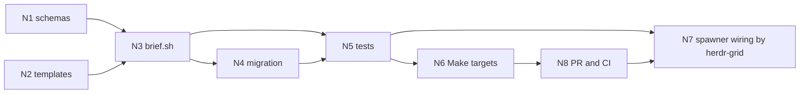

# Design: agent to agent briefs and results as schema

<!-- START doctoc generated TOC please keep comment here to allow auto update -->
- [Design principles 101](#design-principles-101)
- [Inventory](#inventory)
- [DAG](#dag)
- [Nodes](#nodes)
- [State and recovery](#state-and-recovery)
<!-- END doctoc generated TOC please keep comment here to allow auto update -->

## Design principles 101

1. Speed: validation is one python-jsonschema call; no new CI job, the existing `claude/workflow` job runs it.
2. Parallelism: N1 to N4 touch only new files and run apart from the shared-file nodes.
3. Make and scripts: `bin/brief.sh` does the work, Make targets (N6) call it with `VAR=value`.
4. Reuse: extends the compaction-guard a2a envelope and `tools/validate-schema.sh`; no new validator.
5. Small scope: one schema pair, one script, one gate.
6. Tests where they count: only `tests/unit/test_a2a_brief.sh` runs locally; CI runs lint and the full suite.
7. Evidence: every AC carries a proof kind and a proof; unticked means rejected.
8. Specs: this design is under 1000 lines; the schemas are the spec.
9. DAG first: see DAG.
10. Migrations: `migrations/brief/*.jq`, chained by `brief.sh migrate`.
11. Clean up: temp files are removed by an EXIT trap; the worktree is removed after merge.
12. Frictionless: the owner sees none of this; seats exchange JSON.
13. Context: the seat is handed a path, not the brief text.
14. Multi-agent: GOOD and NEVER examples are in README.md.
15. Mermaid DAG is the source; the build follows it.
16. Migration test: a draft-0 brief upgrades with zero hand edits (tested).
17. Config and arguments: `brief.sh new --config FILE` plus flags; Make passes `VAR=value`.
18. Agent to agent is schema: this design is that rule.
19. File ownership: each node lists its files; Makefile (PR 134) and workflow-spawn.sh (seat herdr-grid) are not touched; targets live in a2a.mk.
20. Worktree, branch, DAG walk: `~/.cache/wt-dotfiles-a2a`, `feat/a2a-brief-schemas`, state in the state file below.

## Inventory

Reused: compaction-guard `a2a-message.schema.json` envelope, `tools/validate-schema.sh`, `inbox-sweep` result schema style.
New: the files named per node.
Callers of `--brief-file` (`reply-send.sh`, `seat-watch.sh`) pass prose and must keep working.

## DAG

## Nodes

| Node | Input | Output | Files | Checklist |
| --- | --- | --- | --- | --- |
| N1 | brief | two schemas | schemas/brief.schema.json, result.schema.json | parse; reject no-AC; reject unticked |
| N2 | N1 | templates | templates/a2a/*.json | validate against schemas |
| N3 | N1, N2 | brief.sh | bin/brief.sh | check, result-check, new, migrate; shellcheck |
| N4 | N3 | migration | migrations/brief/*.jq | draft-0 upgrades unedited |
| N5 | N3, N4 | test | tests/unit/test_a2a_brief.sh | 21 checks green in Podman |
| N6 | N5 | Make targets | claude/workflow/a2a.mk | brief-new, brief-check, result-check, brief-migrate, a2a-test |
| N7 | N8 merged | spawner call, owned by seat herdr-grid | bin/workflow-spawn.sh | calls `make -C claude/workflow -f a2a.mk brief-check FILE=<brief>`, refuses on non-zero, hands the seat the path |
| N8 | N6, N7 | PR | none | checks green, done token |

## State and recovery

The state file `~/.local/state/zenith/inbox-triage/20261015/a2a-state.json` holds each node's status; it is the source of truth.
A restarted seat reads it and resumes at the first node not `done`.
Every node is safe to re-run: files are rewritten whole, nothing is appended.
