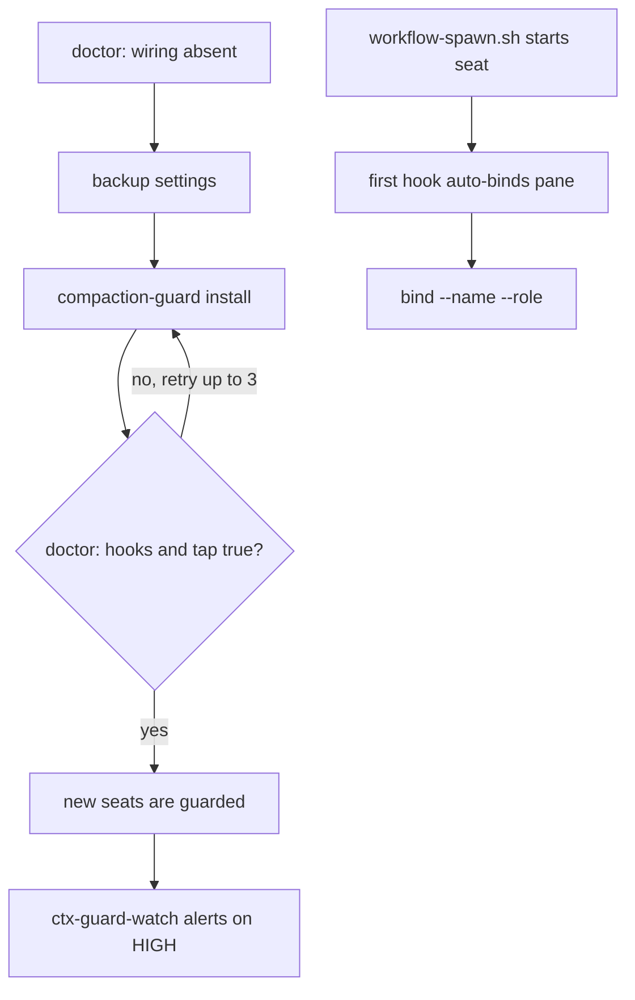

# ctx-guard

## Contents

- [Design principles 101](#design-principles-101)
- [DAG](#dag)
- [Spec](#spec)
- [Use](#use)
- [Migration and updates](#migration-and-updates)
- [Live sessions](#live-sessions)
- [Ledgers and cleanup](#ledgers-and-cleanup)
- [Windows](#windows)

## Design principles 101

1. Speed is king: the PR runs `make ctx-guard-test` (relevant only) in CI selection; CI runs lint and the full suite.
2. Parallelism: the dedupe proof and the spawner change were built by parallel subagents.
3. Make and scripts: every action is a `make ctx-guard-*` target over `ctx-guard.sh`.
4. Portable, reused: wraps the existing compaction-guard, no new guard; one `.mk` any repo includes.
5. Small scope, proven: one wrapper, one spawner hook, dedupe proven in Podman with the real `claude`.
6. Tests where they count: ctx-guard test and spawner test only; CI runs lint and the full suite.
7. Specs: the XML spec below is far under 1000 lines.
8. DAG first: the DAG below is the source; the build follows it.
9. Migrations: install and uninstall are idempotent and backed up; see Migration and updates.
10. Cleanup: backups and ledgers have a documented cleanup command.
11. Frictionless: the owner runs nothing; the agent ran `make ctx-guard-install`.
12. Context discipline: this is the 30% ceiling and checkpoints, wired for every seat.
13. Multi-agent: GOOD `make ctx-guard-install` once, every later seat guarded. NEVER hand-editing each seat's settings.
14. XML spec and mermaid DAG: below; GOOD build matches the DAG. NEVER a step with no node.
15. Migration is the test: install, upgrade (guard release promote) and removal are each one target; no workflow needs a hand rebuild.
17. Config and arguments: inputs come from `CTX_GUARD_*` variables, a conf file or arguments, passed as `make VAR=value`; nothing hard-coded.
18. Schemas with defined AC: the result is JSON with `acceptance_criteria [{id, statement, proof_kind, proof}]`; switches to `result.schema.json` when it merges.

## DAG



## Spec

```xml
<spec name="ctx-guard">
  <node id="install" input="doctor shows wiring absent" output="global_hooks and statusline_tap true, old status line chained">
    <step>backup to ~/.local/state/zenith/backup/YYYY/MM</step>
    <step>compaction-guard install --global, 3 tries</step>
    <step>assert doctor</step>
  </node>
  <node id="bind" input="seat started by workflow-spawn.sh" output="binding carries seat name and role"/>
  <node id="watch" input="make ctx-guard-watch" output="one herdr pane ctx-watch, no model calls"/>
</spec>
```

## Use

Any repo includes `claude/tools/ctx-guard/ctx-guard.mk` and calls `make ctx-guard-install` (all projects) or `make ctx-guard-project CTX_GUARD_DIR=<dir>`.
Other targets: `ctx-guard-status`, `ctx-guard-check`, `ctx-guard-watch`, `ctx-guard-uninstall`.
Projects with a project-level install do not run the hook twice: identical command strings are deduplicated (`claude/skills/container-sandbox/references/hook-dedupe.md`).

## Migration and updates

Inputs: arguments, `CTX_GUARD_*` variables passed as `make VAR=value`, or a `CTX_GUARD_CONF` file; nothing is hard-coded.
Re-running install is idempotent.
A new guard release is picked up by `compaction-guard promote`; the settings command string does not change, so no seat is edited.
Removal is `make ctx-guard-uninstall`, which restores the chained status line.
Flag: none of these workflows needs a hand rebuild.

## Live sessions

Hooks and status line are read at session start.
A running session is assumed not to pick up new global hooks and is guarded after restart.
Orchestrators get the guard on their next seat, because finished seats are downed anyway.

## Ledgers and cleanup

State lives in `~/.local/state/compaction-guard/`; settings backups in `~/.local/state/zenith/backup/YYYY/MM/`.
Cleanup: `compaction-guard release <session>` for one session, `make ctx-guard-uninstall` for the wiring.

## Windows

Not changed.
Whether compaction-guard runs under Windows claude.exe is reported in the PR.
