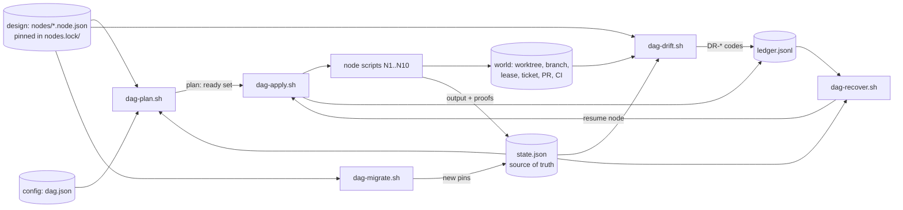
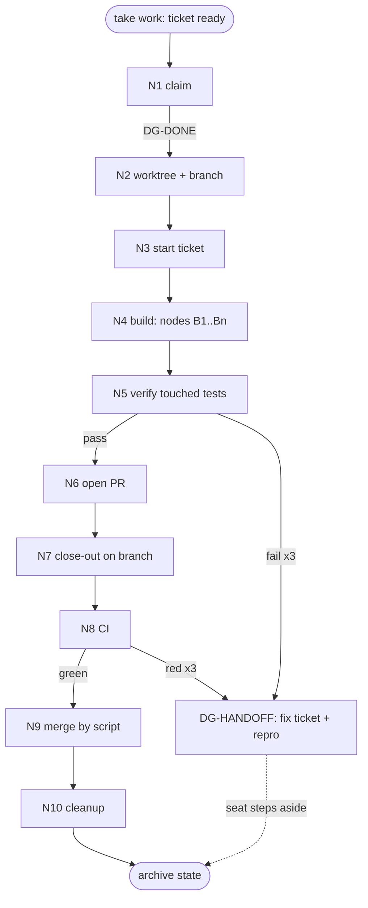

# DAG state - one deterministic path from taking work to cleanup

Status: DESIGN, for the owner to read on Bearings. Nothing in this document is built yet.
Owner order, 2026-10-16 UTC: "worktrees and feature branches with the whole process DAG when getting work so it follows a deterministic path with clear checklist runbooks playbooks documents everything that node needs is there and graceful recovery, always, doc design first with those mermaid and build to spec and keep the idea of terraform in mind, the state file is the source of truth, so should the DAG doc design architecture".
Companion files: [`dag-state.spec.xml`](dag-state.spec.xml) (verbs, codes, make, config), [`dag-state-nodes.spec.xml`](dag-state-nodes.spec.xml) (nodes, bundles, migration, build tickets) and the schemas in [`claude/workflow/dag/schemas/`](../../claude/workflow/dag/schemas/).

## Contents

1. [Design principles 101](#1-design-principles-101)
2. [Goal](#2-goal)
3. [Inventory](#3-inventory)
4. [Tool choice](#4-tool-choice)
5. [Architecture](#5-architecture)
6. [The intake DAG](#6-the-intake-dag)
7. [The state file](#7-the-state-file)
8. [Verbs: plan, apply, drift, recover](#8-verbs-plan-apply-drift-recover)
9. [Status code map](#9-status-code-map)
10. [Node bundles](#10-node-bundles)
11. [Migration](#11-migration)
12. [Make targets and config](#12-make-targets-and-config)
13. [Bottlenecks found and fixed in this design](#13-bottlenecks-found-and-fixed-in-this-design)
14. [Build tickets](#14-build-tickets)
15. [Testing](#15-testing)
16. [Where everything lives, and how it is cleaned](#16-where-everything-lives-and-how-it-is-cleaned)

## 1. Design principles 101

Each line says how this design meets the principle, or why it does not apply.

1. CI/CD speed is king: the intake DAG runs only the tests the change touches (`N5`), CI runs lint and the full suite in parallel jobs, and the merge node polls CI instead of waiting on a human.
2. Parallelism: sibling build nodes with disjoint `touches` run at once, and `apply --jobs N` runs every ready node in parallel; only the nodes with a stated serial reason run alone.
3. Make and scripts drive the automation: every verb is a script, every script has a Make target, nothing in the path is done by hand (section 12).
4. Portable, generic, templated, reused: the node schema generalises the existing inbox-sweep node schema, and `claude/workflow` supplies the validator, the library, the spawn, the runbooks and the Podman test pattern; section 3 lists what is reused and section 4 what is new and why.
5. Small scope, proven: the first build ticket is the state library alone, proven by its own unit test before any verb exists.
6. Tests where they count: each ticket names the one suite its change touches; `N5` runs only that suite and CI owns lint and the full suite.
7. Evidence or silence: `drift` reports a mismatch only with the two values that disagree attached, and a node is done only when every checklist box has a proof row.
8. Specs: two XML specs, each under 1000 lines, each with a contents list, no examples (`make dag-check` runs `spec-lint.sh` on both).
9. DAG and doc design first: this document and the mermaid below come before any build ticket is cut.
10. Migrations and easy node updates: node versions are pinned per run and a running DAG moves to a new design version by `migrate` without a restart (section 11).
11. Clean up after itself: `N10` removes the worktree, branch, lease and lock and archives the state; `make dag-clean` removes anything a dead run left.
12. Frictionless for the owner: the owner decides only the one design approval on Bearings; everything after it runs by script to merge.
13. Context discipline: a seat on a node reads only its bundle, and `recover` rebuilds a seat's context from `state.json` plus the last compaction-guard checkpoint, so a restart costs one small read.
14. Multi-agent work with GOOD and NEVER examples: every rule in sections 8 and 10 carries one, and the run lock plus `serial` let many runs and many seats work at once.
15. XML spec, mermaid architecture and DAG, the DAG is the source: sections 5 and 6 are the source, the specs are written from them, and `drift` compares the build back to them.
16. Migration is the test of the design: section 11 shows a node edit, a schema bump and a new node each moving a live run with one command.
17. Config files and arguments pass every input: `claude/workflow/dag/config/dag.json` plus `VAR=value` on every Make target; no path or name is hard-coded in a script.
18. Agent to agent is schema, never prose: node input and output records, the state file and the ledger rows are JSON with schemas, and every node carries its acceptance criteria as the checklist with a proof per box.
19. Small tickets, disjoint files, logical order: section 14 lists the build tickets, each with its file set, and the table is checked for overlap.
20. Worktree, feature branch, deterministic path, the DAG is the state: this whole document; the intake DAG opens the worktree and branch in `N2` and walks a fixed order.
21. Merge, never park: `N9` merges by script as soon as CI is green and the design approval is on record, and the build is cut so no ticket waits on an unmerged one more than one deep.
22. See it, isolate it, fix it, or hand it off: a failed node retries 3 times, then opens a fix ticket carrying the reproduction and the evidence, and the seat steps aside (`DG-HANDOFF`, section 9).
23. Artifacts live outside the repo, linked like packages: run state, ledger, records, verify output and the archived state are never committed; every file a run writes outside the repository is created through `make artifact-new` (seat artifacts is building it) under `<key name>/YYYY/MM/YYYYMMDD-HHMMSS-<name under 55 chars>.<ext>` with frontmatter, and `state.json` stays the one fixed-name file because it is the live record, not an artifact (section 16).

## 2. Goal

Taking a piece of work opens its own worktree and feature branch and walks a fixed graph of nodes to a merged pull request and a clean machine.
One state file per run says where the run is.
The design DAG says where it should be.
The difference between the two is the plan.

GOOD: a seat dies on node N5, a fresh seat runs `make dag-recover RUN=<id>`, reads `state.json`, and resumes on N5 with its inputs and proofs intact.
NEVER: a seat that restarts the whole task because nothing recorded how far the last one got.

## 3. Inventory

What exists, and what each piece gives this design.

| Piece | Path | Reused for |
| --- | --- | --- |
| Workflow declarations and meta-schema | `claude/workflow/schemas/workflows/workflow.schema.json`, `*.workflow.json` | The intake DAG is declared as one workflow (`dag-intake.workflow.json`), so spawn, spec and validation work unchanged |
| Library | `claude/workflow/bin/workflow-lib.sh` | `wf_cfg`, `wf_state_dir`, `wf_validate`, `wf_seat_dir`, `wf_interpolate` |
| Spawn into a worktree | `claude/workflow/bin/workflow-spawn.sh` | Starting the seat for a build node in the run's worktree |
| Runbooks | `claude/workflow/runbooks/RB-*.md` | Section structure for the per-node runbooks |
| Seat recovery | `claude/workflow/bin/seat-watch.sh` | Resume, hot swap and alert for a dead seat; `recover` reuses the seat half |
| Node schema and checks | `claude/workflow/inbox-sweep/schemas/node.schema.json`, `bin/node-lib.sh` | Shape of the node file, `nodes-check` and `bottleneck-check`, generalised |
| Migration | `claude/workflow/inbox-sweep/bin/migrate.sh`, `migrations/` | Copy-forward record migration, version pins, rollback |
| Run pinning | `claude/workflow/inbox-sweep/bin/sweep-init.sh` (`nodes.lock/`) | Pinning node versions at run start |
| Checklist, retry, atomic write | `claude/workflow/inbox-sweep/bin/sweep-lib.sh` (`sweep_check`, `sweep_retry`, `sweep_json_set`) | Lifted into `dag-lib.sh` |
| Ledger pattern | `claude/workflow/inbox-sweep/bin/reply-send.sh` (`ledger()`) | Append-only `ledger.jsonl` |
| Spec lint | `claude/workflow/inbox-sweep/bin/spec-lint.sh` | The 1000-line and well-formed check on both specs |
| Schema validator | `claude/workflow/tools/validate-schema.sh` | Validating state, node, bundle and ledger |
| Ticket lifecycle | `claude/skills/work-order/scripts/work-order.sh` | `start`, `submit`, `done`, `cleanup` called by nodes N3, N6, N7, N10 |
| Worktree lease | `claude/skills/hydration-prompt/scripts/slot.sh` | `acquire` and `release` in N2 and N10 |
| Checkpoints | `claude/skills/context-compaction/scripts/checkpoint.sh`, `claude/workflow/bin/after-compact.sh` | `recover` reads the last checkpoint for a seat |
| Close-out | `workflows/close-out-procedure.md` | Becomes nodes N6 to N10; the prose is replaced by the declaration |
| CI | `.github/workflows/skill-pr-gate.yml` (job `workflow` runs `make -C claude/workflow test`) | N8 polls these jobs |
| Podman test pattern | `claude/workflow/Makefile`, `tests/container/Containerfile` | Every suite for this design |

Gaps this design fills, each with evidence from the inventory.

- No edges: the workflow schema has no `depends_on`, and sweep node edges are implicit in record paths.
- No plan step: `workflow-spawn.sh --dry-run` only prints commands.
- No single state file: state is spread over seat-dir flag files, `records/*.jsonl`, ticket front matter, the lease pool and git refs.
- No drift check across ticket, lease, branch, PR and CI: `work-order.sh verify` covers tickets only.
- `work-order.sh start` runs `git checkout -b` in the current directory and nothing links it to `slot.sh acquire`.
- No CI or merge node: `gh pr merge` is a manual step in `workflows/close-out-procedure.md`.
- No resume for an interrupted close-out.

## 4. Tool choice

The state is a small JSON file written by `jq` under a `mkdir` lock, validated by the existing `validate-schema.sh`.

Terraform was considered, because plan, apply, state and drift are its model.
It is not used as a dependency, for these reasons.

- It needs a provider for each thing it manages. There is no provider for a work-order ticket, a treehouse slot, a herdr pane or a seat, so each would be a new Go plugin, which is more code than the whole design.
- The graph here is under 15 nodes and the state under 5 KB. A binary, HCL and a lock backend are weight with no gain at that size.
- The test image is pinned by digest and carries bash, jq and python3. A new binary means a new pinned layer in every suite.

What is kept from Terraform is the model: a `serial` and `lineage` in the state, a lock, a plan that diffs design against state, an apply that changes only what the plan says, and a drift check that compares state against the world.

The new code is `dag-lib.sh`, the four verbs and the node scripts.
Everything else is reused (section 3).
The reason for each new piece is the gap it closes in section 3.

## 5. Architecture

Plan reads the design, the state and the config, and prints the ready set.
Apply runs the ready nodes and writes their outputs and proofs back to the state.
Drift compares the state against the design and against the world.
Recover rebuilds the next step from the state and the ledger, and hands it to apply.
Migrate moves the pins in the state to a new design version.

## 6. The intake DAG

Every node is input to output.
A node starts when every node in its `depends_on` is `DG-DONE` and its input record exists.
A node ends when its output record exists and every checklist box has a proof.

| Node | Input | Output | Script it calls | Serial reason |
| --- | --- | --- | --- | --- |
| N1 claim | ticket id, config | `state.json` (new), `nodes.lock/`, run lock | `dag-take.sh` | The run dir must exist before any node |
| N2 worktree + branch | `state.json` | worktree path, branch, lease in state | `slot.sh acquire`, `git worktree add` | Everything after works inside this worktree |
| N3 start ticket | worktree | ticket `in-progress` | `work-order.sh start` run in the worktree | None; it is one call |
| N4 build | ticket, bundle docs | commits on the branch | seat via `workflow-spawn.sh`, one per file set | Sibling build nodes run in parallel when `touches` are disjoint |
| N5 verify | branch diff | `verify.json` | `ci-select.sh` then the one suite the change touches | None |
| N6 open PR | green verify | PR number, ticket `in-review` | `gh pr create`, `work-order.sh submit` | `submit` must precede `done` |
| N7 close-out | PR number | ticket archived, hydration entry, pushed | `work-order.sh done`, `hydration.sh add`, `git push` | Rides the same PR, after `submit` |
| N8 CI | PR | gate job results | `dag-ci.sh` polling `gh pr checks` | Intended wait: CI time |
| N9 merge | green CI, design approval on record | merge commit | `gh pr merge --squash --delete-branch` | None |
| N10 cleanup | merged PR | clean machine, archived state | `work-order.sh cleanup`, `slot.sh release`, `git worktree remove` | None |

GOOD: N9 runs the moment N8 turns green, by `dag-apply.sh`, with no human step between.
NEVER: a green PR left open "to batch with the next one", or a stack of three PRs each waiting on the one below.

## 7. The state file

Path: `<state_dir>/runs/<run-id>/state.json`, validated by [`state.schema.json`](../../claude/workflow/dag/schemas/state.schema.json).
Beside it: `nodes.lock/` (the pinned node declarations), `ledger.jsonl`, `records/` (node inputs and outputs), `verify.json`, `lock/`.

It holds, per node: status, pinned version, attempts, input and output paths with their sha256, error code, times, and the proof rows that tick the checklist.
It holds, per run: the serial, the lineage, the design id, version and hash, the ticket id and title, the worktree path, branch and lease, and the PR.

Rules for the file.

- Only `dag-lib.sh` writes it, atomically: write a temp file in the same directory, validate it, `mv` it over the old one.
- A writer takes the run lock first (`mkdir lock/`, atomic everywhere), and a lock older than `lock_stale_seconds` is reported as `DG-LOCK-STALE`, never broken silently.
- Every write increments `serial`. A writer that read serial N and finds N+1 on disk aborts with `DG-STATE-STALE` and re-reads.
- The ledger records every verb with its code, so the history can be rebuilt but the state is what is believed.

GOOD: two seats each finish a sibling build node at once; the lock serialises the two writes and both proofs land.
NEVER: a script that edits `state.json` with `sed`, or a seat that writes its own status line into a markdown file.

## 8. Verbs: plan, apply, drift, recover

All four take `RUN=<run-id>` and read `config/dag.json`.
None needs a flag that the config cannot supply.

**plan** diffs the design against the state and prints a plan; it writes only a ledger row.

- Each node is classed `DG-READY` (all dependencies done, input present, bundle complete), `DG-PENDING` (waiting), `DG-STALE` (done, but its pinned version or input hash no longer matches), or `DG-BLOCKED` (a dependency failed or a bundle file is missing).
- The plan lists the ready set and what each ready node will run.

GOOD: `make dag-plan RUN=<id>` shows N5 ready, N6 to N10 pending, and exits 0 with no side effect.
NEVER: a plan that starts a seat, edits the world, or writes the state.

**apply** runs the ready set from the last plan, recomputed under the lock.

- It runs ready nodes up to `jobs` at once, each node in the state `DG-RUNNING` before its script starts.
- On success it writes the output, the hashes and the proofs, and sets `DG-DONE`.
- On failure it retries up to the node's `retry.max` (never more than 3) with the node's waits, then sets `DG-FAILED` with an error code and hands off (`DG-HANDOFF`, below).
- A node whose `retry.idempotent` is false (N6 open PR, N9 merge) is never re-run blindly; its `max` is 0 and `recover` checks the world first.

GOOD: N8 fails twice on a flaky job, passes on the third attempt, and the state shows `attempts: 3` and the ledger shows both failures.
NEVER: a retry loop with no bound, or a failed node that leaves the run looking healthy.

**drift** compares state against design and against the world, and reports each mismatch with both values.

| Check | State says | World says |
| --- | --- | --- |
| Design drift | pinned hash | hash of `nodes/*.node.json` now |
| Worktree drift | path and branch | `git worktree list`, current branch |
| Lease drift | slot held | `slot.sh status` |
| Ticket drift | ticket status for the node | `work-order.sh show` |
| PR drift | PR number, open | `gh pr view` state |
| CI drift | N8 `DG-DONE` | `gh pr checks` now |
| Output drift | output sha256 | sha256 of the file now |

Drift never repairs; it prints `DR-*` codes and exits 1 when any mismatch exists.
Repair is `apply` after `plan` shows the node `DG-STALE`.

GOOD: someone force-pushes the branch, drift reports `DR-WORKTREE` with both commit ids, and plan marks N5 stale.
NEVER: a drift report that says "something looks off" with no values.

**recover** resumes a run from its last good node.

- It checks the lock, clears a stale lock whose holder is gone (ledger row `unlock`), and resets any node left `DG-RUNNING` with no live seat to `DG-READY` if its node is idempotent, or to `DG-BLOCKED` with a drift report if it is not.
- It then runs `plan` and `apply`.
- For a build node with a dead seat it reuses `seat-watch.sh` resume and hot swap, and gives the new seat the node bundle plus `checkpoint.sh read --top 1`.

GOOD: the machine reboots mid N8; `make dag-recover RUN=<id>` polls CI again and carries on.
NEVER: recover that re-opens a PR because N6 was left `DG-RUNNING`; it asks the world first.

## 9. Status code map

Every code has a meaning and a party who acts.
Prefixes: `DG` for run and node codes, `DR` for drift.

| Code | Level | Meaning | Who acts |
| --- | --- | --- | --- |
| DG-PENDING | node | Waiting on a dependency | The system |
| DG-READY | node | Dependencies done, input and bundle present | `apply` |
| DG-RUNNING | node | Script or seat is on it | The node's seat or script |
| DG-DONE | node | Output exists and every box has a proof | Nobody |
| DG-FAILED | node | Retries exhausted | `apply` opens the handoff |
| DG-BLOCKED | node | Dependency failed or bundle file missing | The orchestrator |
| DG-SKIPPED | node | Declared not needed for this run | Nobody |
| DG-STALE | node | Done, but pinned version or input hash moved | `plan` re-queues it |
| DG-HANDOFF | run | Fix ticket filed with reproduction and evidence; seat stepped aside | The orchestrator assigns a seat |
| DG-COMPLETE | run | N10 done, state archived | Nobody |
| DG-BUNDLE-MISSING | plan | A document in a node bundle does not exist | The build ticket owner |
| DG-STATE-STALE | write | Serial moved under the writer | The writer re-reads |
| DG-LOCK-HELD | write | Another writer holds the run lock | The writer waits |
| DG-LOCK-STALE | write | Lock older than `lock_stale_seconds` | `recover` |
| DG-SCHEMA | write | A record failed its schema | The script's owner |
| DG-APPROVAL-MISSING | N9 | No design approval on record, merge refused | The orchestrator raises the card |
| DR-DESIGN | drift | Pinned node hash differs from the design now | `migrate` or `plan` |
| DR-WORKTREE | drift | Worktree path or branch differs | `recover` |
| DR-LEASE | drift | Lease differs from state | `recover` |
| DR-TICKET | drift | Ticket status differs from the node | `recover` |
| DR-PR | drift | PR state differs | `recover` |
| DR-CI | drift | CI result differs | `plan` re-queues N8 |
| DR-OUTPUT | drift | Output hash differs | `plan` re-queues the node |

Each code is in the spec `codes` section and in the schema enums; `make dag-check` fails if a code appears in a script and not in the map.

## 10. Node bundles

A node file carries its `bundle` ([`bundle.schema.json`](../../claude/workflow/dag/schemas/bundle.schema.json)): the checklist document, the runbook, the playbook and every other document the node reads.
`plan` reports `DG-BUNDLE-MISSING` for a node whose bundle names a file that does not exist, so a node cannot be ready without its documents.

| Part | What it is | Where |
| --- | --- | --- |
| Checklist | Boxes with proofs, in the node file | `claude/workflow/dag/nodes/N<n>.node.json` |
| Runbook | What a seat does when this node fails, per failure case | `claude/workflow/runbooks/RB-dag-intake.md`, one section per node |
| Playbook | The happy path, step by step | `claude/workflow/dag/playbooks/PB-intake.md`, one section per node |
| Docs | Schemas, specs, skills the node reads | Paths listed in `bundle.docs` |

GOOD: a seat started on N5 reads only `nodes/N5.node.json`, the N5 section of `RB-dag-intake.md` and of `PB-intake.md` and the two schemas listed, and has all it needs.
NEVER: a node whose runbook is "ask the architect".

## 11. Migration

A running DAG moves to a new design version with one command and no restart.
The mechanism is the existing one in `inbox-sweep/bin/migrate.sh`: copy-forward, versioned record schemas, pins, rollback.

| Change | What `make dag-migrate RUN=<id>` does |
| --- | --- |
| Node edited, new version | Compares each pinned version with the design; a `DG-DONE` node whose edit changes its checklist or script becomes `DG-STALE`, an untouched one keeps its pin. Pending nodes take the new version. |
| Record schema bumped | Migrates the run's records with `migrations/<name>/vN-to-vN+1.sh`, writing `.vN+1.json` beside the original; the original stays. |
| Node added | Added as `DG-PENDING` with its dependencies; if it sits upstream of a done node, that node is `DG-STALE`. |
| Node removed | Marked `DG-SKIPPED`; its output is kept. |
| State schema bumped | `state.vN+1.schema.json` plus `migrations/state/vN-to-vN+1.sh`; same rule. |

Rollback is `make dag-migrate-rollback RUN=<id> TO=<version>`; it resets the pins and renames newer copies to `*.rolled-back`, no down-migration needed.
The migration test is the test of this design: a fixture run at design 1.0.0 must reach 1.1.0 through `make dag-migrate`, and back, in the unit suite.

GOOD: the design adds a node N5b; one `dag-migrate` run later the live run shows N5b pending and nothing else changed.
NEVER: finishing the old runs and then starting new ones because the state cannot be moved.

## 12. Make targets and config

Config: `claude/workflow/dag/config/dag.json`, validated by `config.schema.json` (a build ticket). Fields: `state_dir`, `jobs`, `retry_waits_seconds`, `lock_stale_seconds`, `ci_poll_seconds`, `ci_timeout_seconds`, `required_checks`, `approval_dir`, `base_branch`.
Every script reads the config and takes arguments that override it.

Targets live in `claude/workflow/dag/dag.mk`, included once from `claude/workflow/Makefile`. Each takes `VAR=value`.

| Target | Arguments | Script |
| --- | --- | --- |
| `dag-take` | `TICKET=` | `dag-take.sh` (N1 to N3) |
| `dag-plan` | `RUN=` | `dag-plan.sh` |
| `dag-apply` | `RUN=` `JOBS=` | `dag-apply.sh` |
| `dag-drift` | `RUN=` | `dag-drift.sh` |
| `dag-recover` | `RUN=` | `dag-recover.sh` |
| `dag-migrate` | `RUN=` | `dag-migrate.sh` |
| `dag-migrate-rollback` | `RUN=` `TO=` | `dag-migrate.sh rollback` |
| `dag-status` | `RUN=` | `dag-lib.sh status` |
| `dag-check` | none | node checks, code-map check, spec lint |
| `dag-clean` | `OLDER_THAN=` | removes archived and dead runs |
| `dag-test` | `SUITE=` | one suite in Podman |

## 13. Bottlenecks found and fixed in this design

Owner order, 2026-10-16 UTC: "fucking ID bottlenecks and get them fixed as soon as possible".

| Bottleneck | Evidence | Fix in this design |
| --- | --- | --- |
| The merge is manual | `workflows/close-out-procedure.md` ends in a prose `gh pr merge` step; nothing runs it | N9 merges by script when N8 is green and the approval is on record |
| PRs stack and park | Recent history shows chained feature PRs (#129 to #133), each built on the last | Build tickets (section 14) are cut so no ticket depends on an unmerged one more than one deep; the merge script collapses a stack leaves first |
| No resume after an interrupted close-out | Close-out is prose; `done` and `cleanup` read the ticket in the main checkout | `recover` plus a state file that holds the worktree path |
| Start and lease are not joined | `work-order.sh start` checks out in the current directory; `grep treehouse work-order.sh` finds nothing | N2 acquires the lease and creates the worktree and branch, N3 runs `start` inside it |
| Node edges are implicit | The sweep node schema has no `depends_on` | Explicit `depends_on`, so the ready set is computed, not read from prose |
| A failure waits for the owner to notice | Gates run only in a watcher; `on_failure` is prose | Retry 3 times, then `DG-HANDOFF` with a fix ticket (principle 22) |

## 14. Build tickets

Each ticket is small, declares its files, and touches none that another ticket touches.
Order: T1 first; T2 to T5 and T7 to T9 only need T1 merged; T6 needs T2 to T5; T10 last.
Every ticket merges before the next that needs it starts, so the stack is never deeper than one (principle 21).

| Ticket | Title | Files it touches | Needs |
| --- | --- | --- | --- |
| T1 | State library: init, read, write, lock, serial, ledger | `claude/workflow/dag/bin/dag-lib.sh`, `claude/workflow/dag/tests/unit/test_dag_lib.sh` | none |
| T2 | plan verb | `claude/workflow/dag/bin/dag-plan.sh`, `claude/workflow/dag/tests/unit/test_dag_plan.sh` | T1 |
| T3 | apply verb with retry and handoff | `claude/workflow/dag/bin/dag-apply.sh`, `claude/workflow/dag/tests/unit/test_dag_apply.sh` | T1 |
| T4 | drift verb | `claude/workflow/dag/bin/dag-drift.sh`, `claude/workflow/dag/tests/unit/test_dag_drift.sh` | T1 |
| T5 | recover verb | `claude/workflow/dag/bin/dag-recover.sh`, `claude/workflow/dag/tests/unit/test_dag_recover.sh` | T1 |
| T6 | Intake node declarations N1 to N10 | `claude/workflow/dag/nodes/N*.node.json` | T2 |
| T7 | Runbooks and playbooks for N1 to N10 | `claude/workflow/runbooks/RB-dag-intake.md`, `claude/workflow/dag/playbooks/PB-intake.md` | none |
| T8 | Take and ship scripts for N1 to N3 and N6 to N10 | `claude/workflow/dag/bin/dag-take.sh`, `claude/workflow/dag/bin/dag-ship.sh`, `claude/workflow/dag/tests/unit/test_dag_take.sh`, `claude/workflow/dag/tests/unit/test_dag_ship.sh` | T1 |
| T9 | CI poll and merge script, with approval check | `claude/workflow/dag/bin/dag-ci.sh`, `claude/workflow/dag/bin/dag-merge.sh`, `claude/workflow/dag/tests/unit/test_dag_merge.sh` | T1 |
| T10 | Migrate verb, state migrations, fixtures | `claude/workflow/dag/bin/dag-migrate.sh`, `claude/workflow/dag/migrations/**`, `claude/workflow/dag/tests/fixtures/**`, `claude/workflow/dag/tests/unit/test_dag_migrate.sh` | T1 |
| T11 | Config, schema, `dag.mk`, Makefile include, `dag-check` | `claude/workflow/dag/config/dag.json`, `claude/workflow/dag/schemas/config.schema.json`, `claude/workflow/dag/dag.mk`, `claude/workflow/Makefile`, `claude/workflow/dag/bin/dag-check.sh` | T1 |
| T12 | Intake workflow declaration | `claude/workflow/schemas/workflows/dag-intake.workflow.json` | T6 |

The full table, with the machine-checked file sets, is in [`dag-state-nodes.spec.xml`](dag-state-nodes.spec.xml); `dag-check` fails if two tickets that can run at once share a file.

## 15. Testing

Each ticket adds one unit suite and runs only that suite locally, in Podman with the pinned workflow test image.
CI runs lint and the full suite through the existing `workflow` job.
The suites use a stub `gh`, a stub `slot.sh` and a temp git repo, so none touches the network or the real lease pool.
Migration has a fixture run at design 1.0.0 that must reach 1.1.0 and back.

## 16. Where everything lives, and how it is cleaned

| Output | Location | Cleaned by |
| --- | --- | --- |
| Run state, ledger, records | `<state_dir>/runs/<run-id>/` | N10 archives it; `make dag-clean OLDER_THAN=` removes archives |
| Worktree and branch | The lease path, `feat/<slug>` | N10 |
| Lease | The treehouse pool | N10 `slot.sh release` |
| Run lock | `<run>/lock/` | Writer on exit; `recover` for a stale one |
| Test output | Podman `--rm`, nothing on disk | Container exit |

Nothing is written inside the repository except the design and the build.
Owner order, 2026-10-16 UTC: "any files we ever need to create, they never go in the git repo, artifacts get smartly linked to the outside like packages do on linux, use format <key name>/YYYY/MM/YYYYMMDD-HHMMSS-<descriptive name under 55 chars completely with the prefix included>.<whatever ext> scripted too with frontmatter".
Once `make artifact-new` is merged, the verify output, the archived state and any report a run writes are created through it with key name `dag-state`, and the run dir links to them.
Until it is merged, the design only names the rule; no script in this design hard-codes a file name that the target will replace (ticket T11 reads the artifact root from `dag.json`).
