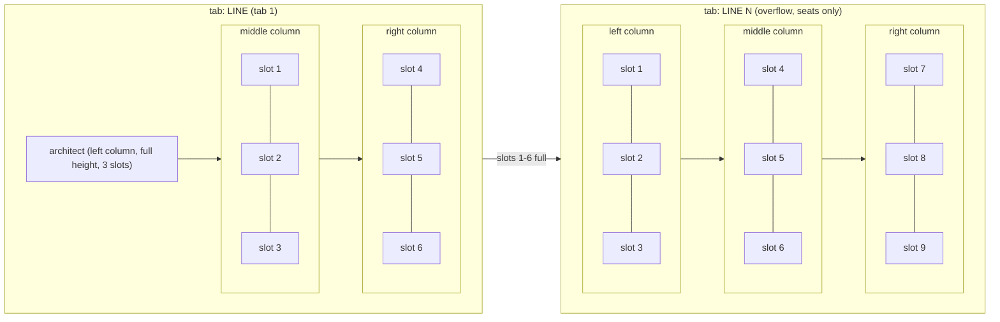
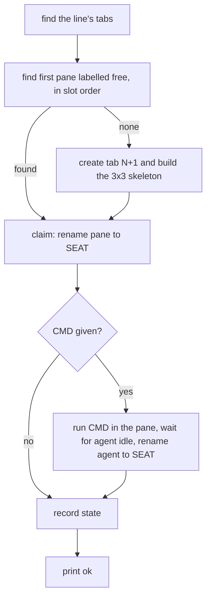

# Herdr grid layout - design

Status: DRAFT for owner reading.
Owner order, 2026-10-16 UTC: "since we use herdr, its should always be known to use herdr in a tab layout with 3X3 and the 1(YOU ONLY ON AGENT IN THIS FULL 3 slots)|3 panes|3 panes, everything labeled, make new tabs when not, driven by makefiles and scripts with automated cleanup too".
The implementation is one script, `claude/workflow/bin/herdr-grid.sh`, called by Make targets.

## Contents

- [Design principles 101](#design-principles-101)
- [Inventory](#inventory)
- [Layout](#layout)
- [Commands](#commands)
- [Seat-up DAG](#seat-up-dag)
- [Status codes](#status-codes)
- [Cleanup rules](#cleanup-rules)
- [State](#state)
- [GOOD and NEVER](#good-and-never)
- [Migration of a live workspace](#migration-of-a-live-workspace)

## Design principles 101

1. CI/CD speed is king: every command is one script call with no waiting on the owner, and seat-up claims a free slot in a single pass.
2. Parallelism: seats are claimed independently, so several seats can come up at once on different slots.
3. Make and scripts drive the automation, never hands: every operation is a `make` target that calls `herdr-grid.sh`.
4. Portable, generic, templated, reused: the script reuses the existing spawn path and herdr commands listed in the Inventory instead of building a new launcher.
5. Small scope, proven: one script, six commands, and each command is proven alone before the next is added.
6. Tests where they count: `make grid` runs only this script's suite; lint and the full suite are left to CI (owner, 2026-10-16 UTC).
7. Specs: this is a script, so no XML spec is needed, and this note plus the status code map is the contract.
8. DAG and doc design first: this note and the seat-up DAG come before the script.
9. Migrations and easy node updates: the `line-adopt` command migrates a live line into the grid without restarting any seat.
10. Clean up after itself: `seat-down` and `line-clean` close finished panes and empty overflow tabs and reflow the rest.
11. Frictionless for the owner: the owner never places, labels or closes a pane, and only sees a labeled grid.
12. Context discipline: commands print one status line each, so an agent reading the output spends almost no context.
13. Multi-agent work: slot claiming is by label, so many agents can call seat-up at once, with GOOD and NEVER examples below.
14. XML spec, mermaid architecture and DAG, the DAG is the source: no XML spec applies to a script, and the mermaid layout and the seat-up DAG below are the source the script follows.
15. Migration is the test of the design: `line-adopt` moves a live workspace into the grid with no restart, so the design passes its own test.
16. Test only what changed: a change here runs `make grid` and nothing else locally.
17. Inputs from config or arguments: every knob is a VAR=value on the Make target or a key under `.workflow.herdr.grid` in `config/project.json`, none is hard-coded.
18. Schemas with acceptance criteria: the seat result for this work is a JSON document with `acceptance_criteria [{id, statement, proof_kind, proof}]`.
19. Small tickets, no shared files: this change touches only `bin/herdr-grid.sh`, its test, the workflow Makefile, the config and this note.

## Inventory

Everything below exists already and is reused.

- `claude/workflow/bin/workflow-spawn.sh` already opens a seat in a herdr pane.
  It honours a `PANE` override, so a seat can be placed into a chosen pane.
  It also has a `claude.exe` launcher branch for seats that must run as Windows Claude Code.
- The herdr pane and tab commands provide create, split, rename, move, swap, read and close.
  No new terminal tooling is needed.
- `~/projects/coq-jev-herdr-plugin` holds line scripts that already open and label panes for a line.
  Its naming and label conventions are followed so the two do not disagree.

Nothing here is invented; the new script only decides which pane a seat goes into and tidies after it.

## Layout

Tab 1 is named after the line.
The left column holds the architect alone at full height, spanning 3 slots.
The middle column holds slots 1-3 and the right column holds slots 4-6.
Overflow tabs are named `<line> N` and hold 9 seat slots, the left column included, because the architect lives only once.

A free slot is a pane whose label is `free`.
Slots are filled in order: middle column top to bottom, then right column top to bottom.

## Commands

All commands call `claude/workflow/bin/herdr-grid.sh`.

| Make target        | Arguments                                 | What it does                                                               |
| ------------------ | ----------------------------------------- | -------------------------------------------------------------------------- |
| `make line-up`     | `LINE=`                                   | Builds tab 1 for the line with the architect column and 6 free seat slots. |
| `make seat-up`     | `LINE= SEAT= [CMD=] [CWD=]`               | Claims the first free slot for the seat, optionally starting `CMD` in it.  |
| `make seat-down`   | `SEAT= [LINE=] [FORCE=1]`                 | Closes a finished seat's pane and reflows the grid.                        |
| `make line-clean`  | `LINE=`                                   | Closes every finished seat and every all-free overflow tab.                |
| `make line-status` | `LINE=`                                   | Prints each tab, slot, label and seat state, one line per slot.            |
| `make line-adopt`  | `LINE= ARCH=<pane> SEATS="name=pane ..."` | Moves a live line into the grid with no restart.                           |

## Seat-up DAG

Every node is input to output: the input is the line and seat name, and the output is a labeled pane holding the seat.

## Status codes

Every command prints exactly one of these codes.

| Code                 | Meaning                                                                            | Who acts                                                      |
| -------------------- | ---------------------------------------------------------------------------------- | ------------------------------------------------------------- |
| `ok`                 | The command finished.                                                              | Nobody.                                                       |
| `no-free-slot`       | Every slot in every tab is taken; seat-up opens a new tab.                         | The script, automatically.                                    |
| `retry n/3`          | A herdr call failed and is being retried, n of 3.                                  | The script, automatically.                                    |
| `failed`             | Three retries failed; the script reports the step and exits 1.                     | The orchestrator, who sends a fresh seat or fixes the system. |
| `refused-unfinished` | `seat-down` found no `DONE` line and no exited agent, and `FORCE=1` was not given. | The orchestrator, who waits for the seat or sets `FORCE=1`.   |
| `refused-architect`  | The target is the architect pane or tab 1.                                         | Nobody; the architect is never closed by the grid.            |

## Cleanup rules

A seat is finished when either of these holds:

- It printed `DONE <seat> <non-placeholder>` in its last 40 lines.
- Its agent exited after having been seen running.

Closing a pane then reflows the tab:

1. Restore each column to 3 panes by splitting.
2. Compact seats upward by swapping panes, so free slots sit at the end.
3. Close any overflow tab whose slots are all free.

Tab 1 and the architect pane are never closed.
A column that vanished entirely is not rebuilt, and the next seat-up opens a new tab instead.
This is the stated cost of the design: it trades a rebuilt column for a simpler script.

## State

State lives outside the repository so cleanup commands can exist and no artifact reaches a pull request.
The path is `~/.local/state/zenith/herdr-grid/<line>/<seat>.agent-seen`.
The file means the seat's agent was seen running, which is what makes "agent exited" mean finished rather than not started.
`line-clean` removes the line's state directory when the line is empty.

## GOOD and NEVER

GOOD: `make seat-up LINE=inbox-triage SEAT=sweep-build CMD=...` claims slot 1, and the pane is labeled `sweep-build`.
NEVER: split a pane by hand wherever there was room.

GOOD: `make seat-down SEAT=sweep-build` after the seat printed `DONE sweep-build merged-pr-131`.
NEVER: close a seat's pane by hand while its agent is still working.

GOOD: the seventh seat opens tab `inbox-triage 2` with the 3x3 skeleton.
NEVER: squeeze a seventh pane into tab 1 or leave a dead seat's pane open.

GOOD: two agents call seat-up at once and each claims a different free label.
NEVER: pick a slot by pane position instead of its `free` label.

## Migration of a live workspace

`make line-adopt LINE= ARCH=<pane> SEATS="name=pane ..."` migrates a running line without restarting any process.

1. Stage every non-architect pane into a temporary tab with the herdr pane move command.
2. Rebuild the skeleton around the architect pane: the left column for the architect, then the middle and right columns of free slots.
3. Move each seat pane into its slot and rename it to the seat name.
4. Close the temporary tab once it is empty.

Pane ids are preserved because every move happens inside one workspace.
No seat process is restarted, so no seat loses its context.
