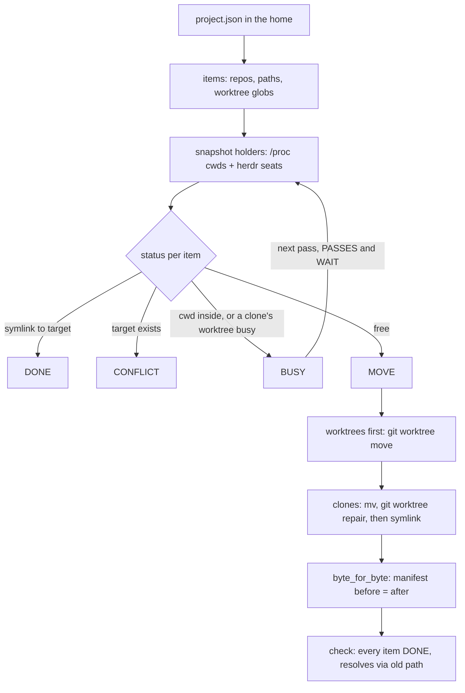

# Home migrate - one home per project, symlinks at every old path

<!-- START doctoc generated TOC please keep comment here to allow auto update -->
<!-- DON'T EDIT THIS SECTION, INSTEAD RE-RUN doctoc TO UPDATE -->

- [Design principles 101](#design-principles-101)
- [What it does](#what-it-does)
- [DAG](#dag)
- [Rules](#rules)

<!-- END doctoc generated TOC please keep comment here to allow auto update -->

## Design principles 101

1. CI/CD speed: plan is read-only and runs in seconds (one cwd snapshot per pass); the dev test is one Podman run.
2. Parallelism: apply is serial on purpose (one lock per home); seats keep working because busy paths are skipped, not waited on.
3. Make and scripts: `make home-plan|home-apply|home-check CONF=`, and a project home wraps them (`make yp-home-*`).
4. Reuse: `git worktree move` and `git worktree repair` do the git side; `artifact.sh` writes the run log; `doctoc` lists contents.
5. Small scope: one script, five verbs (plan, apply, check, rollback, rolodex), one config file.
6. Tests where they count: `make home-migrate-test` (fixture, 43 cases) and `make home-migrate-dev CONF=` (mirror of the real tree); CI runs the rest.
7. Evidence: every item prints a status code; apply's log is written to the artifact store.
8. Specs: [home-migrate.spec.xml](home-migrate.spec.xml), under 1000 lines, opens with `<contents>`.
9. DAG first: the DAG below is the order the script walks.
10. Migrations: adding a path to the home is one config entry; a rerun moves only the new item.
11. Clean up: nothing to clean; the script never deletes, and the only leftovers are symlinks that are the point.
12. Frictionless: no owner step; busy paths retry on the next pass by themselves.
13. Context: an agent reads one status line per item, never the tree.
14. Multi-agent: live seats are detected from `/proc` cwds and `herdr agent list`; GOOD and NEVER below.
15. XML spec and mermaid: both here; the spec is the source.
16. Migration is the test: the design is itself a migration, rerunnable from any state.
17. Config and arguments: the home's `project.json` and `ONLY=`, `PASSES=`, `WAIT=`.
18. Schema between agents: the config is JSON; status lines are codes, not prose.
19. Disjoint files: one home is one lock; two homes never share a config.
20. Worktree and DAG: built on a feature worktree; the DAG below is the state, and `plan` reports drift from it.
21. Merge, never park: the PR auto-merges on green CI.
22. Fix or hand off: a CONFLICT stops that item only and names it.
23. Artifacts outside git: the run log and byte manifests live under the artifact store.
24. Checkpointing: not applicable; the filesystem is the checkpoint, every pass restarts from it.
25. No AWS spend: none.
26. Producer and consumer: not applicable; a one-shot migration, no events.
27. One watch pattern: not applicable; no monitor.
28. Idempotent: a second apply reports `changed 0` and leaves the tree byte-identical (TP-5).
29. Status codes: MOVE, MOVED, DONE, BUSY, CONFLICT, KEEP, FAIL, OK.
30. Ape-sized: each item is one rename and one symlink.
31. Evidence on every node: check prints proof per item; vault bytes are compared by manifest.
32. No opinions: what moves and what stays is the owner's word, recorded in the config's exceptions.
33. Break glass: not needed; the lock is a directory an operator may `rmdir`.
34. dev, UAT, stable: dev is the fixture and the mirror, UAT is `ONLY=` one idle worktree, stable is the full apply; `rollback ONLY=` is the scripted way back.
35. Tests never notify: the tests touch only a temp root inside a container.
36. Permissions: none beyond file ownership.
37. Timing: plan under 5 seconds on 61 items; apply is the same plus one rename per item.
38. Batching: one apply moves the whole batch; busy items ride the next pass.
39. Cluster: not applicable; it moves local directories.

## What it does

A project whose clones and worktrees are scattered across `~/projects` gets one home directory.
Every clone moves into the home, every worktree into `<home>/.worktrees/`, and any other directory to a home-relative target.
A symlink is left at every old path, so a seat, a brief or a recorded path that names the old place keeps working.

## DAG

## Rules

GOOD: a seat works in `ypconsult-01-src-s02e`; apply moves the other 57 items, prints `BUSY ... pid` for that one and its clone, and a later pass moves them once the seat leaves.
NEVER: a move under a live seat, a `git worktree prune`, a delete, or an overwrite of an existing target.

GOOD: a moved clone's worktrees have their `.git` files repaired to the new path before the symlink is made.
NEVER: relying on the symlink for git links, which breaks the day the symlink is removed.
