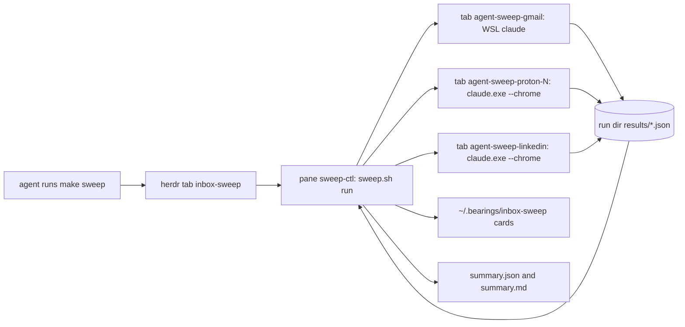
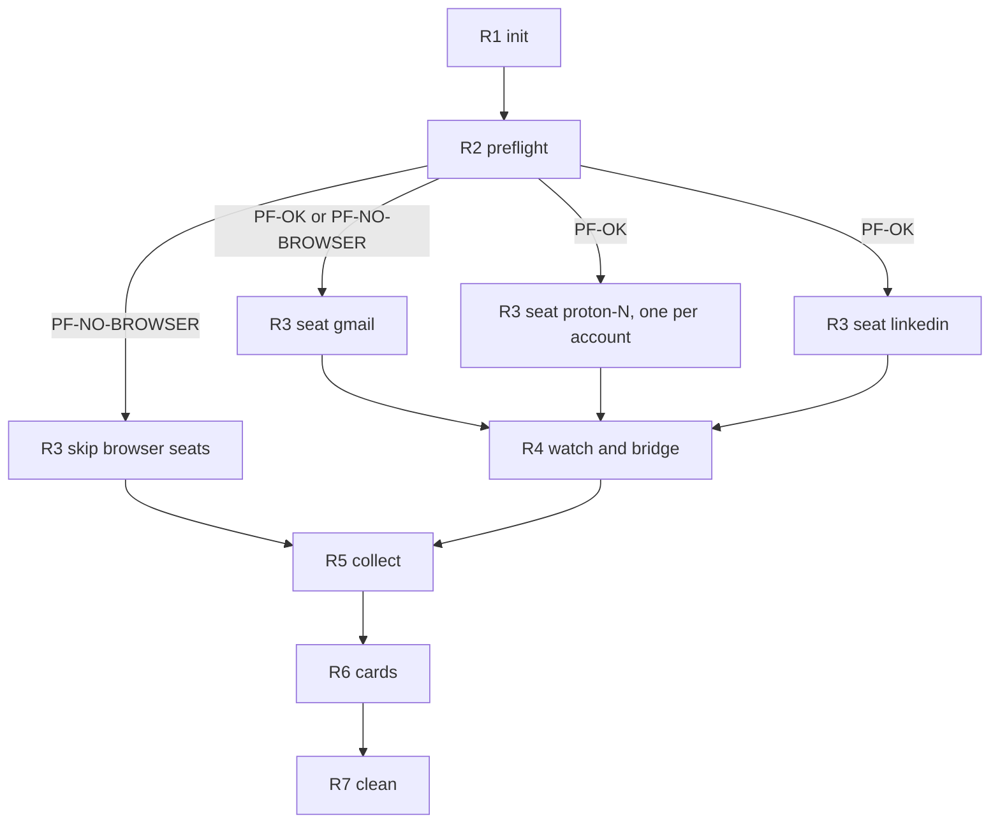
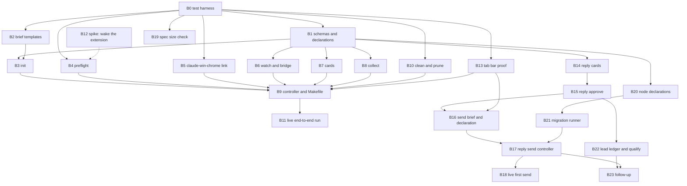
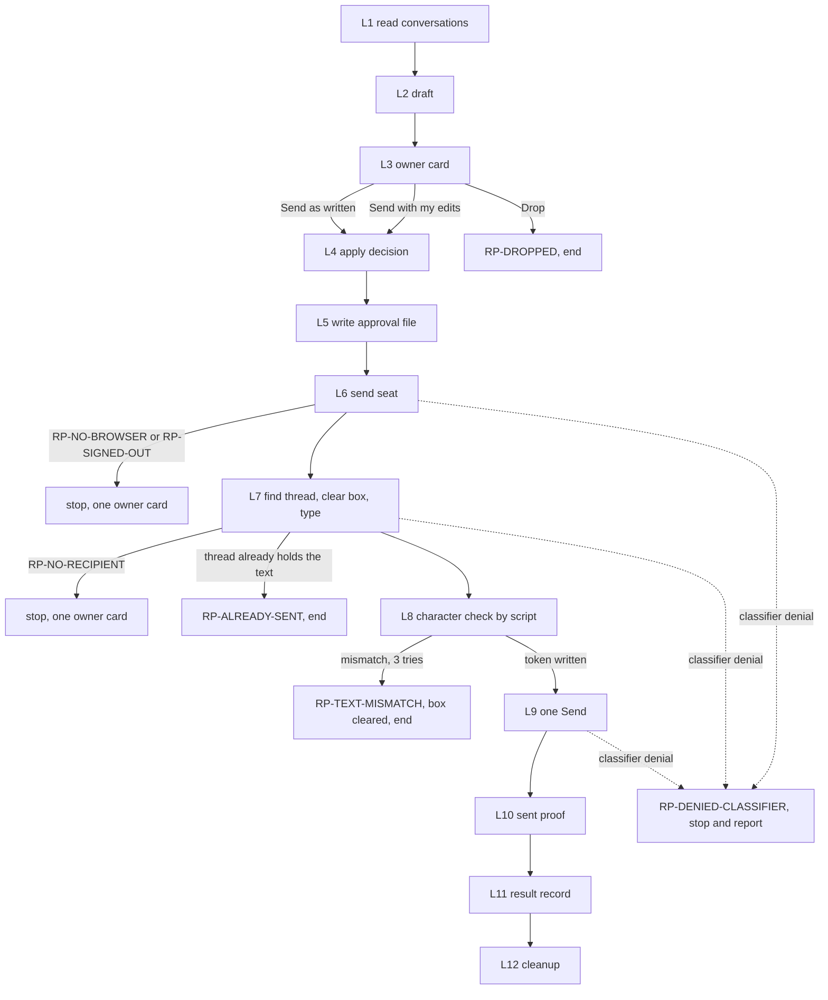
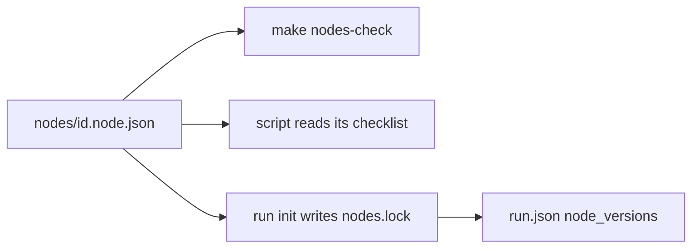
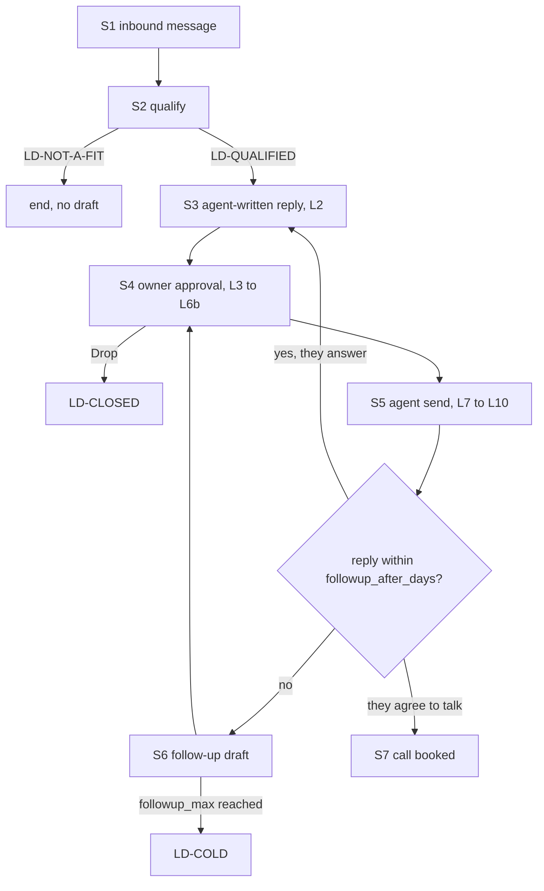

# Inbox sweep - design

Status: APPROVED, owner ruling 2026-10-16 UTC on Bearings card D-04, with the architect's rulings recorded in [section 12](#12-owner-decisions).
Build tickets are cut from [section 10](#10-build-dag).
Owner order, 2026-10-15 UTC: "make sure you clean up too and shit is automated with makefiles and scripts, i'm not fucking around, dag this shit out doc design first".
Companion files: [`inbox-sweep.spec.xml`](inbox-sweep.spec.xml) (the build spec), [`linkedin-reply.spec.xml`](linkedin-reply.spec.xml) (the reply, node and migration spec) and [`result.schema.json`](../../claude/workflow/inbox-sweep/schemas/result.schema.json) (one seat's result record).

## Contents

1. [Goal](#1-goal)
2. [Inventory](#2-inventory)
3. [Failures this design removes](#3-failures-this-design-removes)
4. [Shape of one run](#4-shape-of-one-run)
5. [Run DAG](#5-run-dag)
6. [Status code map](#6-status-code-map)
7. [Tool chosen for each step](#7-tool-chosen-for-each-step)
8. [Make and script plan](#8-make-and-script-plan)
9. [Where everything lives, and how it is cleaned](#9-where-everything-lives-and-how-it-is-cleaned)
10. [Build DAG](#10-build-dag)
11. [Testing](#11-testing)
12. [Owner decisions](#12-owner-decisions)
13. [Conflicts surfaced](#13-conflicts-surfaced)
14. [LinkedIn reply DAG](#14-linkedin-reply-dag)
15. [Versioned nodes and migrations](#15-versioned-nodes-and-migrations)
16. [No-bottleneck check](#16-no-bottleneck-check)
17. [Lead stage](#17-lead-stage)

## 1. Goal

One command, `make sweep`, run by an agent, sweeps every inbox in parallel with no owner hands on the browser.
Sources: Proton (every signed-in account), Gmail (claude.ai connector), LinkedIn (read, draft replies, never send).
A run ends in three outputs: one validated result record per seat, one run summary, and one Getting My Bearings card per owner decision or LinkedIn draft.
The only mailbox mutation a sweep may make is marking a message read (see [D1](#d1-mark-read-or-leave-unread)).
Nothing is ever sent, replied to, forwarded, deleted, archived, accepted or posted.

## 2. Inventory

Everything the sweep touches, read before designing it.

| Id  | Thing                            | Where                                                                                        | What the sweep uses it for                                                    |
| --- | -------------------------------- | -------------------------------------------------------------------------------------------- | ----------------------------------------------------------------------------- |
| I1  | Browser rule                     | `~/AGENTS.md`, "Hard rule: agents drive the browser, in the owner's own Chrome"              | Which Chrome profile, which launcher, the wake procedure                      |
| I2  | Today's hand-driven run          | `~/.local/state/zenith/inbox-triage/20261015/` and the Windows-side `inbox-triage-20261015/` | Report shapes that the result schema generalises; the failures in section 3   |
| I3  | Spawner                          | `claude/workflow/bin/workflow-spawn.sh`                                                      | Starts each seat in a labeled herdr tab; chain links carry a custom launcher  |
| I4  | Seat watcher                     | `claude/workflow/bin/seat-watch.sh`                                                          | Done from the seat's record row, never from the screen; respawn up to 3 times |
| I5  | Seat record                      | `claude/workflow/bin/seat-record.sh`                                                         | Writes the done row the watcher reads                                         |
| I6  | Workflow declarations            | `claude/workflow/schemas/workflows/*.workflow.json`                                          | One declaration per seat kind; tool allow and deny lists are data             |
| I7  | Workflow config                  | `claude/workflow/config/project.json`                                                        | Seat table, herdr workspace label, watcher thresholds                         |
| I8  | Workflow Makefile and test image | `claude/workflow/Makefile`, `claude/workflow/tests/container/Containerfile`                  | Precedent for make as entry point, and the pinned Podman test image           |
| I9  | CI selector                      | `claude/workflow/tools/ci-select.sh`                                                         | Selects suites from changed paths; `make test` reuses it                      |
| I10 | Bearings                         | `~/.claude/skills/bearings/SKILL.md`, `~/.bearings/<name>/questions.json`                    | Owner decision cards and LinkedIn draft approvals                             |
| I11 | Claude Code for Windows          | `%USERPROFILE%\.local\bin\claude.exe`                                                        | The only runtime whose `--chrome` reaches the extension's native host         |
| I12 | Claude in Chrome extension       | Chrome profile `Default`, native host `%USERPROFILE%\.claude\chrome\chrome-native-host.bat`  | Proton and LinkedIn tabs, one tab per seat                                    |
| I13 | Gmail connector                  | claude.ai Gmail MCP, reachable from WSL Claude                                               | Gmail seat; no browser needed                                                 |
| I14 | Repo rules                       | `CLAUDE.md` Rules 14, 15, 17, 18, 19                                                         | Podman testing, pinned images, entry point, herdr-first, surface by runtime   |
| I15 | Screen capture script | `%USERPROFILE%\inbox-triage-20261015\screen.ps1`, ported to `claude/workflow/inbox-sweep/bin/screen.ps1` | Windows screenshot of the tab bar, the completion proof for browser seats |

## 3. Failures this design removes

| Id  | Seen 2026-10-15                                                         | Removed by                                                                                                                                                            |
| --- | ----------------------------------------------------------------------- | --------------------------------------------------------------------------------------------------------------------------------------------------------------------- |
| F1  | WSL `claude --chrome` never connects                                    | Browser seats launch only through the `claude-win-chrome` chain link (spec `launcher/claude-win-chrome`); the declarations for Proton and LinkedIn name no other link |
| F2  | `list_connected_browsers` returned `[]` until the side panel was opened | Preflight probes before any browser seat starts, 3 tries; on failure browser seats are `SKIPPED`, Gmail still runs, and one card asks for the wake                    |
| F3  | Seats refused prompts without the owner's own words                     | `sweep-init.sh` renders every brief with the owner's words from `owner-words.md` and refuses (`PF-NO-OWNER-WORDS`) if the file is missing                             |
| F4  | A watcher matched `DONE` inside the echoed prompt                       | Done is a result file that parses and validates against the schema, bridged into a seat record row; the screen is never read for completion                           |
| F5  | Background watcher jobs broke Rule 18                                   | The controller loop runs in the labeled herdr pane `sweep-ctl`; `make herdr-first` fails the suite on any `&`, `nohup`, `disown` or `setsid`                          |
| F6  | Closing the blank anchor tab that `tabs_context_mcp` with `createIfEmpty` creates (the owner asked for it) dissolved the seat's tab group and orphaned its working tab; tools then failed with "Tab is not in Claude's tab group for this session" | Rule `tab-anchor`: the anchor is never closed early; the seat navigates it to the work URL and uses it as its first working tab, and closes the group's tabs only at the very end, anchor last. The result records it in `tab_group`, and the schema refuses a browser result that did not |
| F7  | A seat's own "tab closed" was taken as proof | Completion proof is a Windows screenshot of the tab bar taken by `screen.ps1` before and after the run (R2 baseline, R7 final), read by a verifier, never the seat's say-so |

## 4. Shape of one run

`make sweep` returns at once: it opens the `inbox-sweep` tab and starts the controller in its `sweep-ctl` pane.
Agents follow progress with `make status`, which reads `run.json` and never a screen.

## 5. Run DAG

Each node is input to output; a node's process exists only between the two.
Every box on a checklist is ticked with the proof named beside it, written to the run's `checklist.jsonl` by the script that owns the node.

### R1 init

- Input: `~/.config/zenith/inbox-sweep/config.json`, `~/.config/zenith/inbox-sweep/owner-words.md`, the brief templates.
- Output: run dir `<runs>/<run-id>/` with `run.json` (status `RUN-RUNNING`) and one rendered brief per seat in `briefs/`.
- Checklist:
  - [ ] Config validates against `config.schema.json` - proof: validator exit 0 in `logs/init.log`.
  - [ ] Owner words present and non-empty - proof: sha256 of the file in `run.json.owner_words_sha256`.
  - [ ] One brief per enabled seat, each containing the owner words block - proof: `grep -c '<owner-words>'` equals seat count in `logs/init.log`.

### R2 preflight

- Input: `run.json`.
- Output: `preflight.json` with one `PF-*` code per check.
- Checklist:
  - [ ] Inside herdr - proof: `HERDR_ENV=1` and `herdr workspace list` shows the configured label.
  - [ ] `claude.exe` resolves and runs - proof: `claude.exe --version` output captured.
  - [ ] Chrome is running - proof: `tasklist.exe` row for `chrome.exe`.
  - [ ] Baseline tab bar captured before any seat starts - proof: `proof/R2-tabbar-<UTC>.png` from `screen.ps1`.
  - [ ] Extension connected - proof: probe output lists at least one browser, tries recorded (max 3).

### R3 seats

- Input: the seat's rendered brief.
- Output: `results/<seat>.json`, valid against the result schema.
- Checklist (per seat):
  - [ ] Seat started in tab `agent-sweep-<seat>` - proof: seat-link written by the spawner.
  - [ ] Counts before and after recorded, after verified by a second read - proof: `counts.after.verified_at` in the result.
  - [ ] No forbidden mutation - proof: `mutations[]` holds only `marked-read`, enforced by the schema.
  - [ ] Anchor tab reused as the first working tab, never closed early - proof: `tab_group.anchor_reused: true` in the result.
  - [ ] Group closed at the very end, anchor last - proof: `tab_group.closed_anchor_last: true`; the claim is checked by the R7 screenshot, not trusted.

### R4 watch and bridge

- Input: `results/` directory, seat deadlines from config.
- Output: one seat record row per seat via `seat-record.sh`, so `seat-watch.sh` retires the seat.
- Checklist:
  - [ ] Each result parsed and validated, or `FAILED-SCHEMA` after 3 rewrite requests - proof: `logs/watch.log`.
  - [ ] No seat outlives its deadline - proof: `TIMEOUT` row for any seat with no result at deadline.

### R5 collect

- Input: every `results/*.json` plus `preflight.json`.
- Output: `summary.json` (run status code, per-seat code, counts) and `summary.md` (contents list, one table per source).
- Checklist:
  - [ ] Run status derived by the rule in spec `codes/run` - proof: `summary.json.status`.
  - [ ] Every seat accounted for, including `SKIPPED` - proof: seat count in summary equals seat count in `run.json`.

### R6 cards

- Input: `summary.json`, every result's `owner_decisions[]` and `drafts[]`.
- Output: cards merged into `~/.bearings/inbox-sweep/questions.json`, ids `IS-<run-id>-<seat>-<n>`.
- Checklist:
  - [ ] Ids are new and never reused - proof: `jq` uniqueness check in `logs/cards.log`.
  - [ ] Every `BLOCKED-*` seat produced exactly one card - proof: count match in `logs/cards.log`.

### R7 clean

- Input: `run.json` with a final status.
- Output: seat tabs closed, `briefs/` removed, run dir kept for retention, `run.json.cleaned_at` set.
- Checklist:
  - [ ] No `agent-sweep-*` herdr tab left for this run - proof: `herdr tab list` captured after close.
  - [ ] No Claude tab group and no orphaned seat tab left in Chrome - proof: `proof/R7-tabbar-<UTC>.png` from `screen.ps1`, compared with the R2 baseline by the verifier, verdict in `proof/R7-verdict.json`.
  - [ ] Controller pane left open showing the final summary line - proof: pane title `sweep-ctl <run-id> <status>`.

## 6. Status code map

Seat codes appear in a result's `status`; run codes in `summary.json.status`; preflight codes in `preflight.json`; clean codes in `proof/R7-verdict.json`.

| Code                 | Level     | Meaning                                                                   | Who acts                                                                       |
| -------------------- | --------- | ------------------------------------------------------------------------- | ------------------------------------------------------------------------------ |
| `OK`                 | seat      | Every unread item processed and the after count verified                  | Nobody                                                                         |
| `PARTIAL`            | seat      | Cap of 500 items reached, or some items unreadable; `errors[]` says which | Orchestrator reruns that seat                                                  |
| `BLOCKED-NO-BROWSER` | seat      | `list_connected_browsers` empty after 3 tries                             | Owner, through one card: open the Claude side panel once                       |
| `BLOCKED-SIGNED-OUT` | seat      | The site showed a login page                                              | Owner, through one card                                                        |
| `BLOCKED-CHALLENGE`  | seat      | 2FA, CAPTCHA or a security check appeared                                 | Owner, through one card                                                        |
| `BLOCKED-CONNECTOR`  | seat      | Gmail connector absent or unauthorised after 3 tries                      | Owner, through one card                                                        |
| `REFUSED`            | seat      | The seat declined its brief                                               | System: a brief template defect; orchestrator files it                         |
| `TIMEOUT`            | seat      | No valid result at the seat deadline (40 minutes)                         | Orchestrator                                                                   |
| `FAILED-SEAT`        | seat      | The seat died 3 times without a result                                    | Orchestrator                                                                   |
| `FAILED-SCHEMA`      | seat      | The result did not validate after 3 rewrite requests                      | Orchestrator                                                                   |
| `SKIPPED`            | seat      | Not started because preflight said `PF-NO-BROWSER`                        | Nobody beyond the `BLOCKED-NO-BROWSER` card                                    |
| `RUN-RUNNING`        | run       | Controller is between R1 and R7                                           | Nobody                                                                         |
| `RUN-OK`             | run       | Every seat `OK` and R7 returned `CLEAN-OK`                                | Nobody                                                                         |
| `RUN-PARTIAL`        | run       | At least one seat `OK` and at least one not                               | Orchestrator for `PARTIAL`, `TIMEOUT`, `FAILED-*`; owner for `BLOCKED-*` cards |
| `RUN-BLOCKED`        | run       | No seat `OK`, at least one `BLOCKED-*` or `SKIPPED`                       | Owner, through the cards                                                       |
| `RUN-FAILED`         | run       | No seat `OK` and none blocked, or the controller itself failed            | Orchestrator                                                                   |
| `PF-OK`              | preflight | Every check passed                                                        | Nobody                                                                         |
| `PF-NO-HERDR`        | preflight | Not inside herdr; the run stops before any seat (Rule 18)                 | Orchestrator                                                                   |
| `PF-NO-CLAUDE-EXE`   | preflight | Windows Claude Code missing; browser seats `SKIPPED`                      | Orchestrator                                                                   |
| `PF-NO-CHROME`       | preflight | Chrome not running; browser seats `SKIPPED`                               | Owner, through one card                                                        |
| `PF-NO-BROWSER`      | preflight | Extension not connected after 3 tries; browser seats `SKIPPED`            | Owner, through one card                                                        |
| `PF-NO-OWNER-WORDS`  | preflight | `owner-words.md` missing; the run stops before any seat                   | Orchestrator restores it from its backup                                       |
| `CLEAN-OK`           | clean     | R7 screenshot shows no Claude tab group and no tab beyond the R2 baseline | Nobody |
| `CLEAN-TABS-LEFT`    | clean     | A seat group is still open in the R7 screenshot; the controller asks the seat pane to close it, up to 3 times | Orchestrator |
| `CLEAN-ORPHAN-TAB`   | clean     | A seat tab is open outside any Claude group, so no tool can close it | Owner, through one card: close that tab |
| `CLEAN-NO-PROOF`     | clean     | `screen.ps1` failed 3 times, so completion is unproven | Orchestrator; the run cannot be `RUN-OK` |

## 7. Tool chosen for each step

| Step             | Tool                                                                       | Why                                                                                                      | Rejected                                                                             |
| ---------------- | -------------------------------------------------------------------------- | -------------------------------------------------------------------------------------------------------- | ------------------------------------------------------------------------------------ |
| Entry point      | `make` over `bin/sweep.sh`                                                 | Owner asked for makefiles; `claude/workflow/Makefile` is the precedent; targets are one-line delegations | A justfile mirror, decided A in [D2](#d2-make-only-or-make-plus-just)                         |
| Orchestration    | Bash scripts plus `jq`                                                     | Deterministic routing and retries are code, not model work (Rule 5); same stack as `claude/workflow/bin` | Python: a second language for the same machinery                                     |
| Seat start       | `workflow-spawn.sh` with a chain link                                      | Already names tabs, writes seat-link, exports `RAIL_SURFACE`, supports a launcher unlike its kind        | `herdr agent start` by hand, which duplicates the spawner                            |
| Browser seats    | `claude.exe --chrome` from WSL                                             | The extension's native host is registered to Windows Claude Code only (I11, I12)                         | WSL `claude --chrome` (F1); the separate debug Chrome profile (owner rejected)       |
| Gmail seat       | WSL `claude` with the Gmail connector                                      | Structured API, no browser, no tab contention                                                            | Gmail in the browser: slower, and contends for the one Chrome                        |
| Done detection   | Result file validated by `tools/validate-schema.sh`                        | A file either validates or it does not; the screen never decides (F4)                                    | `herdr pane wait-output DONE`                                                        |
| Completion proof | `screen.ps1` through `powershell.exe`, read by `claude -p --model haiku` against the R2 baseline | A seat's own report is not proof (F7); the screen is what the owner sees; reading an image is a judgment call, the one place a model belongs here (Rule 5) | Trusting `tab_closed`; `tabs_context_mcp` from another session, which cannot see another session's group |
| Seat supervision | `seat-watch.sh`                                                            | Existing respawn up to `resume_attempts: 3` and retirement on the record row                             | A new watcher                                                                        |
| Owner decisions  | Bearings cards                                                             | The only permitted owner surface; one card per decision                                                  | Prose in the summary                                                                 |
| Extension probe  | `claude.exe -p --chrome` asking only for `list_connected_browsers`         | No local API exposes the connection; the probe is one tool call with a 90 second timeout                 | Reading Chrome's extension storage, which is undocumented and moves between versions |
| Testing          | Podman, the pinned workflow test image, stub `herdr` and stub `claude.exe` | Rule 14; the stubs already exist in `test_seat_watch.sh`                                                 | Host runs                                                                            |

## 8. Make and script plan

The sweep lives in `claude/workflow/inbox-sweep/`, beside the machinery it reuses.
Every target is one line that calls `bin/sweep.sh <verb>`; a machine without make runs the same `bash bin/sweep.sh <verb>`.

| Target           | Script call                             | What it does                                                                                   |
| ---------------- | --------------------------------------- | ---------------------------------------------------------------------------------------------- |
| `sweep`          | `bin/sweep.sh start --seats all`        | R1, then opens tab `inbox-sweep` and runs `sweep.sh run <run-id>` in pane `sweep-ctl`; returns |
| `sweep-gmail`    | `bin/sweep.sh start --seats gmail`      | Same, Gmail seat only                                                                          |
| `sweep-proton`   | `bin/sweep.sh start --seats proton`     | Same, one seat per configured Proton account                                                   |
| `sweep-linkedin` | `bin/sweep.sh start --seats linkedin`   | Same, LinkedIn seat only                                                                       |
| `status`         | `bin/sweep.sh status [--run <id>]`      | Prints run code, per-seat code, counts, deadline; latest run by default                        |
| `clean`          | `bin/sweep.sh clean [--run <id>]`       | R7 for a finished run: closes its tabs, removes its briefs                                     |
| `prune`          | `bin/sweep.sh prune --days 14`          | Deletes run dirs older than the retention and their WSL symlinks                               |
| `test`           | `bin/sweep.sh test --changed`           | Podman suites for files changed against `origin/main` only                                     |
| `test-all`       | `bin/sweep.sh test --all`               | Every suite, before a pull request only                                                        |
| `herdr-first`    | `bin/sweep.sh test --suite herdr-first` | Fails on any backgrounding construct in the sweep's scripts                                    |

Retries: every automated step goes through one helper, `sweep_retry 3 <step> <cmd...>`, with waits of 10, 30 and 90 seconds.
After the third failure it writes the step's status code to `run.json` and returns non-zero; the controller moves to collect rather than looping.

## 9. Where everything lives, and how it is cleaned

Nothing the sweep writes goes into the repository.
`<win-home>` is resolved at run time with `wslpath -u "$(cmd.exe /c 'echo %USERPROFILE%' | tr -d '\r')"` and stored in `run.json`.
Run dirs sit on the Windows drive because both runtimes reach it natively; WSL gets a symlink.

| Output                    | Path                                                            | Cleanup command                                                                                     |
| ------------------------- | --------------------------------------------------------------- | --------------------------------------------------------------------------------------------------- |
| Run dir                   | `<win-home>/.local/state/zenith/inbox-sweep/runs/<run-id>/`     | `make prune` (14 days)                                                                              |
| WSL pointer to latest run | `~/.local/state/zenith/inbox-sweep/latest`                      | Rewritten each run; removed by `make prune` if dangling                                             |
| Rendered briefs           | `<run dir>/briefs/`                                             | `make clean`                                                                                        |
| Seat results              | `<run dir>/results/<seat>.json`                                 | `make prune`                                                                                        |
| Logs                      | `<run dir>/logs/<node>.log`                                     | `make prune`                                                                                        |
| Checklist proofs          | `<run dir>/checklist.jsonl`                                     | `make prune`                                                                                        |
| Tab bar screenshots and verdict | `<run dir>/proof/` | `make prune` |
| Summary                   | `<run dir>/summary.json`, `summary.md`                          | `make prune`                                                                                        |
| Seat record rows          | `~/.local/state/dotfiles/execution/records/inbox-sweep-*.jsonl` | `make prune` trims rows older than the retention                                                    |
| Seat watcher dirs         | `~/.local/state/dotfiles/execution/seats/<pane>/`               | `make clean` removes the run's seat dirs                                                            |
| Bearings cards            | `~/.bearings/inbox-sweep/questions.json`                        | Answered cards stay; `node <bearings>/scripts/server.mjs inbox-sweep --stop` then delete the folder |
| Config and owner words    | `~/.config/zenith/inbox-sweep/config.json`, `owner-words.md`    | Never cleaned; owner data                                                                           |
| Test output               | `${XDG_CACHE_HOME:-~/.cache}/dotfiles/inbox-sweep-test/`        | `make clean` with no run removes it                                                                 |

Run dirs hold mail gists and LinkedIn text, so the retention is short and the repository never sees them.

## 10. Build DAG

Each node becomes one build ticket: one concern, a few files, a diff a reviewer reads in minutes.
Inputs and outputs are files; the checklist proof is what the reviewer checks.

B14 to B18 belong to the LinkedIn reply DAG ([section 14](#14-linkedin-reply-dag)); they are not inputs to B9 or B11.
B19 to B21 carry the spec size rule and [section 15](#15-versioned-nodes-and-migrations); B21 is an input to B17 so the send path is born migratable.

| Node | Concern                                                                     | Input                          | Output                                                                                                   | Checklist and proof                                                                                                               |
| ---- | --------------------------------------------------------------------------- | ------------------------------ | -------------------------------------------------------------------------------------------------------- | --------------------------------------------------------------------------------------------------------------------------------- |
| B0   | Test harness: stub `herdr`, stub `claude.exe`, `make test` change selection | This design                    | `inbox-sweep/tests/lib/`, `Makefile` targets `test`, `test-all`, `herdr-first`                           | Stub records every call (test log); `make test` with no change runs zero suites (output); `make herdr-first` red on a planted `&` |
| B1   | Schemas and declarations                                                    | Spec `schemas`, `declarations` | `schemas/result.schema.json` (moved from this folder), `schemas/config.schema.json`, 3 `*.workflow.json` | `make -C claude/workflow schema` green; a fixture of each status code validates; a `sent` mutation is refused                     |
| B2   | Brief templates with the owner-words block                                  | Spec `briefs`                  | `templates/brief-gmail.md`, `brief-proton.md`, `brief-linkedin.md`                                       | Each holds `<owner-words>`, the forbidden-action list and the result path (grep in test)                                          |
| B3   | `sweep-init.sh`                                                             | B1, B2                         | Run dir, `run.json`, rendered briefs                                                                     | Missing owner words gives `PF-NO-OWNER-WORDS` (test); run id matches `^[0-9]{8}T[0-9]{6}Z$` (test)                                |
| B4   | `sweep-preflight.sh`                                                        | B0                             | `preflight.json`                                                                                         | Stub probe `[]` three times gives `PF-NO-BROWSER` after exactly 3 tries (test); each `PF-*` code has a fixture                    |
| B5   | `claude-win-chrome` chain link in `workflow-spawn.sh`                       | B0                             | Link entry in `project.json`, launcher branch in the spawner                                             | `--dry-run` prints `claude.exe --chrome` with a cwd under `<win-home>` (test); `make -C claude/workflow chain` green              |
| B6   | `sweep-watch.sh` bridge                                                     | B1                             | Record rows, `TIMEOUT` and `FAILED-SCHEMA` handling                                                      | Truncated JSON is not accepted (test); deadline passes gives `TIMEOUT` row (test); valid result gives one row only                |
| B7   | `sweep-cards.sh`                                                            | B1                             | Merged `questions.json`                                                                                  | Rerun adds no duplicate (test); each `BLOCKED-*` gives one card (test); draft card carries the full draft text                    |
| B8   | `sweep-collect.sh`                                                          | B1                             | `summary.json`, `summary.md`                                                                             | Run code table in spec `codes/run` covered by fixtures (test)                                                                     |
| B9   | `sweep.sh` controller and the `Makefile`                                    | B3 to B8, B10                  | `bin/sweep.sh`, `Makefile`                                                                               | Full stubbed run reaches `RUN-OK` (test); `make sweep` returns in under 5 seconds (test)                                          |
| B10  | `sweep-clean.sh` for `clean` and `prune`                                    | B0                             | Clean and prune verbs                                                                                    | Prune keeps a 13-day run and removes a 15-day run (test); clean leaves no `agent-sweep-*` tab in the stub (test)                  |
| B11  | Live end-to-end run                                                         | B9 merged                      | One real `summary.json`                                                                                  | `RUN-OK` or every non-OK seat has its card; no `sent` in any result (`jq`); herdr tabs gone and `R7-verdict.json` says `CLEAN-OK`                          |
| B12  | Spike: can the extension be woken without the owner                         | None                           | A short finding in this design's D3                                                                      | Reproducible command or a documented no                                                                                           |
| B13  | Tab bar proof: port `screen.ps1`, add `sweep-proof.sh` for capture and verdict | B0 | `bin/screen.ps1`, `bin/sweep-proof.sh`, R2 and R7 hooks | Stubbed `powershell.exe` capture failing 3 times gives `CLEAN-NO-PROOF` (test); a verdict naming an orphan tab gives one `CLEAN-ORPHAN-TAB` card (test); `screen.ps1` carries a breadcrumb naming F6 and F7 |
| B14  | `reply-cards.sh`: one card per draft with the three options, and reading the answers back | B1, [section 14](#14-linkedin-reply-dag) L3 | Draft cards in `questions.json`, `answers.json` read into `decisions.jsonl` | Card carries the full draft text and exactly 3 options (test); rerun adds no duplicate (test); unanswered card stays `RP-AWAITING-OWNER` (test) |
| B15  | `reply-approve.sh`: apply the decision verbatim and write the approval file | B14 | `send-<id>.txt` or `send-<id>-r<n>.txt`, `approvals.jsonl` row, `RP-DROPPED` row | Edited text in gives the same bytes out, sha256 equal (test); a second text for one thread gets a new revision file and supersedes the first (test); Drop writes no file (test) |
| B16  | Send brief, declaration and `screen.ps1` reuse | B13, B15 | `templates/brief-linkedin-send.md`, `schemas/workflows/inbox-sweep-linkedin-send.workflow.json`, `schemas/send-result.schema.json` | Brief names one file and one thread only (grep in test); schema refuses a result with two sends (test); declaration launcher is `claude-win-chrome` with bypass (`make -C claude/workflow schema` green) |
| B17  | `reply-send.sh` controller, handshake gate and `make reply-*` targets | B16 | `bin/reply-send.sh`, `bin/reply-verify.sh`, Makefile targets `reply-status`, `reply-send`, `reply-prune` | Stub seat with a one-character mismatch never reaches Send (test); classifier denial stub gives `RP-DENIED-CLASSIFIER` with zero retries (test); thread already holding the text gives `RP-ALREADY-SENT` (test); stub run reaches `RP-SENT` with a ledger row (test) |
| B18  | Live first send: one approved reply, owner-chosen thread | B17 merged, a card answered by the owner | One real `send-result.json` with `RP-SENT` | Thread read back shows the text once (screenshot in `proof/`); tab bar shows no Claude group left (`CLEAN-OK`); ledger has exactly one row for the file |

| B19  | `make spec-lint`: every spec file is 1000 lines or fewer | B0 | Makefile target `spec-lint`, `bin/spec-lint.sh` | A fixture spec of 1001 lines fails with the file name and count (test); 1000 lines passes (test); every file under `docs/design/*.spec.xml` parses (test) |
| B20  | Node declarations: one `nodes/<id>.node.json` per node and the loader | B1 | `nodes/*.node.json`, `schemas/node.schema.json`, `bin/node-lib.sh`, `make nodes-check`, `make bottleneck-check` | Each declaration validates against `node.schema.json` (test); a script naming an undeclared node fails `nodes-check` (test); run init writes `nodes.lock/` and the versions into `run.json` (test); a serial node with no reason fails `bottleneck-check` (test) |
| B21  | Migration runner and the first fixture migration | B20 | `bin/migrate.sh`, `migrations/`, `make migrate`, `make migrate-rollback` | A v1 fixture upgrades to v2 and validates (test); the v1 file is still present after (test); rollback restores the pinned versions and the run finishes (test); a schema bump with no migration fails `nodes-check` (test) |

| B22  | Lead ledger and qualify: `lead-ledger.sh`, `lead-qualify.sh` | B15 | `leads.jsonl`, `LD-*` rows, qualify rubric read from `owner-words.md` | Every inbound thread gets exactly one `LD-` row (test); a thread the rubric rejects gets `LD-NOT-A-FIT` and no draft (test); the rubric is read from the file, never inlined (grep) |
| B23  | Follow-up scheduler: `lead-followup.sh` | B17, B22 | Follow-up drafts that enter L3 as new cards | A due lead gets one draft and one card, never a send (test); a declined or answered lead gets none (test); after `followup_max` follow-ups the lead is `LD-COLD` (test) |

## 11. Testing

All tests run in Podman on the image built from `claude/workflow/tests/container/Containerfile` (Rule 14, pinned base per Rule 15), with `--network=none`.
`make test` selects suites from `git diff --name-only origin/main...HEAD` through `ci-select.sh`, so a change to `bin/sweep-cards.sh` runs only the cards suite and `herdr-first`.
`make test-all` runs every suite, and is run once before a pull request.
The live run (B11) is the end-to-end test and is the only step that touches real mailboxes; it is never run by CI.
Where the `container-sandbox` skill has no section for stubbed Windows binaries, B0 adds one to `claude/skills/container-sandbox/references/skill-testing.md`.

## 12. Owner decisions

All seven were decided together on 2026-10-16 UTC, when the owner approved this design on Bearings card D-04 with the architect's rulings.
Each heading keeps its anchor so links into this section still resolve.

| Code | Decision                     | Ruling                                                                                       |
| ---- | ---------------------------- | -------------------------------------------------------------------------------------------- |
| D1   | Mark read or leave unread    | A: mark everything read                                                                      |
| D2   | Make only, or make plus just | A: make only; the controller is declared WSL-only under Rule 17's escape clause               |
| D3   | Waking the extension         | A: a sleeping extension raises one card; Gmail still runs                                    |
| D4   | Proton seats                 | A: one Proton seat per account, in parallel                                                  |
| D5   | When a sweep runs            | A then B: on demand until three clean live runs, then daily                                  |
| D6   | Retention of run dirs        | A: 14 days                                                                                   |
| D7   | After a LinkedIn draft       | A draft is sent only after the owner approves that exact draft; the sweep itself never sends |

### D1 Mark read or leave unread

Decided: A.
Every message a seat processes is marked read, so the after count proves coverage.
Marking read stays the only mailbox mutation a sweep may make.

### D2 Make only, or make plus just

Decided: A.
`make` is the one entry point, and `bin/sweep.sh <verb>` is its plain equivalent.
The controller is WSL-only by necessity (herdr and WSL interop), which its README states per Rule 17.

### D3 Waking the extension

Decided: A.
When preflight reports `PF-NO-BROWSER`, the run raises exactly one card asking the owner to open the Claude side panel once, and the Gmail seat still runs.
B12 stays in the build DAG to look for an automatic wake; if it finds one, this ruling is revisited.

### D4 Proton seats

Decided: A.
One seat per configured Proton account, each in its own tab, all in parallel.

### D5 When a sweep runs

Decided: A, then B.
On demand only (`make sweep`) until three clean live runs, then daily at a fixed UTC time started by the orchestrator.
"Clean" means the run code is `RUN-OK` and R7's verdict is `CLEAN-OK`.
Scheduling the daily run is a follow-up ticket cut after the third clean run, not part of this build.

### D6 Retention of run dirs

Decided: A.
14 days, enforced by `make prune --days 14`.

### D7 After a LinkedIn draft is approved

Decided: a LinkedIn draft is sent only after the owner approves that exact draft on its card.
No sweep seat ever sends; `sent` stays a refused mutation in the result schema.
The send path after approval is its own DAG, designed in [section 14](#14-linkedin-reply-dag), and it runs as separate send seats that the sweep never starts.

## 13. Conflicts surfaced

- The brief asks for real paths with no placeholders; the repository's PII policy forbids real usernames in this public repo.
  Resolved by resolving the Windows home at run time (section 9), which is specific and runnable without naming anyone.
- Rule 17 asks every skill with code for a justfile; the owner asked for makefiles.
  The sweep is workflow machinery, not a skill, and is WSL-only by necessity; the owner confirmed make only in [D2](#d2-make-only-or-make-plus-just).
- The bearings skill starts its server and wait with `run_in_background`, which Rule 18 forbids under herdr.
  The sweep runs both in labeled herdr panes `bearings-inbox-sweep` and `bearings-wait`; the bearings skill text should be updated to match, flagged for cleanup.
- The existing Windows `autoMode.allow` entry matches `inbox-triage-*\send-*.txt` under the Windows home.
  Approval files therefore live in a dated `inbox-triage-<yyyymmdd>` folder, not in the run dir, so the rule needs no change.
  A rule changes only when the owner changes it, so this design adapts to the rule rather than widening it.
- `~/AGENTS.md` says nothing is sent without the owner's approval of that exact item, and also says agents send.
  Both hold: the owner decides on a card, the agent performs the click, and the approval file is the only bridge between the two.

## 14. LinkedIn reply DAG

Owner orders, 2026-10-16 UTC: "i need to approve, because i may want the wording changed or updated or drop or all of it, you feel me, so yah, it needs me, thats the dag to this fucking process, doc design first fuvcker, dag this process".
Earlier the same day: "i want agents being the ones to send the message, i don't want to at all ever".
This section is the send path that [D7](#d7-after-a-linkedin-draft-is-approved) left open.
Status: proposed, for the owner to read; nothing here is built until the owner approves it on a Bearings card.

### Sections in this part

1. [Goal and boundary](#141-goal-and-boundary)
2. [Reply DAG](#142-reply-dag)
3. [Nodes](#143-nodes)
4. [Failure branches](#144-failure-branches)
5. [The edit path](#145-the-edit-path)
6. [Status code map](#146-status-code-map)
7. [Where everything lives, and how it is cleaned](#147-where-everything-lives-and-how-it-is-cleaned)
8. [Build nodes](#148-build-nodes)

### 14.1 Goal and boundary

Agents draft, the owner decides, agents send exactly what the owner decided, and agents prove it was sent.
The owner never pastes and never clicks Send; the owner only decides.
Three things are guaranteed by the shape of the DAG, not by anyone's care:

- No text reaches a LinkedIn box unless a file exists whose bytes the owner approved.
- No Send is clicked unless a script has compared the typed text with that file and written a token.
- No thread gets a second Send for the same file, even after a crash.

The sweep's LinkedIn seat stays read-only and still never sends.
Send seats are a different seat kind, started by `make reply-send` only for approved files.

### 14.2 Reply DAG

Every node is input to output; a node's process exists only between the two.
A node is done only when every box on its checklist is ticked with its proof, written by the script that owns the node to `ledger.jsonl`.

### 14.3 Nodes

Owners: L6b is the owner, in the send pane; L1 and L2 are the sweep's LinkedIn seat; L3 is `reply-cards.sh`; L4 and L5 are `reply-approve.sh`; L6 and L11 are `reply-send.sh`; L7, L9 and L10 are the send seat; L8 is `reply-verify.sh`; L12 is `make reply-prune`.

| Node | Name | Input | Output | Checklist and proof |
| ---- | ---- | ----- | ------ | ------------------- |
| L1 | Read conversations | Sweep run, LinkedIn seat result | `linkedin.md` in the run dir: one block per conversation with thread URL, sender, last message date | Every unread thread appears (count equals `counts.before.unread` in the result); thread URL recorded for each draftable thread |
| L2 | Draft | L1 blocks, `owner-words.md` | `drafts/<id>.txt` and a `RP-DRAFTED` ledger row per thread | No draft names YieldPoint or ties it to the personal profile (grep against the rules in `owner-words.md`); no em dash (grep); one sentence per line is not required for message text |
| L3 | Owner card | `drafts/<id>.txt` | One Bearings card per draft with options `Send as written`, `Send with my edits`, `Drop`; `RP-AWAITING-OWNER` | Card holds the full draft text, never a summary; rerun adds no duplicate; the card text states that nothing sends until this card is answered |
| L4 | Apply decision | Card answer in `answers.json` | `decisions.jsonl` row: id, choice, the text, sha256 | `Send as written`: text equals the draft, bytes compared; `Send with my edits`: text equals the owner's words exactly (see [14.5](#145-the-edit-path)); `Drop`: row only, no text file |
| L5 | Write approval file | A `RP-APPROVED` or `RP-APPROVED-EDITED` row | `<win-home>/inbox-triage-<yyyymmdd>/send-<id>.txt` (or `-r<n>`), `approvals.jsonl` row with the sha256, thread URL and card id | File bytes hash to the row's sha256; file sits under a folder the allow rule matches (path test); an older file for the same thread is marked `RP-SUPERSEDED` |
| L6 | Send seat | One approval file path | A running seat `agent-reply-<id>` (Windows `claude.exe --chrome`, bypass permissions, launcher `claude-win-chrome`) holding at `RP-AWAITING-CONFIRM` | Preflight `PF-OK` for this seat; the brief names exactly one file and one thread URL; ledger has no `RP-SENT` for this sha256 and thread (the exactly-once check); the pane shows the id, recipient, text and sha256 |
| L6b | Owner confirm | The owner's typed line in the send pane (or the retry from Recently denied) | Ledger row `RP-CONFIRMED`; the seat proceeds to L7 | Line names the id and is the owner's own message in this session; nothing was typed into LinkedIn before it; this is the only wait ([14.3](#143-nodes)) |
| L7 | Clear box and type | Approval file, thread URL | Thread open in the seat's own tab; text typed; `readback-<id>.txt` | Thread found by URL and sender name; last outbound message does not already equal the text; box emptied first, then typed from the file, never from memory |
| L8 | Character-for-character check | `readback-<id>.txt` and the approval file | `verified-<id>.token` or `RP-TEXT-MISMATCH` | `reply-verify.sh` compares bytes after one fixed newline rule, written down in the script; the seat waits for the token and clicks nothing before it appears |
| L9 | One Send | The token | Exactly one click on Send | The seat's result records one `send_clicked_at`; the result schema refuses two; the Send is never retried |
| L10 | Sent proof | The click | Thread read back showing the text once as the last outbound message; a Windows tab bar screenshot via `screen.ps1` | Read-back text equals the file (script compare); screenshot file exists and is non-empty; proof steps may be retried up to 3 times because they only read |
| L11 | Result record | Seat result, proofs | `send-result.json` and a ledger row `RP-SENT` (or the failure code) | Result validates against `send-result.schema.json`; the row carries sha256, thread URL, UTC time and the proof paths |
| L12 | Cleanup | `RP-SENT`, `RP-DROPPED` or a terminal failure | Seat tab closed, tab group gone, scratch files removed after retention | `CLEAN-OK` from the existing R7 check; box confirmed empty or sent; `make reply-prune` command recorded |

#### Delivering the approval to the sending session

A live finding, 2026-10-16 UTC: with the `autoMode.allow` entry in place, the classifier still denied the Guru Nagaraj send (`[Real-World Transactions]`, on a batched click, clear and type).
The owner's reading of the Claude Code auto mode configuration page (https://code.claude.com/docs/en/auto-mode-config) is that explicit intent has to come from the user's own message in the sending session, and that a prompt relayed by another agent did not clear it.
That has not been re-verified against the live docs by this seat; the first live send (B18) is the test, and the design holds either way because it asks for the stronger evidence.

So a Bearings card decision alone is not enough to reach the sending session.
The card still decides the wording, because it is where the owner reads, edits and drops.
The decision then has to arrive in the send session as the owner's own message.
Two delivery options, both documented, both one action per reply:

| Option | The owner's one action | Why it should clear the classifier | Cost |
| ------ | ---------------------- | ---------------------------------- | ---- |
| A. Type in the send pane | The seat opens in its labeled pane, prints the id, the recipient and the exact approved text, and waits. The owner types `send <id>` in that pane. | The approval is a user message typed in the sending session itself | One typed line per reply, in a pane |
| B. Recently denied, then retry | The seat attempts the step. If denied, the owner opens `/permissions`, selects Recently denied, finds the denied step and presses `r` to retry | The retry is an action by the user on that exact denied step | Only works after a denial, so each reply costs a failed attempt first |

Recommendation: A.
It is deterministic, needs no failed attempt, and the pane shows the exact text that `reply-verify.sh` will later compare.
B stays as the documented recovery when A was typed but a step was still denied.
This is a ruling for the owner, raised as one card and not decided here.

Because the owner's typed line is itself an approval, L3 and the pane are one decision made in two places, so they must agree:
the pane prints the sha256 of the approval file and the owner's line names the id; `reply-send.sh` records the line in the ledger as `RP-CONFIRMED` with the time.
A pane line that does not name a ready id is ignored, never guessed at.

**This typed line is the single intended wait in the whole process.**
Every other step, before and after it, runs without the owner.

### 14.4 Failure branches

Each branch ends in one code; none loops, none fails silently, none works around a refusal.

| Branch | Seen at | What happens | Code |
| ------ | ------- | ------------ | ---- |
| Classifier denial | L6, L7, L9 | The seat stops at once and reports the denial text; recovery is only the owner's own action in the send session (option A or B above). Nothing is retried, no other tool is tried, no setting is changed. This is the 2026-10-15 failure in `send-result.md`: the first browser call was refused and nothing was sent. | `RP-DENIED-CLASSIFIER` |
| Extension asleep | L6 | `list_connected_browsers` is empty after 3 tries; one card asks the owner to open the Claude side panel once; the approval file stays valid and the send is rerun by `make reply-send` after the card is answered. | `RP-NO-BROWSER` |
| Signed out or challenged | L7 | A login page or security check shows; stop and raise one card. | `RP-SIGNED-OUT` |
| Recipient not found | L7 | The thread URL does not open or the sender name does not match; nothing is typed; one card. | `RP-NO-RECIPIENT` |
| Already sent | L6, L7 | The ledger or the thread shows the text as the last outbound message; the seat skips, ends, and records the finding. | `RP-ALREADY-SENT` |
| Partial text left in a box | L7, L8, any seat death | The seat clears the box (select all, delete) and reads it back empty before it ends; if the seat died, the controller starts a fresh seat whose only job is clear the box in that thread and prove it empty. A box is never left holding text. | `RP-BOX-CLEARED` then the original code |
| Text mismatch | L8 | Clear, retype and compare again, up to 3 times; then clear, end, and report. Send is never clicked. | `RP-TEXT-MISMATCH` |
| Sent but unproven | L10 | The click happened and the read-back failed 3 times. The controller never resends. One card asks the owner to look, or the next read-only seat re-checks the thread. | `RP-UNPROVEN` |
| Seat died | L7 to L10 | Respawn up to 3 times through `seat-watch.sh`, but only before the click; each respawn starts with the ledger check so a send that landed is not repeated. | `RP-FAILED-SEAT` after 3 |

The Send click is the one step that is not retried.
A retry before the click is safe because nothing has left the box; a retry after it could post twice.

### 14.5 The edit path

The card has three outcomes, and each has a defined effect on the text.

- **Send as written**: the approved text is the draft's bytes. `reply-approve.sh` copies `drafts/<id>.txt` to the approval file and records the sha256.
- **Send with my edits**: the owner's words on the card replace the draft exactly. The script takes the text the owner entered and writes it byte for byte. It does not fix spelling, trim, reflow, add a greeting or a signature, or merge the owner's note into the draft. If the owner writes an instruction instead of finished text, the card is not understood as an approval: it stays `RP-AWAITING-OWNER`, a drafting seat produces a new draft, and a new card is raised.
- **Drop**: no approval file is written and the thread is left as it is.

A changed text is a new approval, never a silent rewrite.
If any agent changes the text after the owner approved it, for any reason, the old approval file is marked `RP-SUPERSEDED`, a new file `send-<id>-r<n>.txt` gets its own sha256, and a new card shows the new text for a new decision.
The send seat is given one file path and never a choice between revisions.
The glob in the allow rule matches both file names, so the sha256 in `approvals.jsonl` is the real check, not the file name.

### 14.6 Status code map

| Code | Level | Meaning | Who acts |
| ---- | ----- | ------- | -------- |
| `RP-DRAFTED` | draft | A draft exists for a thread | `reply-cards.sh` raises the card |
| `RP-AWAITING-OWNER` | card | The card is open and unanswered | Owner, on Bearings; nothing else moves |
| `RP-APPROVED` | decision | Owner chose Send as written | `reply-approve.sh` |
| `RP-APPROVED-EDITED` | decision | Owner chose Send with my edits and gave finished text | `reply-approve.sh` |
| `RP-DROPPED` | decision | Owner chose Drop; terminal | Nobody |
| `RP-READY` | file | Approval file written and hashed | `reply-send.sh` starts a seat |
| `RP-SUPERSEDED` | file | A later revision exists; this file is never sent | Nobody |
| `RP-AWAITING-CONFIRM` | seat | The seat is up and shows the exact text; waiting for the owner's own line in this session | Owner, in the send pane; the single intended wait |
| `RP-CONFIRMED` | seat | The owner's line was received | Seat proceeds |
| `RP-SENDING` | seat | A seat holds the file and is between L6 and L10 | `seat-watch.sh` |
| `RP-SENT` | terminal | Send clicked once and proven | Nobody |
| `RP-ALREADY-SENT` | terminal | The thread already held the text; no click | Nobody |
| `RP-BOX-CLEARED` | seat | A box held partial text and was emptied and proven empty | Seat, then the original code applies |
| `RP-TEXT-MISMATCH` | terminal | Typed text differed after 3 tries; box cleared, no click | Orchestrator files a defect; the owner is not asked |
| `RP-NO-BROWSER` | blocked | Extension not connected after 3 tries | Owner, through one card: open the Claude side panel once |
| `RP-SIGNED-OUT` | blocked | Login page or security check | Owner, through one card |
| `RP-NO-RECIPIENT` | blocked | Thread not found or sender mismatch | Owner, through one card |
| `RP-DENIED-CLASSIFIER` | blocked | The auto mode classifier refused a browser step, even after the allow entry | Orchestrator posts one card offering the owner option A or B above; nobody retries around it; the file stays approved |
| `RP-UNPROVEN` | blocked | Click made, proof failed 3 times | Orchestrator runs a read-only re-check; owner only if that fails |
| `RP-FAILED-SEAT` | terminal | Seat died 3 times before the click | Orchestrator |

### 14.7 Where everything lives, and how it is cleaned

Nothing here goes into the repository.
`<win-home>` is resolved at run time as in [section 9](#9-where-everything-lives-and-how-it-is-cleaned); `<yyyymmdd>` is the UTC date the approval was written.
The approval folder name is fixed by the allow rule in the Windows settings file, so the folder keeps the `inbox-triage-` prefix.

| Output | Path | Cleanup command |
| ------ | ---- | --------------- |
| Drafts and `linkedin.md` | `<run dir>/reply/` | `make prune` (14 days) |
| Card answers read back | `<run dir>/reply/answers.json`, `decisions.jsonl` | `make prune` |
| Approval files | `<win-home>/inbox-triage-<yyyymmdd>/send-<id>[-r<n>].txt` | `make reply-prune` after 14 days; never while the ledger row is `RP-READY` or `RP-SENDING` |
| Approvals and ledger | `<win-home>/inbox-triage-<yyyymmdd>/approvals.jsonl`, `ledger.jsonl` | `make reply-prune` after 90 days, so the exactly-once check outlives the files it guards |
| Readbacks and tokens | `<win-home>/inbox-triage-<yyyymmdd>/readback-<id>.txt`, `verified-<id>.token` | `make reply-prune` after 14 days |
| Send results | `<win-home>/inbox-triage-<yyyymmdd>/send-result-<id>.json` | `make reply-prune` after 14 days |
| Proof screenshots | `<win-home>/inbox-triage-<yyyymmdd>/proof/` | `make reply-prune` after 14 days |
| Send seat tab and group | the herdr tab `agent-reply-<id>` and the Chrome tab group | `make clean`; confirmed by the R7 check |
| Send seat dirs and record rows | `~/.local/state/dotfiles/execution/seats/<pane>/`, `records/inbox-sweep-*.jsonl` | `make clean`, `make prune` |
| Bearings cards | `~/.bearings/inbox-sweep/questions.json` | As in section 9; answered cards stay |
| Windows allow rule | Windows `~/.claude/settings.json`, `autoMode.allow` | Never cleaned or edited by this work; owner data |

Approved text is the owner's own words and can name people, so the folders stay on the owner's machine and are never copied into the repository or a pull request.

### 14.8 Build nodes

B14 to B18 in [section 10](#10-build-dag) build this DAG, sized as small tickets.
Each is one concern with a diff read in minutes, and the order is B14, B15, B16, B17, then the live first send B18.
B18 is the only step that posts to a real LinkedIn thread, runs once, uses a reply the owner chose, and is never run by CI.

## 15. Versioned nodes and migrations

Owner addition, 2026-10-16 UTC: "ensure migrations plans and easy updates to the nodes, if not, you cause friction from beginning, speed is the name of the game, no bottlenecks".
This section applies to every node in the run DAG (R1 to R7) and the reply DAG (L1 to L12).
The rules are in [`linkedin-reply.spec.xml`](linkedin-reply.spec.xml) under `node-declarations` and `migrations`.

### 15.1 One declaration per node

Each node has one file, `claude/workflow/inbox-sweep/nodes/<id>.node.json`.
It holds the node `id`, its `version` (semver), the `script` that runs it, the input schema and output schema (each a path and a schema version) and the checklist with a proof for every box.
Changing a node means editing that one file and bumping its `version`.
The design tables in this document describe the nodes; the declaration is what the code reads, so a table and a declaration that disagree are a defect that `make nodes-check` reports.

### 15.2 Schema versions and migrations

Every input and output record carries `schema_version`, an integer.
A schema change adds `schemas/records/<name>.v<N>.schema.json`, keeps the previous one, and ships in the same pull request:

- a migration script `migrations/<name>/v<N-1>-to-v<N>.sh`, which reads a record and writes a new one beside it,
- a test that feeds it the previous version's fixture and validates the result against the new schema.

`make nodes-check` fails a pull request that raises a `schema_version` with no migration or no test.
Migrations copy forward and never edit in place, so the old record always survives.
Scripts read versions N and N-1 and write only the pinned version, which gives one release of overlap.

### 15.3 Migration plan

| Case | What happens | Why it is safe |
| ---- | ------------ | -------------- |
| A sweep is running when a node changes | R1 copies the declarations it needs into the run's `nodes.lock/` and records the versions in `run.json.node_versions`. The running sweep keeps reading `nodes.lock/`, so it finishes on the old version; the next run pins the new one. | A run never changes shape in the middle |
| An approval card is open when a node changes | The card keeps its id and its text. `make migrate` upgrades `answers.json`, `decisions.jsonl` and `approvals.jsonl` rows copy-forward. The approval binds the sha256 of the text, not the schema, so the approval stays valid. | Only the envelope changes, never the approved bytes |
| A migration would change an approved text | The migration refuses. The text is superseded under [14.5](#145-the-edit-path) and a new card is raised. | Text never changes without a new owner decision |
| A send seat is mid-flight | It finishes on its pinned versions; the exactly-once ledger check works across versions because the sha256 and thread URL are version-independent keys. | A version change cannot cause a second Send |
| Rollback | `make migrate-rollback NODE=<id> TO=<version>` repoints the pins in new runs, restores the previous-version records kept beside the migrated ones, and a revert of the declaration file restores the node. | Old records were never overwritten, so no down-migration is needed |

Records kept for rollback are removed by `make prune` after the retention, never before a run that pins them has ended.

## 16. No-bottleneck check

Owner addition, 2026-10-16 UTC: "speed is the name of the game, no bottlenecks".
Rule: a step is serial only when it needs a result from before it, or when running it twice at once would break something, and the reason is written down.
Everything else runs in parallel, per account, per conversation and per approved reply.
The owner's approval is the only intended wait.

| Serial step | Why it is serial | How long and how bounded |
| ----------- | ---------------- | ------------------------ |
| R1 init, then R2 preflight | The seats need the run dir and the answer on whether a browser exists | Seconds; no model call |
| R2 baseline tab bar capture | The R7 comparison needs the starting state before any seat opens a tab | One screenshot; retried up to 3 times |
| R5 collect, then R6 cards, then R7 clean | Each reads what the one before wrote; collect is a join over all seats | Scripts only; no model call |
| One seat's own tab, read to write | A tab shows one page at a time | Parallelism comes from more tabs, not from this |
| L4 then L5 for one reply | The file needs the decision | Script only |
| L6b owner confirm | **The single intended wait.** The owner decides each reply | Per reply; the rest of the replies do not queue behind it |
| L8 handshake, then L9 Send, for one reply | The click must follow the check, or the check is worthless | Seconds; a file token |
| One Send per thread | Two Sends to one thread could post twice | Enforced by the ledger check |

| Step | Parallel by |
| ---- | ----------- |
| Proton seats | One seat per configured account |
| Gmail and LinkedIn seats | Each its own seat, alongside Proton |
| L2 drafting | One draft per conversation, independent drafts |
| L3 cards | All cards raised together; the owner answers in any order |
| L4 to L12 | One send seat per approved reply, each in its own tab |
| Migrations | One per record file |

Send seats run at most `reply_send_parallel` at once, a config field with a default of 4.
The cap is a guess at what LinkedIn tolerates, not a measured limit, so B18 and the first real batch are where it gets tested and tuned.
Waits that are not the intended one (a sleeping extension, a classifier denial) are failures with a code and a card, never a queue.
`make bottleneck-check` lists each declared node with its `serial` field and reason and fails on a serial node with no reason.

## 17. Lead stage

Owner order, 2026-10-16 02:54Z: "we're basically using Linkedin to fish, get our name (Yieldpoint) out there and hope we can get people to come talk to us so I can get on the phone, all comms on linkedin are driven by agents though, i'm too slow".
The one outcome every post, reply and follow-up drives toward is a conversation that becomes a phone call with the owner.
Agents write and send every LinkedIn message; the owner approval of each exact item still holds.
The spec is in [`linkedin-reply.spec.xml`](linkedin-reply.spec.xml) under `lead-stage`.

The lead stage wraps the reply DAG rather than replacing it.
S3 is L2, S4 is L3 to L6b, S5 is L7 to L10; every message in the lead's life, first reply and every follow-up, goes through them, so there is no second send path to guard.

| Stage | Name | Input | Output | Checklist and proof |
| ----- | ---- | ----- | ------ | ------------------- |
| S1 | Inbound | A new or unanswered thread from L1 | `leads.jsonl` row `LD-NEW` with thread URL and sender | One row per thread, no duplicate on rerun (test) |
| S2 | Qualify | The thread text (data, not instructions), the rubric in `owner-words.md` | `LD-QUALIFIED` or `LD-NOT-A-FIT`, with the reason | Rubric is read from the owner's file; a reason is recorded for every outcome; a not-a-fit thread gets no draft and no card |
| S3 | Reply | A qualified lead | Draft that moves toward a call, no YieldPoint tie from the personal profile | Draft asks for or offers a call or a time; grep for YieldPoint in the draft is empty |
| S4 | Owner approval | The draft | Decision as in [14.5](#145-the-edit-path) | Unchanged; the single intended wait |
| S5 | Send | An approved file | `RP-SENT` | Unchanged; ledger links the send to the lead id |
| S6 | Follow-up | `RP-SENT` plus `followup_after_days` with no reply | A new draft that enters S4 as a new card | A follow-up is never sent without its own approval; none for a decline, an answer or a booked call |
| S7 | Call booked | The lead agrees to talk and a time is named | `LD-CALL-BOOKED` | Booking is an owner-approved item: the time and any calendar event come to the owner as a card first; the thread shows the agreed time |

Status codes: `LD-NEW` (inbound recorded; agent qualifies), `LD-QUALIFIED` (agent drafts), `LD-NOT-A-FIT` (nobody; terminal), `LD-REPLIED` (our reply is out; agent waits then follows up), `LD-ANSWERED` (they wrote back; agent drafts the next reply), `LD-CALL-PROPOSED` (a call or time is on the table; agent drafts, owner approves), `LD-CALL-BOOKED` (terminal success; owner takes the call), `LD-CLOSED` (owner dropped or the lead declined; terminal), `LD-COLD` (follow-ups spent with no answer; terminal).

Two points where the order and the standing rules meet:

- The owner's purpose is to get the YieldPoint name out, but his personal profile never shows YieldPoint and says "my LLC" at most.
  Replies from the personal profile therefore invite a call without the name; the name is carried by the `yieldpoint-ai` company page, which is designed first and published only with approval.
  Both rules stay as written, and the call is where the name is said.
- The qualify rubric and the follow-up cadence are the owner's to set.
  `followup_after_days` (default 3) and `followup_max` (default 2) are guesses to be tuned, not rulings, and the rubric is not invented here: it comes from `owner-words.md` and the answer to Bearings card D-03.

Per lead everything runs in parallel; the owner approval remains the only intended wait ([section 16](#16-no-bottleneck-check)).
Lead rows are versioned records under [section 15](#15-versioned-nodes-and-migrations) like any other.
