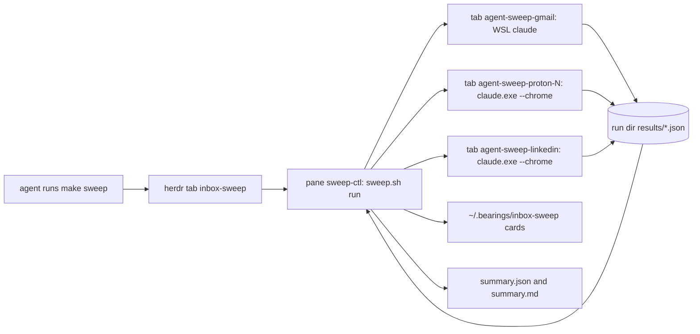
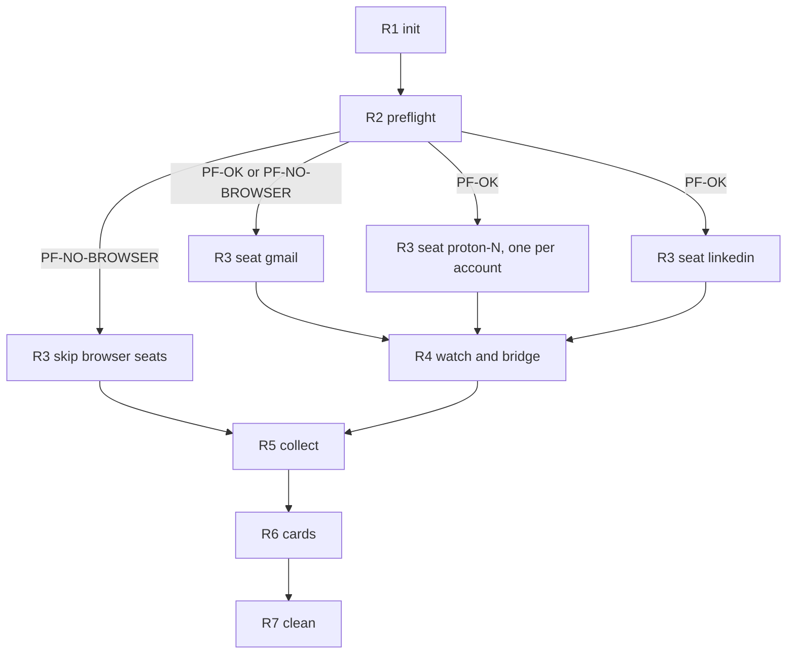
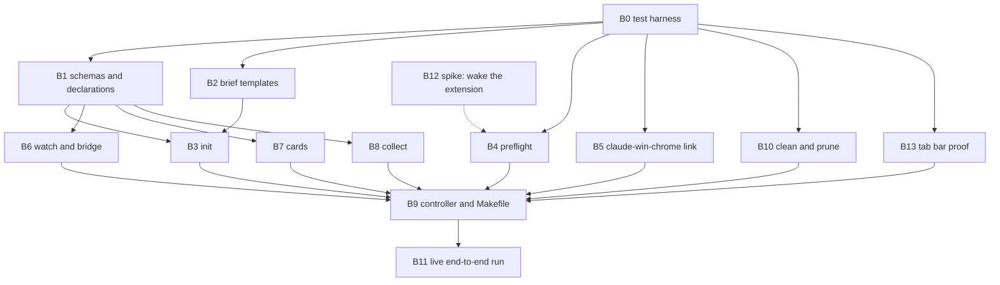

# Inbox sweep - design

Status: APPROVED, owner ruling 2026-10-16 UTC on Bearings card D-04, with the architect's rulings recorded in [section 12](#12-owner-decisions).
Build tickets are cut from [section 10](#10-build-dag).
Owner order, 2026-10-15 UTC: "make sure you clean up too and shit is automated with makefiles and scripts, i'm not fucking around, dag this shit out doc design first".
Companion files: [`inbox-sweep.spec.xml`](inbox-sweep.spec.xml) (the build spec) and [`inbox-sweep.result.schema.json`](inbox-sweep.result.schema.json) (one seat's result record).

## Contents

1. [Goal](#1-goal)
2. [Inventory](#2-inventory)
3. [Failures this design removes](#3-failures-this-design-removes)
4. [Shape of one run](#4-shape-of-one-run)
5. [Run DAG](#5-run-dag)
6. [Status code map](#6-status-code-map)
7. [Tool chosen for each step](#7-tool-chosen-for-each-step)
8. [Make and script plan](#8-make-and-script-plan)
9. [Where everything lives, and how it is cleaned](#9-where-everything-lives-and-how-it-is-cleaned)
10. [Build DAG](#10-build-dag)
11. [Testing](#11-testing)
12. [Owner decisions](#12-owner-decisions)
13. [Conflicts surfaced](#13-conflicts-surfaced)

## 1. Goal

One command, `make sweep`, run by an agent, sweeps every inbox in parallel with no owner hands on the browser.
Sources: Proton (every signed-in account), Gmail (claude.ai connector), LinkedIn (read, draft replies, never send).
A run ends in three outputs: one validated result record per seat, one run summary, and one Getting My Bearings card per owner decision or LinkedIn draft.
The only mailbox mutation a sweep may make is marking a message read (see [D1](#d1-mark-read-or-leave-unread)).
Nothing is ever sent, replied to, forwarded, deleted, archived, accepted or posted.

## 2. Inventory

Everything the sweep touches, read before designing it.

| Id  | Thing                            | Where                                                                                        | What the sweep uses it for                                                    |
| --- | -------------------------------- | -------------------------------------------------------------------------------------------- | ----------------------------------------------------------------------------- |
| I1  | Browser rule                     | `~/AGENTS.md`, "Hard rule: agents drive the browser, in the owner's own Chrome"              | Which Chrome profile, which launcher, the wake procedure                      |
| I2  | Today's hand-driven run          | `~/.local/state/zenith/inbox-triage/20261015/` and the Windows-side `inbox-triage-20261015/` | Report shapes that the result schema generalises; the failures in section 3   |
| I3  | Spawner                          | `claude/workflow/bin/workflow-spawn.sh`                                                      | Starts each seat in a labeled herdr tab; chain links carry a custom launcher  |
| I4  | Seat watcher                     | `claude/workflow/bin/seat-watch.sh`                                                          | Done from the seat's record row, never from the screen; respawn up to 3 times |
| I5  | Seat record                      | `claude/workflow/bin/seat-record.sh`                                                         | Writes the done row the watcher reads                                         |
| I6  | Workflow declarations            | `claude/workflow/schemas/workflows/*.workflow.json`                                          | One declaration per seat kind; tool allow and deny lists are data             |
| I7  | Workflow config                  | `claude/workflow/config/project.json`                                                        | Seat table, herdr workspace label, watcher thresholds                         |
| I8  | Workflow Makefile and test image | `claude/workflow/Makefile`, `claude/workflow/tests/container/Containerfile`                  | Precedent for make as entry point, and the pinned Podman test image           |
| I9  | CI selector                      | `claude/workflow/tools/ci-select.sh`                                                         | Selects suites from changed paths; `make test` reuses it                      |
| I10 | Bearings                         | `~/.claude/skills/bearings/SKILL.md`, `~/.bearings/<name>/questions.json`                    | Owner decision cards and LinkedIn draft approvals                             |
| I11 | Claude Code for Windows          | `%USERPROFILE%\.local\bin\claude.exe`                                                        | The only runtime whose `--chrome` reaches the extension's native host         |
| I12 | Claude in Chrome extension       | Chrome profile `Default`, native host `%USERPROFILE%\.claude\chrome\chrome-native-host.bat`  | Proton and LinkedIn tabs, one tab per seat                                    |
| I13 | Gmail connector                  | claude.ai Gmail MCP, reachable from WSL Claude                                               | Gmail seat; no browser needed                                                 |
| I14 | Repo rules                       | `CLAUDE.md` Rules 14, 15, 17, 18, 19                                                         | Podman testing, pinned images, entry point, herdr-first, surface by runtime   |
| I15 | Screen capture script | `%USERPROFILE%\inbox-triage-20261015\screen.ps1`, ported to `claude/workflow/inbox-sweep/bin/screen.ps1` | Windows screenshot of the tab bar, the completion proof for browser seats |

## 3. Failures this design removes

| Id  | Seen 2026-10-15                                                         | Removed by                                                                                                                                                            |
| --- | ----------------------------------------------------------------------- | --------------------------------------------------------------------------------------------------------------------------------------------------------------------- |
| F1  | WSL `claude --chrome` never connects                                    | Browser seats launch only through the `claude-win-chrome` chain link (spec `launcher/claude-win-chrome`); the declarations for Proton and LinkedIn name no other link |
| F2  | `list_connected_browsers` returned `[]` until the side panel was opened | Preflight probes before any browser seat starts, 3 tries; on failure browser seats are `SKIPPED`, Gmail still runs, and one card asks for the wake                    |
| F3  | Seats refused prompts without the owner's own words                     | `sweep-init.sh` renders every brief with the owner's words from `owner-words.md` and refuses (`PF-NO-OWNER-WORDS`) if the file is missing                             |
| F4  | A watcher matched `DONE` inside the echoed prompt                       | Done is a result file that parses and validates against the schema, bridged into a seat record row; the screen is never read for completion                           |
| F5  | Background watcher jobs broke Rule 18                                   | The controller loop runs in the labeled herdr pane `sweep-ctl`; `make herdr-first` fails the suite on any `&`, `nohup`, `disown` or `setsid`                          |
| F6  | Closing the blank anchor tab that `tabs_context_mcp` with `createIfEmpty` creates (the owner asked for it) dissolved the seat's tab group and orphaned its working tab; tools then failed with "Tab is not in Claude's tab group for this session" | Rule `tab-anchor`: the anchor is never closed early; the seat navigates it to the work URL and uses it as its first working tab, and closes the group's tabs only at the very end, anchor last. The result records it in `tab_group`, and the schema refuses a browser result that did not |
| F7  | A seat's own "tab closed" was taken as proof | Completion proof is a Windows screenshot of the tab bar taken by `screen.ps1` before and after the run (R2 baseline, R7 final), read by a verifier, never the seat's say-so |

## 4. Shape of one run

`make sweep` returns at once: it opens the `inbox-sweep` tab and starts the controller in its `sweep-ctl` pane.
Agents follow progress with `make status`, which reads `run.json` and never a screen.

## 5. Run DAG

Each node is input to output; a node's process exists only between the two.
Every box on a checklist is ticked with the proof named beside it, written to the run's `checklist.jsonl` by the script that owns the node.

### R1 init

- Input: `~/.config/zenith/inbox-sweep/config.json`, `~/.config/zenith/inbox-sweep/owner-words.md`, the brief templates.
- Output: run dir `<runs>/<run-id>/` with `run.json` (status `RUN-RUNNING`) and one rendered brief per seat in `briefs/`.
- Checklist:
  - [ ] Config validates against `config.schema.json` - proof: validator exit 0 in `logs/init.log`.
  - [ ] Owner words present and non-empty - proof: sha256 of the file in `run.json.owner_words_sha256`.
  - [ ] One brief per enabled seat, each containing the owner words block - proof: `grep -c '<owner-words>'` equals seat count in `logs/init.log`.

### R2 preflight

- Input: `run.json`.
- Output: `preflight.json` with one `PF-*` code per check.
- Checklist:
  - [ ] Inside herdr - proof: `HERDR_ENV=1` and `herdr workspace list` shows the configured label.
  - [ ] `claude.exe` resolves and runs - proof: `claude.exe --version` output captured.
  - [ ] Chrome is running - proof: `tasklist.exe` row for `chrome.exe`.
  - [ ] Baseline tab bar captured before any seat starts - proof: `proof/R2-tabbar-<UTC>.png` from `screen.ps1`.
  - [ ] Extension connected - proof: probe output lists at least one browser, tries recorded (max 3).

### R3 seats

- Input: the seat's rendered brief.
- Output: `results/<seat>.json`, valid against the result schema.
- Checklist (per seat):
  - [ ] Seat started in tab `agent-sweep-<seat>` - proof: seat-link written by the spawner.
  - [ ] Counts before and after recorded, after verified by a second read - proof: `counts.after.verified_at` in the result.
  - [ ] No forbidden mutation - proof: `mutations[]` holds only `marked-read`, enforced by the schema.
  - [ ] Anchor tab reused as the first working tab, never closed early - proof: `tab_group.anchor_reused: true` in the result.
  - [ ] Group closed at the very end, anchor last - proof: `tab_group.closed_anchor_last: true`; the claim is checked by the R7 screenshot, not trusted.

### R4 watch and bridge

- Input: `results/` directory, seat deadlines from config.
- Output: one seat record row per seat via `seat-record.sh`, so `seat-watch.sh` retires the seat.
- Checklist:
  - [ ] Each result parsed and validated, or `FAILED-SCHEMA` after 3 rewrite requests - proof: `logs/watch.log`.
  - [ ] No seat outlives its deadline - proof: `TIMEOUT` row for any seat with no result at deadline.

### R5 collect

- Input: every `results/*.json` plus `preflight.json`.
- Output: `summary.json` (run status code, per-seat code, counts) and `summary.md` (contents list, one table per source).
- Checklist:
  - [ ] Run status derived by the rule in spec `codes/run` - proof: `summary.json.status`.
  - [ ] Every seat accounted for, including `SKIPPED` - proof: seat count in summary equals seat count in `run.json`.

### R6 cards

- Input: `summary.json`, every result's `owner_decisions[]` and `drafts[]`.
- Output: cards merged into `~/.bearings/inbox-sweep/questions.json`, ids `IS-<run-id>-<seat>-<n>`.
- Checklist:
  - [ ] Ids are new and never reused - proof: `jq` uniqueness check in `logs/cards.log`.
  - [ ] Every `BLOCKED-*` seat produced exactly one card - proof: count match in `logs/cards.log`.

### R7 clean

- Input: `run.json` with a final status.
- Output: seat tabs closed, `briefs/` removed, run dir kept for retention, `run.json.cleaned_at` set.
- Checklist:
  - [ ] No `agent-sweep-*` herdr tab left for this run - proof: `herdr tab list` captured after close.
  - [ ] No Claude tab group and no orphaned seat tab left in Chrome - proof: `proof/R7-tabbar-<UTC>.png` from `screen.ps1`, compared with the R2 baseline by the verifier, verdict in `proof/R7-verdict.json`.
  - [ ] Controller pane left open showing the final summary line - proof: pane title `sweep-ctl <run-id> <status>`.

## 6. Status code map

Seat codes appear in a result's `status`; run codes in `summary.json.status`; preflight codes in `preflight.json`; clean codes in `proof/R7-verdict.json`.

| Code                 | Level     | Meaning                                                                   | Who acts                                                                       |
| -------------------- | --------- | ------------------------------------------------------------------------- | ------------------------------------------------------------------------------ |
| `OK`                 | seat      | Every unread item processed and the after count verified                  | Nobody                                                                         |
| `PARTIAL`            | seat      | Cap of 500 items reached, or some items unreadable; `errors[]` says which | Orchestrator reruns that seat                                                  |
| `BLOCKED-NO-BROWSER` | seat      | `list_connected_browsers` empty after 3 tries                             | Owner, through one card: open the Claude side panel once                       |
| `BLOCKED-SIGNED-OUT` | seat      | The site showed a login page                                              | Owner, through one card                                                        |
| `BLOCKED-CHALLENGE`  | seat      | 2FA, CAPTCHA or a security check appeared                                 | Owner, through one card                                                        |
| `BLOCKED-CONNECTOR`  | seat      | Gmail connector absent or unauthorised after 3 tries                      | Owner, through one card                                                        |
| `REFUSED`            | seat      | The seat declined its brief                                               | System: a brief template defect; orchestrator files it                         |
| `TIMEOUT`            | seat      | No valid result at the seat deadline (40 minutes)                         | Orchestrator                                                                   |
| `FAILED-SEAT`        | seat      | The seat died 3 times without a result                                    | Orchestrator                                                                   |
| `FAILED-SCHEMA`      | seat      | The result did not validate after 3 rewrite requests                      | Orchestrator                                                                   |
| `SKIPPED`            | seat      | Not started because preflight said `PF-NO-BROWSER`                        | Nobody beyond the `BLOCKED-NO-BROWSER` card                                    |
| `RUN-RUNNING`        | run       | Controller is between R1 and R7                                           | Nobody                                                                         |
| `RUN-OK`             | run       | Every seat `OK` and R7 returned `CLEAN-OK`                                | Nobody                                                                         |
| `RUN-PARTIAL`        | run       | At least one seat `OK` and at least one not                               | Orchestrator for `PARTIAL`, `TIMEOUT`, `FAILED-*`; owner for `BLOCKED-*` cards |
| `RUN-BLOCKED`        | run       | No seat `OK`, at least one `BLOCKED-*` or `SKIPPED`                       | Owner, through the cards                                                       |
| `RUN-FAILED`         | run       | No seat `OK` and none blocked, or the controller itself failed            | Orchestrator                                                                   |
| `PF-OK`              | preflight | Every check passed                                                        | Nobody                                                                         |
| `PF-NO-HERDR`        | preflight | Not inside herdr; the run stops before any seat (Rule 18)                 | Orchestrator                                                                   |
| `PF-NO-CLAUDE-EXE`   | preflight | Windows Claude Code missing; browser seats `SKIPPED`                      | Orchestrator                                                                   |
| `PF-NO-CHROME`       | preflight | Chrome not running; browser seats `SKIPPED`                               | Owner, through one card                                                        |
| `PF-NO-BROWSER`      | preflight | Extension not connected after 3 tries; browser seats `SKIPPED`            | Owner, through one card                                                        |
| `PF-NO-OWNER-WORDS`  | preflight | `owner-words.md` missing; the run stops before any seat                   | Orchestrator restores it from its backup                                       |
| `CLEAN-OK`           | clean     | R7 screenshot shows no Claude tab group and no tab beyond the R2 baseline | Nobody |
| `CLEAN-TABS-LEFT`    | clean     | A seat group is still open in the R7 screenshot; the controller asks the seat pane to close it, up to 3 times | Orchestrator |
| `CLEAN-ORPHAN-TAB`   | clean     | A seat tab is open outside any Claude group, so no tool can close it | Owner, through one card: close that tab |
| `CLEAN-NO-PROOF`     | clean     | `screen.ps1` failed 3 times, so completion is unproven | Orchestrator; the run cannot be `RUN-OK` |

## 7. Tool chosen for each step

| Step             | Tool                                                                       | Why                                                                                                      | Rejected                                                                             |
| ---------------- | -------------------------------------------------------------------------- | -------------------------------------------------------------------------------------------------------- | ------------------------------------------------------------------------------------ |
| Entry point      | `make` over `bin/sweep.sh`                                                 | Owner asked for makefiles; `claude/workflow/Makefile` is the precedent; targets are one-line delegations | A justfile mirror, decided A in [D2](#d2-make-only-or-make-plus-just)                         |
| Orchestration    | Bash scripts plus `jq`                                                     | Deterministic routing and retries are code, not model work (Rule 5); same stack as `claude/workflow/bin` | Python: a second language for the same machinery                                     |
| Seat start       | `workflow-spawn.sh` with a chain link                                      | Already names tabs, writes seat-link, exports `RAIL_SURFACE`, supports a launcher unlike its kind        | `herdr agent start` by hand, which duplicates the spawner                            |
| Browser seats    | `claude.exe --chrome` from WSL                                             | The extension's native host is registered to Windows Claude Code only (I11, I12)                         | WSL `claude --chrome` (F1); the separate debug Chrome profile (owner rejected)       |
| Gmail seat       | WSL `claude` with the Gmail connector                                      | Structured API, no browser, no tab contention                                                            | Gmail in the browser: slower, and contends for the one Chrome                        |
| Done detection   | Result file validated by `tools/validate-schema.sh`                        | A file either validates or it does not; the screen never decides (F4)                                    | `herdr pane wait-output DONE`                                                        |
| Completion proof | `screen.ps1` through `powershell.exe`, read by `claude -p --model haiku` against the R2 baseline | A seat's own report is not proof (F7); the screen is what the owner sees; reading an image is a judgment call, the one place a model belongs here (Rule 5) | Trusting `tab_closed`; `tabs_context_mcp` from another session, which cannot see another session's group |
| Seat supervision | `seat-watch.sh`                                                            | Existing respawn up to `resume_attempts: 3` and retirement on the record row                             | A new watcher                                                                        |
| Owner decisions  | Bearings cards                                                             | The only permitted owner surface; one card per decision                                                  | Prose in the summary                                                                 |
| Extension probe  | `claude.exe -p --chrome` asking only for `list_connected_browsers`         | No local API exposes the connection; the probe is one tool call with a 90 second timeout                 | Reading Chrome's extension storage, which is undocumented and moves between versions |
| Testing          | Podman, the pinned workflow test image, stub `herdr` and stub `claude.exe` | Rule 14; the stubs already exist in `test_seat_watch.sh`                                                 | Host runs                                                                            |

## 8. Make and script plan

The sweep lives in `claude/workflow/inbox-sweep/`, beside the machinery it reuses.
Every target is one line that calls `bin/sweep.sh <verb>`; a machine without make runs the same `bash bin/sweep.sh <verb>`.

| Target           | Script call                             | What it does                                                                                   |
| ---------------- | --------------------------------------- | ---------------------------------------------------------------------------------------------- |
| `sweep`          | `bin/sweep.sh start --seats all`        | R1, then opens tab `inbox-sweep` and runs `sweep.sh run <run-id>` in pane `sweep-ctl`; returns |
| `sweep-gmail`    | `bin/sweep.sh start --seats gmail`      | Same, Gmail seat only                                                                          |
| `sweep-proton`   | `bin/sweep.sh start --seats proton`     | Same, one seat per configured Proton account                                                   |
| `sweep-linkedin` | `bin/sweep.sh start --seats linkedin`   | Same, LinkedIn seat only                                                                       |
| `status`         | `bin/sweep.sh status [--run <id>]`      | Prints run code, per-seat code, counts, deadline; latest run by default                        |
| `clean`          | `bin/sweep.sh clean [--run <id>]`       | R7 for a finished run: closes its tabs, removes its briefs                                     |
| `prune`          | `bin/sweep.sh prune --days 14`          | Deletes run dirs older than the retention and their WSL symlinks                               |
| `test`           | `bin/sweep.sh test --changed`           | Podman suites for files changed against `origin/main` only                                     |
| `test-all`       | `bin/sweep.sh test --all`               | Every suite, before a pull request only                                                        |
| `herdr-first`    | `bin/sweep.sh test --suite herdr-first` | Fails on any backgrounding construct in the sweep's scripts                                    |

Retries: every automated step goes through one helper, `sweep_retry 3 <step> <cmd...>`, with waits of 10, 30 and 90 seconds.
After the third failure it writes the step's status code to `run.json` and returns non-zero; the controller moves to collect rather than looping.

## 9. Where everything lives, and how it is cleaned

Nothing the sweep writes goes into the repository.
`<win-home>` is resolved at run time with `wslpath -u "$(cmd.exe /c 'echo %USERPROFILE%' | tr -d '\r')"` and stored in `run.json`.
Run dirs sit on the Windows drive because both runtimes reach it natively; WSL gets a symlink.

| Output                    | Path                                                            | Cleanup command                                                                                     |
| ------------------------- | --------------------------------------------------------------- | --------------------------------------------------------------------------------------------------- |
| Run dir                   | `<win-home>/.local/state/zenith/inbox-sweep/runs/<run-id>/`     | `make prune` (14 days)                                                                              |
| WSL pointer to latest run | `~/.local/state/zenith/inbox-sweep/latest`                      | Rewritten each run; removed by `make prune` if dangling                                             |
| Rendered briefs           | `<run dir>/briefs/`                                             | `make clean`                                                                                        |
| Seat results              | `<run dir>/results/<seat>.json`                                 | `make prune`                                                                                        |
| Logs                      | `<run dir>/logs/<node>.log`                                     | `make prune`                                                                                        |
| Checklist proofs          | `<run dir>/checklist.jsonl`                                     | `make prune`                                                                                        |
| Tab bar screenshots and verdict | `<run dir>/proof/` | `make prune` |
| Summary                   | `<run dir>/summary.json`, `summary.md`                          | `make prune`                                                                                        |
| Seat record rows          | `~/.local/state/dotfiles/execution/records/inbox-sweep-*.jsonl` | `make prune` trims rows older than the retention                                                    |
| Seat watcher dirs         | `~/.local/state/dotfiles/execution/seats/<pane>/`               | `make clean` removes the run's seat dirs                                                            |
| Bearings cards            | `~/.bearings/inbox-sweep/questions.json`                        | Answered cards stay; `node <bearings>/scripts/server.mjs inbox-sweep --stop` then delete the folder |
| Config and owner words    | `~/.config/zenith/inbox-sweep/config.json`, `owner-words.md`    | Never cleaned; owner data                                                                           |
| Test output               | `${XDG_CACHE_HOME:-~/.cache}/dotfiles/inbox-sweep-test/`        | `make clean` with no run removes it                                                                 |

Run dirs hold mail gists and LinkedIn text, so the retention is short and the repository never sees them.

## 10. Build DAG

Each node becomes one build ticket: one concern, a few files, a diff a reviewer reads in minutes.
Inputs and outputs are files; the checklist proof is what the reviewer checks.

| Node | Concern                                                                     | Input                          | Output                                                                                                   | Checklist and proof                                                                                                               |
| ---- | --------------------------------------------------------------------------- | ------------------------------ | -------------------------------------------------------------------------------------------------------- | --------------------------------------------------------------------------------------------------------------------------------- |
| B0   | Test harness: stub `herdr`, stub `claude.exe`, `make test` change selection | This design                    | `inbox-sweep/tests/lib/`, `Makefile` targets `test`, `test-all`, `herdr-first`                           | Stub records every call (test log); `make test` with no change runs zero suites (output); `make herdr-first` red on a planted `&` |
| B1   | Schemas and declarations                                                    | Spec `schemas`, `declarations` | `schemas/result.schema.json` (moved from this folder), `schemas/config.schema.json`, 3 `*.workflow.json` | `make -C claude/workflow schema` green; a fixture of each status code validates; a `sent` mutation is refused                     |
| B2   | Brief templates with the owner-words block                                  | Spec `briefs`                  | `templates/brief-gmail.md`, `brief-proton.md`, `brief-linkedin.md`                                       | Each holds `<owner-words>`, the forbidden-action list and the result path (grep in test)                                          |
| B3   | `sweep-init.sh`                                                             | B1, B2                         | Run dir, `run.json`, rendered briefs                                                                     | Missing owner words gives `PF-NO-OWNER-WORDS` (test); run id matches `^[0-9]{8}T[0-9]{6}Z$` (test)                                |
| B4   | `sweep-preflight.sh`                                                        | B0                             | `preflight.json`                                                                                         | Stub probe `[]` three times gives `PF-NO-BROWSER` after exactly 3 tries (test); each `PF-*` code has a fixture                    |
| B5   | `claude-win-chrome` chain link in `workflow-spawn.sh`                       | B0                             | Link entry in `project.json`, launcher branch in the spawner                                             | `--dry-run` prints `claude.exe --chrome` with a cwd under `<win-home>` (test); `make -C claude/workflow chain` green              |
| B6   | `sweep-watch.sh` bridge                                                     | B1                             | Record rows, `TIMEOUT` and `FAILED-SCHEMA` handling                                                      | Truncated JSON is not accepted (test); deadline passes gives `TIMEOUT` row (test); valid result gives one row only                |
| B7   | `sweep-cards.sh`                                                            | B1                             | Merged `questions.json`                                                                                  | Rerun adds no duplicate (test); each `BLOCKED-*` gives one card (test); draft card carries the full draft text                    |
| B8   | `sweep-collect.sh`                                                          | B1                             | `summary.json`, `summary.md`                                                                             | Run code table in spec `codes/run` covered by fixtures (test)                                                                     |
| B9   | `sweep.sh` controller and the `Makefile`                                    | B3 to B8, B10                  | `bin/sweep.sh`, `Makefile`                                                                               | Full stubbed run reaches `RUN-OK` (test); `make sweep` returns in under 5 seconds (test)                                          |
| B10  | `sweep-clean.sh` for `clean` and `prune`                                    | B0                             | Clean and prune verbs                                                                                    | Prune keeps a 13-day run and removes a 15-day run (test); clean leaves no `agent-sweep-*` tab in the stub (test)                  |
| B11  | Live end-to-end run                                                         | B9 merged                      | One real `summary.json`                                                                                  | `RUN-OK` or every non-OK seat has its card; no `sent` in any result (`jq`); herdr tabs gone and `R7-verdict.json` says `CLEAN-OK`                          |
| B12  | Spike: can the extension be woken without the owner                         | None                           | A short finding in this design's D3                                                                      | Reproducible command or a documented no                                                                                           |
| B13  | Tab bar proof: port `screen.ps1`, add `sweep-proof.sh` for capture and verdict | B0 | `bin/screen.ps1`, `bin/sweep-proof.sh`, R2 and R7 hooks | Stubbed `powershell.exe` capture failing 3 times gives `CLEAN-NO-PROOF` (test); a verdict naming an orphan tab gives one `CLEAN-ORPHAN-TAB` card (test); `screen.ps1` carries a breadcrumb naming F6 and F7 |

## 11. Testing

All tests run in Podman on the image built from `claude/workflow/tests/container/Containerfile` (Rule 14, pinned base per Rule 15), with `--network=none`.
`make test` selects suites from `git diff --name-only origin/main...HEAD` through `ci-select.sh`, so a change to `bin/sweep-cards.sh` runs only the cards suite and `herdr-first`.
`make test-all` runs every suite, and is run once before a pull request.
The live run (B11) is the end-to-end test and is the only step that touches real mailboxes; it is never run by CI.
Where the `container-sandbox` skill has no section for stubbed Windows binaries, B0 adds one to `claude/skills/container-sandbox/references/skill-testing.md`.

## 12. Owner decisions

All seven were decided together on 2026-10-16 UTC, when the owner approved this design on Bearings card D-04 with the architect's rulings.
Each heading keeps its anchor so links into this section still resolve.

| Code | Decision                     | Ruling                                                                                       |
| ---- | ---------------------------- | -------------------------------------------------------------------------------------------- |
| D1   | Mark read or leave unread    | A: mark everything read                                                                      |
| D2   | Make only, or make plus just | A: make only; the controller is declared WSL-only under Rule 17's escape clause               |
| D3   | Waking the extension         | A: a sleeping extension raises one card; Gmail still runs                                    |
| D4   | Proton seats                 | A: one Proton seat per account, in parallel                                                  |
| D5   | When a sweep runs            | A then B: on demand until three clean live runs, then daily                                  |
| D6   | Retention of run dirs        | A: 14 days                                                                                   |
| D7   | After a LinkedIn draft       | A draft is sent only after the owner approves that exact draft; the sweep itself never sends |

### D1 Mark read or leave unread

Decided: A.
Every message a seat processes is marked read, so the after count proves coverage.
Marking read stays the only mailbox mutation a sweep may make.

### D2 Make only, or make plus just

Decided: A.
`make` is the one entry point, and `bin/sweep.sh <verb>` is its plain equivalent.
The controller is WSL-only by necessity (herdr and WSL interop), which its README states per Rule 17.

### D3 Waking the extension

Decided: A.
When preflight reports `PF-NO-BROWSER`, the run raises exactly one card asking the owner to open the Claude side panel once, and the Gmail seat still runs.
B12 stays in the build DAG to look for an automatic wake; if it finds one, this ruling is revisited.

### D4 Proton seats

Decided: A.
One seat per configured Proton account, each in its own tab, all in parallel.

### D5 When a sweep runs

Decided: A, then B.
On demand only (`make sweep`) until three clean live runs, then daily at a fixed UTC time started by the orchestrator.
"Clean" means the run code is `RUN-OK` and R7's verdict is `CLEAN-OK`.
Scheduling the daily run is a follow-up ticket cut after the third clean run, not part of this build.

### D6 Retention of run dirs

Decided: A.
14 days, enforced by `make prune --days 14`.

### D7 After a LinkedIn draft is approved

Decided: a LinkedIn draft is sent only after the owner approves that exact draft on its card.
No sweep seat ever sends; `sent` stays a refused mutation in the result schema.
The send path after approval is out of scope for this build and is designed separately before anything can send.

## 13. Conflicts surfaced

- The brief asks for real paths with no placeholders; the repository's PII policy forbids real usernames in this public repo.
  Resolved by resolving the Windows home at run time (section 9), which is specific and runnable without naming anyone.
- Rule 17 asks every skill with code for a justfile; the owner asked for makefiles.
  The sweep is workflow machinery, not a skill, and is WSL-only by necessity; the owner confirmed make only in [D2](#d2-make-only-or-make-plus-just).
- The bearings skill starts its server and wait with `run_in_background`, which Rule 18 forbids under herdr.
  The sweep runs both in labeled herdr panes `bearings-inbox-sweep` and `bearings-wait`; the bearings skill text should be updated to match, flagged for cleanup.
