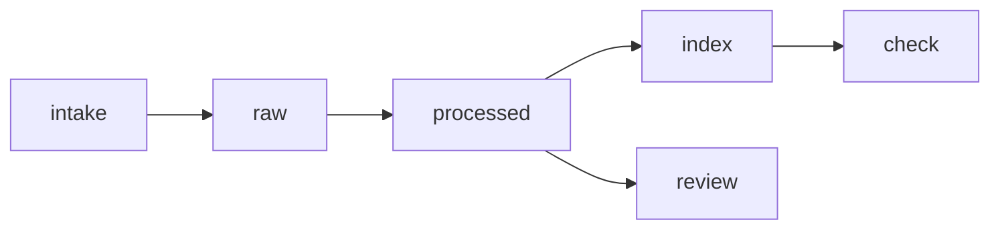

# Wiki engine - design

<!-- START doctoc generated TOC please keep comment here to allow auto update -->
<!-- DON'T EDIT THIS SECTION, INSTEAD RE-RUN doctoc TO UPDATE -->

- [Contents](#contents)
- [Design principles 101](#design-principles-101)
- [Purpose](#purpose)
- [Inventory](#inventory)
- [Layout](#layout)
- [Pipeline](#pipeline)
- [Page format](#page-format)
- [Verbs](#verbs)
- [Status codes](#status-codes)
- [Fallbacks](#fallbacks)
- [Gates dev/UAT/stable](#gates-devuatstable)
- [Migration](#migration)

<!-- END doctoc generated TOC please keep comment here to allow auto update -->

## Contents

## Design principles 101

1. CI/CD speed: every verb is one stdlib Python script; a verb runs in seconds and CI selects tests by path.
2. Parallelism: verbs touch disjoint directories, so intake, index and check on different wikis run at once.
3. Make and scripts: `make -C ~/dotfiles wiki-<verb> WIKI=<root>` for every verb, never by hand.
4. Reuse: md-contents.sh, spec-check.sh, artifact.mk, golden-rules.sh and timed-run.sh are called, not rebuilt.
5. Small scope: five verbs, one library, one config file.
6. Tests where they count: `tests/test_<verb>.py` per verb, run in podman; CI runs lint and the full suite.
7. Evidence: every finding prints `CODE path:line`.
8. Specs: [wiki.spec.xml](wiki.spec.xml), 1000 lines or less, opens with contents.
9. DAG first: the pipeline below is the order the verbs run.
10. Migrations: a new wiki is one `wiki.json`; a new page is one `pages.json` entry and a rerun of process.
11. Clean up: review tars hand files to the artifact store before removing them; nothing else is deleted.
12. Frictionless: the owner reads pages; no owner step in any verb.
13. Context: an agent reads one processed page or one status line, never the tree.
14. Multi-agent: verbs write disjoint files, and every rule below carries GOOD and NEVER.
15. XML spec and mermaid: both here; the spec is the source.
16. Migration is the test: a changed source adds one raw file and a rerun brings every page level.
17. Config and arguments: `WIKI=`, `SRC=`, and `wiki.json`; nothing hard-coded.
18. Schema between agents: pages.json and review.json are JSON; codes are not prose.
19. Disjoint files: one verb owns one directory (raw, processed, index, review_dir).
20. Worktree and DAG: built on a feature worktree; the spec is the state.
21. Merge, never park: the PR auto-merges on green CI.
22. Fix or hand off: a failed check names the code, the file and the line.
23. Artifacts outside git: blobs over the limit and review hand copies go to the artifact store.
24. Checkpointing: not applicable; every verb restarts from the files on disk.
25. No AWS spend: none.
26. Producer and consumer: not applicable; verbs are one-shot and publish no events.
27. One watch pattern: not applicable; no monitor.
28. Idempotent: a second run of any verb leaves the wiki byte-identical.
29. Status codes: WIKI-000 to WIKI-040 below.
30. Ape-sized: one verb per ticket, each with its test ticket.
31. Evidence on every node: check prints the reproduction for each finding.
32. No opinions: page content and sources are the owner's word; the engine writes structure only.
33. Break glass: not needed; a stuck run is rerun.
34. dev, UAT, stable: see Gates.
35. Tests never notify: the tests touch only a temp wiki root inside a container and send nothing.
36. Permissions: none beyond file ownership.
37. Timing: every Make target runs under timed-run.sh.
38. Batching: intake takes many sources in one call; process and index cover every page in one call.
39. Cluster: not applicable; the wiki is local content.
40. DAG is effortless to change: a verb is one `mk/<verb>.mk` and one script; adding one touches no other.

## Purpose

A generic, config-driven wiki engine in dotfiles at `claude/tools/wiki/`.
A wiki is a directory holding config and content only.
The YieldPoint wiki at `~/projects/yieldpoint-ai/wiki` is the first one.
Owner words, verbatim: "MAKE SURE A KNOWLEDGE BASE WIKI OF YIELDPOINT AI IS BUILT AND USING DOC DESIGN FIRST AND PUT THAT SHIT IN THE ~/PROJECTS/YIELDPOINT/WIKI/<ALL SUB DIRS HERE INTAKE|RAW|PROCESS|I'M JUST MAKING SHIT UP TO SHOW>"; "good never examples"; "get everything centrally located for this yieldpoint stuff, i have a directory already in ~/projects".
The call form is `make -C ~/dotfiles wiki-<verb> WIKI=<root>`.
This document adds no decision to the WK and YW tickets under WO-20261016-35de; it writes them down.

GOOD: the engine lives in dotfiles and the wiki root holds `wiki.json`, `pages.json` and content.
NEVER: engine code inside a wiki repository, or a wiki path typed into a script.

## Inventory

Reused, called as they are:

- `scripts/md-contents.sh` - contents lists.
- `scripts/spec-check.sh` - spec limits.
- `claude/tools/artifact/artifact.mk` - `artifact-new`, `artifact-find`.
- `scripts/golden-rules.sh` - golden rules block.
- `claude/workflow/bin/timed-run.sh` - timing, timeout and `--fallback`.

New: `claude/tools/wiki/` only.
Sources for the first content are listed in YW-C, WO-20261016-2013 - YW-C: first YieldPoint wiki content - capture eight sources and write the seven cited pages.

GOOD: a verb that needs the artifact store calls `artifact-new`.
NEVER: a second artifact naming scheme.

## Layout

Engine, under `claude/tools/wiki/`: `wiki.mk`, `mk/<verb>.mk`, `wikilib.py`, `wiki_<verb>.py`, `tests/test_<verb>.py`, `secret-patterns.json`, `review.html.tmpl`.
`wiki.mk` is included from the dotfiles root Makefile after the artifact include.
Wiki root, from `<WIKI>/wiki.json`: `intake`, `raw`, `processed`, `index`, and `review_dir`, plus `pages.json` and `review.json`.
Defaults: `blob_limit_bytes` 1048576, `max_page_lines` 200.

GOOD: `WIKI=` empty stops with exit 2.
NEVER: a verb that guesses a wiki root.

## Pipeline

intake captures into raw, process writes page skeletons from raw, index and review read processed, check reads the index.

GOOD: a verb reads only the directory before it in the pipeline.
NEVER: a verb that writes into a directory another verb owns.

## Page format

Raw capture `raw/<sha12>-<slug>.md`: frontmatter `source` (`~` for `$HOME`), `captured_at` (UTC Z), `sha256`, `bytes`, `blob` (artifact store path, only over the limit).
Processed page `processed/<id>.md`: frontmatter `id`, `title`, `topic`, `sources` (raw file names); `updated`; then `# title`, `## Contents`, and one `## Heading` per section of `pages.json`.
Every section links `../raw/<file>` at least once.
The script writes structure and citations; prose is written by YW-C.

GOOD: a section whose body cites `[raw: file](../raw/file)`.
NEVER: a claim in a page with no raw source.

## Verbs

| Verb    | Script                       | Reads                          | Writes            | Codes                        |
| ------- | ---------------------------- | ------------------------------ | ----------------- | ---------------------------- |
| intake  | `wiki_intake.py ROOT SRC...` | sources                        | `raw/`            | WIKI-001, WIKI-002, WIKI-003 |
| process | `wiki_process.py ROOT`       | `pages.json`, `raw/`           | `processed/`      | WIKI-010, WIKI-011           |
| index   | `wiki_index.py ROOT`         | `processed/`                   | `index/README.md` | WIKI-020                     |
| review  | `wiki_review.py ROOT`        | `review.json`, `raw/`          | `review_dir`      | WIKI-040                     |
| check   | `wiki_check.py ROOT`         | `processed/`, `index/`, `raw/` | nothing           | WIKI-031 to WIKI-037         |

Each verb is a Make target `wiki-<verb>` in `mk/<verb>.mk`; the spec holds inputs, outputs, codes, idempotency and fallback per verb.

GOOD: a second `wiki-intake` run prints `WIKI-002 <path>` and adds nothing.
NEVER: intake that rewrites a raw file whose sha256 is already captured.

GOOD: process rewrites only frontmatter `sources` and `updated`, and appends missing sections.
NEVER: process that touches a written section body.

## Status codes

| Code     | Meaning                         |
| -------- | ------------------------------- |
| WIKI-000 | ok                              |
| WIKI-001 | captured                        |
| WIKI-002 | already captured                |
| WIKI-003 | blob sent to the artifact store |
| WIKI-010 | skeleton written                |
| WIKI-011 | page unchanged                  |
| WIKI-020 | index written                   |
| WIKI-030 | check failed                    |
| WIKI-031 | no contents list                |
| WIKI-032 | broken link                     |
| WIKI-033 | orphan raw                      |
| WIKI-034 | uncited section                 |
| WIKI-035 | page over size                  |
| WIKI-036 | secret pattern                  |
| WIKI-037 | TODO-WRITE left                 |
| WIKI-040 | review page written             |

Exits: 0 ok, 2 usage, 3 check failed, 4 io.

GOOD: check prints one `CODE path:line` per finding and exits 3.
NEVER: a check that exits 0 with a finding, or prints prose in place of a code.

Gaps: WO-20261016-168d (WK2) exits 3 with WIKI-034 for a page source missing from raw, while WO-20261016-0b9c (WK4) uses WIKI-034 for a section without a `../raw/` link.
The spec carries both as the tickets fix them; the owner rules whether one gets its own code.

## Fallbacks

| Tool or dependency                                                | Fallback                                                                                       | Switch                                           | Test                                             |
| ----------------------------------------------------------------- | ---------------------------------------------------------------------------------------------- | ------------------------------------------------ | ------------------------------------------------ |
| podman pinned python image                                        | rerun with `--pull=never` on the cached image of the same digest                               | `timed-run.sh --fallback --fallback-code FB-001` | pull refused, cached digest runs                 |
| `make artifact-new`, `artifact-find`                              | `bash ~/dotfiles/claude/tools/artifact/artifact.sh new`, same KEY NAME EXT                     | `timed-run.sh --fallback --fallback-code FB-004` | fake `artifact_new` fails, `artifact.sh` is used |
| `scripts/spec-check.sh`, `scripts/md-contents.sh`, `timed-run.sh` | none needed: files on main read locally; a missing file stops with exit 4                      | none                                             | none                                             |
| `git`, `gh`                                                       | missing on the host: stop with ENV-MISSING; GitHub down: retry 3 times, then stop with A2A-003 | none                                             | none                                             |

GOOD: the fallback is a scripted switch with its own code.
NEVER: a fallback an agent has to remember.

## Gates dev/UAT/stable

- dev: podman sandbox, fixtures, fake `artifact_new`, only the tests the change touches.
- UAT: a copy of a wiki root with test content through all five verbs, acceptance criteria observed with evidence.
- stable: the YieldPoint wiki, `make wiki-check` exits 0; a failed gate rolls back to the one before.

GOOD: a test that sends nothing to the owner.
NEVER: a gate skipped because the one before passed.

## Migration

A change to a verb is one `mk/<verb>.mk` and one `wiki_<verb>.py`; the other verbs do not move.
A change to the page format is a `wikilib.py` change plus a rerun of process, which rewrites only frontmatter and appends missing sections.
A new page is one `pages.json` entry; a rerun of process writes its skeleton and nothing else.

GOOD: a new section in `pages.json` shows up as an appended section after one process run.
NEVER: a migration that rewrites written prose.
